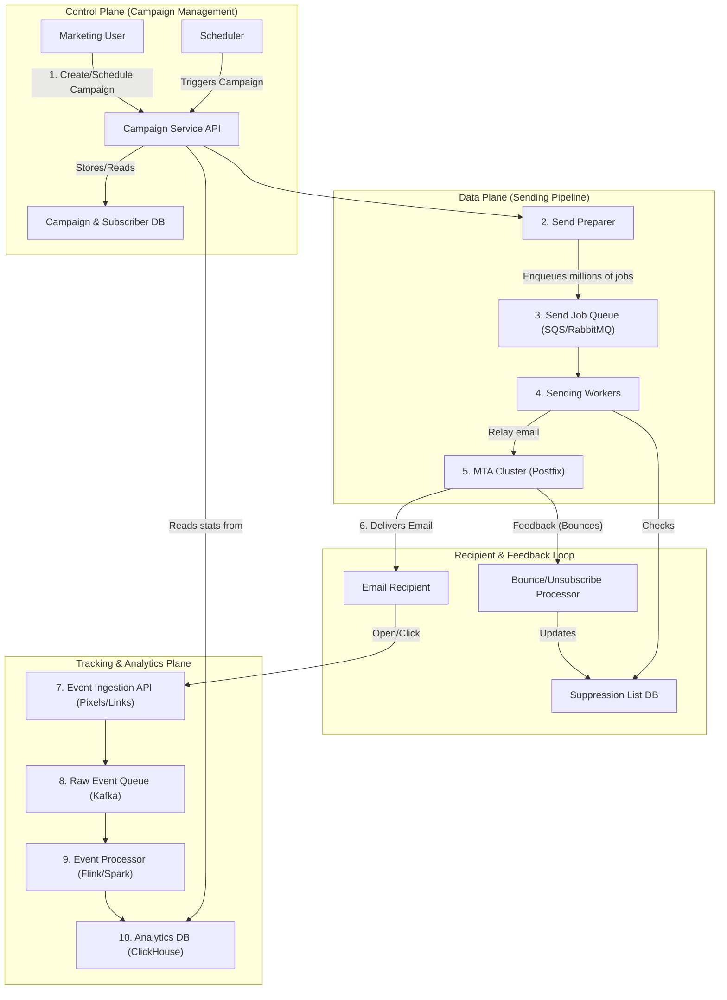

# High-Level Design: Email Marketing Platform

## 1. Document Information

- **Document Title**: Email Marketing Platform - High-Level Design
- **Version**: 1.0
- **Date**: 2025-08-30
- **Author**: Jules (AI Agent)
- **Status**: Draft

---

## 2. Executive Summary

### 2.1 Purpose
This document outlines the high-level design for a scalable Email Marketing Platform, similar to Mailchimp or SendGrid. The system is designed to allow users to manage subscriber lists, create email campaigns using templates, send those campaigns to millions of recipients, and track the engagement results (opens, clicks, unsubscribes). A core focus of the design is on deliverability and sender reputation management.

### 2.2 Scope

**In Scope:**
-   Management of subscriber lists and audience segments.
-   An email campaign creation and scheduling workflow.
-   A high-throughput email sending engine.
-   Tracking of email engagement events (delivery, opens, clicks, bounces, unsubscribes).
-   Management of sender reputation, including IP pools and domain authentication (SPF, DKIM).
-   An API for programmatic access and a data pipeline for analytics.

**Out of Scope:**
-   A user-facing UI for building email templates (e.g., a drag-and-drop editor).
-   The underlying Mail Transfer Agent (MTA) software (e.g., Postfix); we will design the system that uses it.
-   The content of the emails themselves.
-   A/B testing and advanced marketing automation workflows.

### 2.3 High-Level Architecture Overview
The system is composed of several key services. A **Campaign Service** provides an API for users to define and schedule campaigns, specifying the content and target audience segment. When a campaign is scheduled to run, the Campaign Service generates a list of recipients and enqueues millions of individual send jobs into a **Message Queue**. A fleet of **Sending Workers** consumes from this queue. Each worker is responsible for personalizing the email, checking suppression lists, and then relaying the final email to a **Mail Transfer Agent (MTA) Cluster** for actual delivery. The MTAs handle the low-level SMTP protocol. Engagement events like opens (via a tracking pixel) and clicks (via tracked links) are sent to an **Event Ingestion Service**, which processes them and updates an **Analytics Database**.

---

## 3. System Overview

### 3.1 Business Context
Email remains one of the most effective digital marketing channels. Businesses rely on email marketing platforms to communicate with their customers at scale, promoting products, sharing newsletters, and sending transactional notifications. A successful platform must provide not only the tools to create and send campaigns but also the deliverability infrastructure and analytics to ensure messages reach the inbox and drive engagement.

### 3.2 System Purpose
To provide a scalable, reliable, and high-deliverability platform for sending and tracking bulk email campaigns, enabling businesses to effectively engage with their audience.

### 3.3 Success Criteria
-   **High Deliverability Rate**: The vast majority of sent emails must be accepted by recipient mail servers and land in the inbox, not the spam folder.
-   **High Throughput**: The system must be able to send millions of emails per hour.
-   **Accurate Tracking**: Engagement tracking (opens/clicks) must be reliable.
-   **Scalability**: The system must scale to handle a growing number of users, subscribers, and campaigns.
-   **Reputation Management**: The system must protect the reputation of its sending IPs to ensure high deliverability.

### 3.4 Assumptions
-   Users will provide their own email content and manage their subscriber lists in compliance with anti-spam laws (e.g., CAN-SPAM, GDPR).
-   The system will have a pool of dedicated IP addresses for sending emails.
-   DNS records for sending domains can be managed by the system or the user.

### 3.5 Constraints
-   **ISP Throttling and Blocking**: Internet Service Providers (ISPs) and major email providers (Gmail, Outlook) have complex, opaque rules for accepting email. They will throttle or block senders with poor reputations or high bounce rates.
-   **Reputation is Fragile**: A single bad campaign can damage the reputation of a sending IP address for a long time.
-   **Data Volume**: Tracking every open and click for millions of emails generates a massive volume of event data.
-   **Asynchronous Nature**: Email delivery is not instantaneous. Tracking events happen over hours or days, and the system must handle this asynchronous feedback.

---

## 4. Requirements Analysis

### 4.1 Functional Requirements
-   **FR-001 (Subscriber Management)**: The system must allow users to import and manage lists of subscribers, including custom fields.
-   **FR-002 (Audience Segmentation)**: Users must be able to create segments of their audience based on subscriber data (e.g., "all users in New York").
-   **FR-003 (Campaign Creation)**: Users must be able to create an email campaign, specifying the subject, content, and target audience segment.
-   **FR-004 (Campaign Scheduling)**: Users must be able to send a campaign immediately or schedule it for a future time.
-   **FR-005 (High-Volume Sending)**: The system must be able to generate and send personalized emails to millions of recipients.
-   **FR-006 (Open Tracking)**: The system must be able to track when a recipient opens an email.
-   **FR-007 (Click Tracking)**: The system must be able to track when a recipient clicks on a link within an email.
-   **FR-008 (Bounce and Unsubscribe Handling)**: The system must process bounce messages from mail servers and unsubscribe requests from users, automatically updating a suppression list.
-   **FR-009 (Domain Authentication)**: The system must guide users to set up DNS records for SPF and DKIM to authenticate their sending domain.

### 4.2 Non-Functional Requirements
-   **High Throughput**: The sending pipeline must be highly parallelized.
-   **High Deliverability**: The system must actively manage its sender reputation.
-   **Scalability**: All components must be horizontally scalable.
-   **Reliability**: The sending and tracking pipelines must be fault-tolerant.
-   **Data Consistency**: Analytics data should be eventually consistent.
-   **Cost-Effectiveness**: The infrastructure should be managed efficiently.

---

### 5. Core Architecture

The architecture is split into a control plane for campaign management, a data plane for high-throughput sending, and an ingestion pipeline for tracking engagement events.

- **Control Plane:**
  - **Campaign Service (API):** A REST API for creating and managing campaigns, subscribers, and segments.
  - **Campaign Database (e.g., PostgreSQL):** Stores user data, campaign definitions, templates, and subscriber lists.
  - **Scheduler (e.g., Cron, Airflow):** A service that checks for scheduled campaigns. When a campaign is due, it triggers the sending workflow.

- **Data Plane (Sending Pipeline):**
  - **Send Preparer Service:** Triggered by the Scheduler. It fetches the campaign details and the list of recipients in the target segment. It then generates millions of unique "send job" messages, each containing `recipient_email`, `campaign_id`, and personalization data, and places them into a high-throughput message queue.
  - **Message Queue (e.g., SQS, RabbitMQ):** A massive, distributed queue that buffers the send jobs. This decouples campaign preparation from the actual sending.
  - **Sending Workers:** A large fleet of stateless workers that consume from the message queue. Each worker:
    1.  Fetches the email template.
    2.  Personalizes the content (e.g., replaces `[first_name]`).
    3.  Rewrites links for click tracking and adds a 1x1 tracking pixel for open tracking.
    4.  Checks the recipient against a central suppression list (bounces, unsubscribes).
    5.  Adds required headers like `DKIM-Signature`.
    6.  Relays the final, prepared email to the MTA cluster.
  - **MTA Cluster (e.g., Postfix, PowerMTA):** A cluster of Mail Transfer Agents responsible for the low-level SMTP protocol. They manage connections to external ISPs, handle retries, and respect feedback loops. They are configured to send from a pool of managed IP addresses.

- **Tracking & Analytics Plane:**
  - **Event Ingestion Service:** A high-availability, low-latency API endpoint. The tracking pixel and tracked links in emails point here.
  - **Raw Events Queue (e.g., Kafka):** Ingests raw event data (opens, clicks) from the ingestion service.
  - **Event Processor (e.g., Flink, Spark Streaming):** A stream processing job that consumes raw events, enriches them with campaign and user info, and aggregates them.
  - **Analytics Database (e.g., ClickHouse, Druid):** A database optimized for analytical queries, storing the aggregated engagement data.
  - **Feedback Processor:** A separate service that processes incoming bounce messages and unsubscribe requests from the MTAs' feedback loops, updating the central suppression list.

### 6. Data Schema and Models

- **Campaign DB Schema:**
  - `campaigns`: `id`, `name`, `subject`, `template_id`, `segment_id`, `status` (draft, scheduled, sending, sent).
  - `subscribers`: `id`, `email`, `first_name`, `last_name`, `status` (subscribed, unsubscribed).
- **Analytics DB Schema (Columnar):**
  - `events` table: `event_type` (open, click), `campaign_id`, `subscriber_id`, `timestamp`, `ip_address`, `user_agent`.
- **Tracking URL Formats:**
  - **Open Pixel:** `GET /track/open?c=...&s=...` (encrypted campaign and subscriber IDs).
  - **Click Link:** `GET /track/click?url=...&c=...&s=...` (redirects to the original URL after recording the click).

### 7. API Design

- **`POST /api/v1/campaigns`**: Create a new campaign.
- **`POST /api/v1/campaigns/{id}/send`**: Schedule a campaign for sending.
- **`GET /api/v1/campaigns/{id}/stats`**: Get aggregated analytics for a campaign.
- **`GET /track/{type}`**: The public-facing endpoint for the ingestion service.

### 8. Scalability and Performance

- **Sending Throughput:** The system's sending throughput is scaled by increasing the number of Sending Worker instances and ensuring the Message Queue can handle the load.
- **Reputation Management:** To achieve high throughput without being blocked, the system uses a pool of IP addresses. It "warms up" new IPs by sending low volumes of high-engagement email first. It also automatically throttles sending rates to different ISPs based on their real-time feedback.
- **Analytics Ingestion:** The event ingestion pipeline is designed to handle millions of concurrent events using a scalable ingestion service and a message queue.

### 9. Reliability and Fault Tolerance

- **Durable Queues:** The use of durable queues for both send jobs and tracking events ensures that work is not lost if a downstream service fails.
- **Idempotent Workers:** Sending workers should be designed to be idempotent, so that if a job is processed twice due to a failure, it doesn't result in a duplicate email. This can be done by checking the status of a send in a central cache.
- **MTA Retries:** The MTA layer is responsible for handling temporary delivery failures (e.g., a recipient's mailbox is full) by retrying delivery for a configured period.

### 10. Security Considerations

- **Domain Authentication:** Enforcing SPF and DKIM setup is critical to prove to ISPs that the platform is authorized to send email on behalf of the user's domain. This is a major factor in deliverability.
- **Data Privacy:** The platform handles PII (email addresses). It must be compliant with regulations like GDPR, which includes honoring unsubscribe requests promptly.
- **Link Security:** The click tracking redirector must validate URLs to prevent it from being used as an open redirect for phishing attacks.

### 11. Monitoring and Observability

- **Deliverability Metrics:** This is the most important set of metrics.
  - **Delivery Rate:** Percentage of emails accepted by recipient servers.
  - **Bounce Rate:** Percentage of emails that permanently failed.
  - **Spam Complaint Rate:** The rate at which users mark emails as spam.
- **Sending Pipeline:** Monitor the depth of the send queue and the throughput of the sending workers.
- **IP Reputation:** Monitor the reputation of each sending IP address using third-party services like SenderScore.

### 12. Deployment and Operations

- **IP Pool Management:** A dedicated deliverability team is responsible for managing the IP pool, warming up new IPs, and investigating reputation issues.
- **Feedback Loop Integration:** Requires setting up feedback loops (FBLs) with major ISPs to receive automated notifications about spam complaints.

### 13. Cost Estimation

- **Primary Drivers:**
  - **Email Sending Infrastructure:** The compute cost for the large fleet of Sending Workers and MTAs.
  - **Third-Party Services:** The cost of using a third-party delivery service if not building the MTA layer in-house.
  - **Analytics:** The cost of the high-throughput analytics database and stream processing infrastructure.

### 14. Risks and Mitigations

- **IP Blacklisting:**
  - **Risk:** A sending IP address gets blacklisted due to a spammy campaign, causing all emails sent from it to be blocked.
  - **Mitigation:** Proactively monitor IP reputation. Automatically stop sending from a blacklisted IP and move traffic to other IPs in the pool. Have a process for requesting delisting from blacklist operators.
- **Subscriber List Quality:**
  - **Risk:** A user imports a low-quality, purchased list with many invalid addresses, leading to a high bounce rate that damages IP reputation.
  - **Mitigation:** Implement an email verification step for new list imports. Automatically pause campaigns for users with consistently high bounce or spam complaint rates.
- **Tracking Blockers:**
  - **Risk:** Many email clients (like Apple Mail) now block tracking pixels, making open rate data less reliable.
  - **Mitigation:** This is an industry-wide challenge. The system should de-emphasize open rate as a key metric and focus on more reliable signals like click rate. Be transparent with users about the limitations of open tracking.

### 15. Final Considerations

An email marketing platform is a complex system where success is defined by deliverability. The architecture must be designed not just for high-throughput sending, but also for the careful management of sender reputation, which is a fragile and valuable asset. This involves a combination of a scalable, decoupled sending pipeline, a robust real-time feedback processing system, and a dedicated operational focus on monitoring and maintaining relationships with ISPs.
