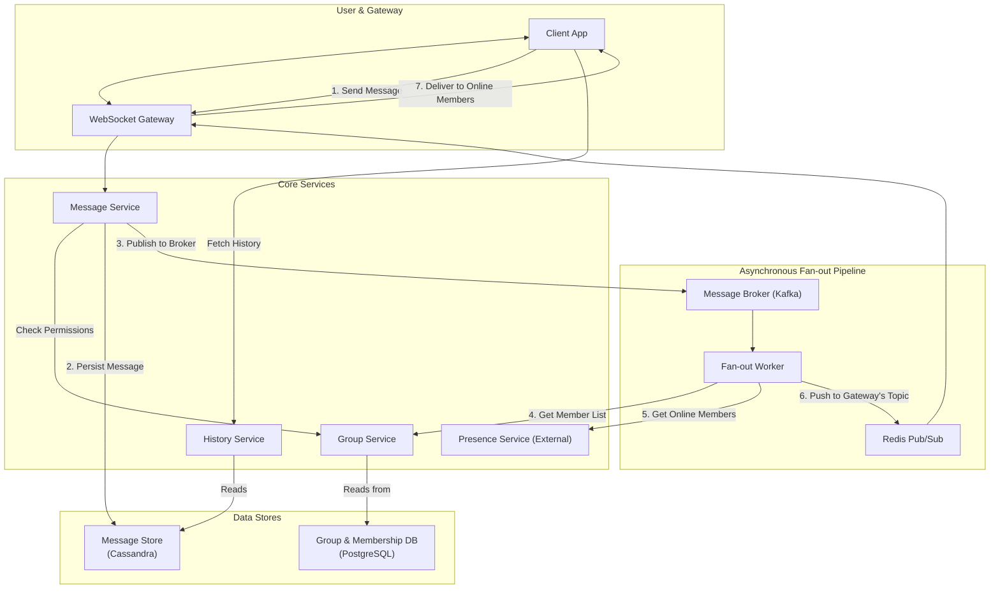

# High-Level Design: Group Chat System

## 1. Document Information

- **Document Title**: Group Chat System - High-Level Design
- **Version**: 1.0
- **Date**: 2025-08-30
- **Author**: Jules (AI Agent)
- **Status**: Draft

---

## 2. Executive Summary

### 2.1 Purpose
This document outlines the high-level design for a Group Chat System, a core component of any modern collaborative or social application. This design focuses specifically on the challenges of managing group conversations, delivering messages efficiently to all members of a group ("fan-out"), and managing group metadata and membership. It is designed to function as a microservice within a larger ecosystem.

### 2.2 Scope

**In Scope:**
-   Creating and managing groups (channels).
-   Managing group membership (joining, leaving, inviting).
-   Sending messages to a group.
-   A real-time, fan-out mechanism to deliver messages to all online group members.
-   Persistent storage of group message history.
-   A service to manage user permissions within a group (roles).

**Out of Scope:**
-   1-on-1 direct messaging (this is a simpler case).
-   The client application UI.
-   The WebSocket connection management layer (we assume a Gateway service exists).
-   User presence and online status.
-   Voice/video channels.

### 2.3 High-Level Architecture Overview
The architecture is designed around the "fan-out on write" pattern. When a user sends a message to a group, the request goes to a **Group Chat Service**. This service first validates the user's permission to post in that group. It then persists the message to a **Message Store** (e.g., Cassandra). After persistence, it publishes the message to a **Message Broker** (e.g., Kafka) on a topic specific to the group/channel. A **Fan-out Service** consumes from the broker. For each message, it retrieves the list of members in that group from a **Group Membership Service**. It then determines which of these members are currently online and pushes the message to the appropriate real-time **Gateway** nodes for delivery to the clients.

---

## 3. System Overview

### 3.1 Business Context
Group chat is a fundamental feature for collaboration (e.g., Slack, Teams) and community building (e.g., Discord, WhatsApp groups). The ability to reliably facilitate conversations between many users in a shared space is key to user engagement and retention. This system provides the core backend functionality to power such a feature.

### 3.2 System Purpose
To provide a scalable and reliable backend for multi-user group chat, focusing on efficient message delivery to large groups and consistent management of group state and history.

### 3.3 Success Criteria
-   **Low Message Fan-out Latency**: Time from a message being sent to being received by all online members of a group should be low (e.g., <500ms).
-   **Scalability**: The system must support millions of concurrent groups, some with tens of thousands of members.
-   **Reliability**: Message history must be durable. Message delivery to online users should be reliable.
-   **Consistency**: All members of a group must see the same messages in the same order.
-   **Permission Integrity**: Group permissions must be strictly enforced.

### 3.4 Assumptions
-   A real-time gateway service for managing persistent client connections (e.g., WebSockets) exists.
-   A user authentication service exists.
-   The number of members in most groups is small to medium, but the system must be designed to handle a few very large groups.

### 3.5 Constraints
-   **The Fan-out Problem**: Delivering a single message to potentially tens of thousands of online users in real-time is a significant scaling challenge.
-   **Read/Write Traffic Patterns**: Group chat has a mixed workload. Reading recent message history is a very common operation. Write traffic can be very "spiky" during active conversations.
-   **State Management**: Managing the membership and roles for millions of groups is a complex state management problem.
-   **Joins and "Backfills"**: When a user joins a channel, they need to load recent history, which can be a read-heavy operation.

---

## 4. Requirements Analysis

### 4.1 Functional Requirements
-   **FR-001 (Group Creation)**: A user must be able to create a new group (channel) and become its owner.
-   **FR-002 (Membership Management)**: Users must be able to join, leave, and invite other users to a group.
-   **FR-003 (Role-Based Access Control)**: The group owner must be able to assign roles (e.g., `admin`, `moderator`, `member`) to other members.
-   **FR-004 (Permission Enforcement)**: The system must enforce permissions based on roles (e.g., only certain roles can send messages, invite users, or delete messages).
-   **FR-005 (Message Sending)**: A user with permission must be able to send a message to the group.
-   **FR-006 (Real-time Delivery)**: The message must be delivered in real-time to all other online members of the group.
-   **FR-007 (Message History)**: The system must store all messages sent to a group, and clients must be able to fetch historical messages.
-   **FR-008 (Message Editing/Deleting)**: Users must be able to edit or delete their own messages, subject to permissions. These actions must be broadcast to all members in real-time.

### 4.2 Non-Functional Requirements
-   **Low Latency**: For real-time message delivery.
-   **High Availability**: The group chat service must be highly available.
-   **Scalability**: The system must scale to handle millions of groups and users.
-   **Durability**: Group messages and metadata must be durably stored.
-   **Strong Consistency**: For message history, strong ordering guarantees are required.
-   **Security**: Permissions must be strictly enforced.

---

### 5. Core Architecture

The architecture is built around a set of microservices that handle the distinct concerns of group management, message storage, and real-time delivery.

- **Group Service:**
  - A REST API service that manages the metadata for groups.
  - It handles creating groups, managing memberships (join, leave, invite), and controlling roles and permissions.
  - **Data Store:** A relational database (e.g., PostgreSQL) is a good fit here, as it can model the relationships between users, groups, and roles with strong consistency.

- **Message Service & Store:**
  - This is the core write path for messages.
  - **API:** A service that receives "send message" requests. It validates that the user has permission to post in the group by calling the Group Service.
  - **Message Store (e.g., Cassandra):** A distributed NoSQL database optimized for the high write throughput of chat messages. Data is partitioned by `group_id` to ensure all messages for a group are co-located and can be retrieved in order.
  - After persisting the message, the Message Service publishes it to the Fan-out system.

- **Fan-out & Real-time Delivery System:**
  - This system is responsible for delivering the message to online users.
  - **Message Broker (e.g., Kafka):** The Message Service writes the message to a Kafka topic. For scalability, there could be many topics, and messages for a given `group_id` are always sent to the same partition to preserve order.
  - **Fan-out Worker:** A stateless service that consumes from Kafka. For each message, it performs the crucial fan-out logic:
    1. It calls the Group Service to get the list of member IDs for the `group_id`.
    2. It queries a **Presence Service** (assumed to exist) to find out which of these members are currently online and which Gateway node each is connected to.
    3. It then publishes the message to a set of specific "delivery" topics on a Pub/Sub system, one topic per Gateway node (e.g., `gateway-123-delivery`).
  - **Pub/Sub System (e.g., Redis Pub/Sub):** A very fast, in-memory pub/sub system used for the final, low-latency delivery hop.
  - **Gateway Service:** Each gateway node subscribes to its own delivery topic on Redis. When it receives a message, it forwards it down the appropriate WebSocket to the end client.

- **Read Path (Message History):**
  - When a client needs to fetch historical messages (e.g., on opening a channel), it makes a REST API call to a **History Service**.
  - The History Service pages through the messages for the given `group_id` directly from the Message Store (Cassandra).

### 6. Data Schema and Models

- **Group DB Schema (PostgreSQL):**
  - `groups`: `id`, `name`, `owner_id`.
  - `group_members`: `group_id`, `user_id`.
  - `roles`: `id`, `group_id`, `role_name` (e.g., 'admin').
  - `role_permissions`: `role_id`, `permission_name` (e.g., 'can_send_message').
  - `member_roles`: `group_id`, `user_id`, `role_id`.
- **Message Store Schema (Cassandra):**
  - Table `messages_by_group`:
    - `PRIMARY KEY (group_id, message_id)` where `message_id` is a TimeUUID.
    - Columns: `author_id`, `content`, `metadata`.

### 7. API Design

- **Group Service API:**
  - `POST /groups`: Create a group.
  - `POST /groups/{id}/members`: Add a member to a group.
  - `DELETE /groups/{id}/members/{userId}`: Remove a member.
- **Message Service API:**
  - `POST /groups/{id}/messages`: Send a message to a group.
- **History Service API:**
  - `GET /groups/{id}/messages?before=<message_id>&limit=50`: Get a page of historical messages.

### 8. Scalability and Performance

- **Fan-out Optimization:** The primary scaling challenge. For very large groups (e.g., >10,000 members), fetching the full member list for every message is inefficient.
  - **Optimization:** The Fan-out Worker can cache the membership list for large channels.
  - **Alternative:** Instead of a "fan-out on write" approach for every message, the system can use a "fan-out on connect" model. When a client connects, the gateway subscribes to a Redis Pub/Sub topic for every group that the user is a member of (e.g., `group-123-messages`). When a message is sent, the Message Service just publishes it once to that topic, and Redis handles the fan-out to the subscribed gateways. This trades higher connection-time complexity and Redis memory usage for lower message-sending latency.
- **Database Scaling:** The Group Service database (PostgreSQL) can be scaled with read replicas. The Message Store (Cassandra) is designed for linear write scalability.

### 9. Reliability and Fault Tolerance

- **Message Durability:** Persisting the message to Cassandra *before* publishing to the fan-out system ensures that messages are not lost if the fan-out system fails.
- **At-Least-Once Delivery:** Using a durable message broker like Kafka ensures that messages from the write path will eventually make it to the fan-out workers.
- **Idempotency:** The system must handle potential redelivery of messages from Kafka. The fan-out workers can use the unique message ID to de-duplicate.

### 10. Security Considerations

- **Strict Permission Checks:** The Message Service acts as a gatekeeper. It is critical that it validates a user's permission to post to a group on every single write request. This check should not be done on the client or the gateway.
- **Authorization Caching:** To avoid calling the Group Service for a permission check on every message, the Message Service can cache user permissions for a short period (e.g., 5 minutes).

### 11. Monitoring and Observability

- **Fan-out Latency:** Measure the time from a message being published by the Message Service to it being delivered to the gateways.
- **Group Size Distribution:** Monitor the number and size of groups to identify potential "mega-channel" hot spots that may require special handling.
- **Database Load:** Monitor the write/read load on both the PostgreSQL and Cassandra clusters.

### 12. Deployment and Operations

- **Membership Changes:** When a user leaves a group, the system must ensure that they stop receiving messages. This requires invalidating any cached membership lists and potentially forcing their gateway to unsubscribe from the group's topic.
- **Data Modeling:** The choice of partitioning key (`group_id`) in the Message Store is critical to avoid hot spots.

### 13. Cost Estimation

- **Primary Drivers:**
  - **The Message Store:** A large, high-throughput Cassandra cluster can be expensive.
  - **The Fan-out System:** The cost of the Kafka and Redis clusters.
  - **Network Traffic:** The cost of fanning out potentially terabytes of message data.

### 14. Risks and Mitigations

- **The "Mega-Channel" Problem:**
  - **Risk:** A single channel with millions of members becomes extremely popular, and all its messages create a hot spot on a single Kafka partition and overwhelm the fan-out logic.
  - **Mitigation:** Use the "fan-out on connect" model described in section 8. For these specific large channels, have clients subscribe directly to the channel's topic, offloading the fan-out work to the Pub/Sub system (Redis).
- **Inconsistent Membership Cache:**
  - **Risk:** The Fan-out Worker uses a stale cache of a group's membership, delivering a message to a user who has just left the group.
  - **Mitigation:** Use a cache with a short TTL. Implement a pub/sub mechanism where the Group Service publishes "membership change" events, which are used to proactively invalidate caches.

### 15. Final Considerations

Designing a group chat system forces a focus on the "fan-out" problem, which is central to many real-time systems. The choice between a "fan-out on write" (where the server does the work) and a "fan-out on connect" (where the pub/sub system does the work) is a key architectural decision with different trade-offs in complexity, performance, and resource usage. A hybrid approach, where the model is chosen based on group size, is often the most effective solution at massive scale.
