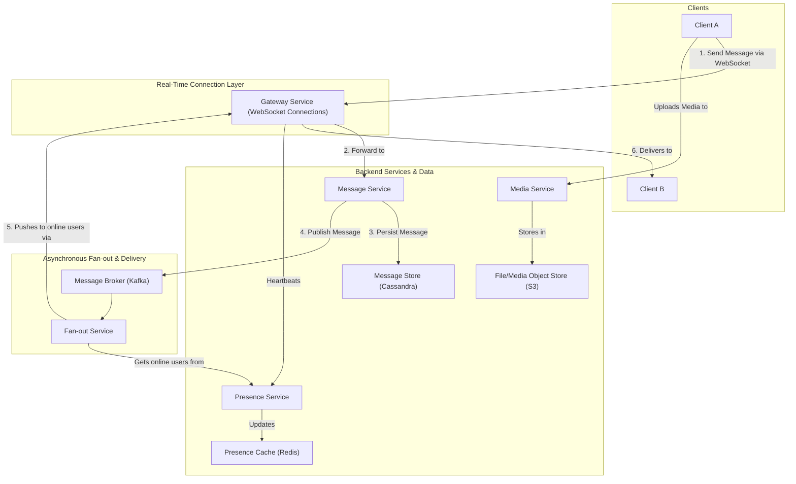

# High-Level Design: Instant Messaging Platform

## 1. Document Information

- **Document Title**: Instant Messaging Platform - High-Level Design
- **Version**: 1.0
- **Date**: 2025-08-30
- **Author**: Jules (AI Agent)
- **Status**: Draft

---

## 2. Executive Summary

### 2.1 Purpose
This document outlines the high-level design for a large-scale, real-time Instant Messaging (IM) platform, architecturally similar to Discord, Slack, or Microsoft Teams. The system is designed to support millions of concurrent users, providing one-on-one messaging, group chats (channels/servers), rich media sharing, and real-time presence information.

### 2.2 Scope

**In Scope:**
-   Real-time messaging for both direct messages (DMs) and group channels.
-   A persistent connection management service using WebSockets.
-   A "presence" service to track user online status (online, offline, idle).
-   A message history service with persistent storage.
-   An API for sending/receiving messages and managing user/channel information.
-   Support for basic rich media (image/file uploads).

**Out of Scope:**
-   Voice and video chat features (these are a separate, complex system).
-   The client applications (web, desktop, mobile).
-   Advanced features like bots, integrations, or threaded conversations.
-   User authentication (assumed to be handled by a separate auth service).

### 2.3 High-Level Architecture Overview
The architecture is centered around a **Gateway Service** that manages persistent WebSocket connections from millions of clients. When a user sends a message, it is sent over the WebSocket to the Gateway. The Gateway forwards the message to a **Message Service**, which is responsible for processing, persisting the message to a **Message Store** (e.g., a Cassandra database), and then publishing it to a **Message Fan-out Service** (e.g., using Redis Pub/Sub). This fan-out service delivers the message back to the Gateways, which then push it to the appropriate online recipients. A separate **Presence Service** tracks user online status via heartbeats sent over the WebSocket, and broadcasts presence updates.

---

## 3. System Overview

### 3.1 Business Context
Instant messaging is the cornerstone of modern communication, both for social interaction and workplace collaboration. A successful IM platform must be extremely reliable, scalable, and provide a low-latency, "real-time" experience to keep users engaged. These platforms create strong network effects and are foundational for building communities and enabling efficient teamwork.

### 3.2 System Purpose
To provide a highly scalable, available, and low-latency infrastructure for real-time text and media-based communication between millions of users across the globe.

### 3.3 Success Criteria
-   **Low Message Latency**: P99 latency from a message being sent by one client to being received by another should be under 200ms.
-   **Scalability**: The system must support tens of millions of concurrent users and millions of messages per second.
-   **High Availability**: The system must be highly available (99.99%), especially the core messaging path. Downtime means users cannot communicate.
-   **Durability**: Message history must not be lost. Once a message is sent, it should be durably stored.
-   **Consistency**: All members of a channel should see the same message history in the same order.

### 3.4 Assumptions
-   Users have a reliable internet connection capable of maintaining a persistent WebSocket connection.
-   A separate authentication service provides user identity.
-   A separate object storage service is available for storing large files/media.

### 3.5 Constraints
-   **Connection Management at Scale**: Maintaining tens of millions of persistent WebSocket connections is a significant technical challenge, requiring a highly optimized gateway layer.
-   **The "Fan-out" Problem**: A message sent to a channel with thousands of online users must be replicated and delivered to each of them with very low latency.
-   **Stateful Presence**: The presence service is highly stateful, tracking the online status of every connected user.
-   **Consistent History**: Ensuring that message history is stored durably and consistently while also being available for low-latency reads is a challenge.

---

## 4. Requirements Analysis

### 4.1 Functional Requirements
-   **FR-001 (User Connectivity)**: Users must be able to establish a persistent, real-time connection to the service (e.g., via WebSocket).
-   **FR-002 (1-on-1 Messaging)**: A user must be able to send a real-time message to another user.
-   **FR-003 (Group/Channel Messaging)**: A user must be able to send a real-time message to a channel, which is then broadcast to all other members of that channel.
-   **FR-004 (Message History)**: The system must store all messages, and users must be able to retrieve the historical messages for any conversation or channel.
-   **FR-005 (Presence Status)**: The system must track and display the online status of users (e.g., online, offline, idle).
-   **FR-006 (Typing Indicators)**: The system should show when another user in a conversation is typing.
-   **FR-007 (Media Uploads)**: Users must be able to upload images and files, which are then accessible to other users in the conversation.
-   **FR-008 (Read Receipts)**: The system should track the last-read message for a user in each conversation.

### 4.2 Non-Functional Requirements
-   **Low Latency**: Messages must be delivered in near real-time.
-   **High Availability**: The service must be fault-tolerant with no single point of failure.
-   **Scalability**: The system must be horizontally scalable to support millions of concurrent users.
-   **Durability**: Message data must be durably stored and replicated.
-   **Consistency**: Eventual consistency is acceptable for presence status, but strong consistency is desired for message history.
-   **Security**: All communication must be encrypted.
-   **Efficiency**: The system should be efficient in its use of network bandwidth and server resources.

---

### 5. Core Architecture

The architecture is a set of specialized microservices designed to handle the different aspects of a real-time chat system at scale.

- **Gateway Service (Connection Manager):**
  - A cluster of servers whose sole purpose is to manage persistent WebSocket connections from clients.
  - This layer is stateful *only* in that it holds the connection socket. It maps each connection to a `user_id`.
  - It acts as a protocol bridge, receiving messages from clients and forwarding them to backend services via a message queue, and receiving messages from the fan-out system to push back down to clients.
  - It also receives heartbeats from clients to maintain presence status.

- **Message Service (REST API):**
  - A stateless service that handles the business logic of sending a message.
  - It receives a `send_message` request from a Gateway, performs validation (e.g., "does this user have permission to post in this channel?"), generates a message ID, and persists the message to the database.
  - After successful persistence, it publishes the message to the fan-out system.

- **Message Store (e.g., Cassandra, ScyllaDB):**
  - A distributed NoSQL database optimized for high write throughput and horizontal scalability.
  - Data is modeled around the query pattern, which is "get the most recent N messages for a given channel."
  - **Primary Key:** `(channel_id, message_id)`, where `message_id` is a time-sortable ID (like a Snowflake ID or a TimeUUID). This ensures messages in a channel are clustered together and sorted by time.

- **Fan-out Service:**
  - This service is responsible for delivering a single message to all online members of a channel.
  - **Implementation:** A combination of a message queue and a topic-based pub/sub system.
    1. The Message Service publishes the message to a Kafka topic.
    2. A "Fan-out Worker" service consumes the message. It looks up the members of the target channel and their current online status (which Gateway they are connected to) from the Presence Service.
    3. For each online user, it publishes the message to a specific topic corresponding to the Gateway node they are connected to (e.g., `gateway-123-messages`).
    4. Each Gateway node subscribes to its own message topic to receive messages destined for its connected clients.

- **Presence Service:**
  - A highly stateful service that maintains the real-time online status of all users.
  - It receives heartbeat events from the Gateway Service.
  - It stores a mapping: `user_id` -> `{ status: 'online', gateway_id: 'gateway-123' }`.
  - This can be implemented using a distributed cache like Redis.

- **Media Service & Object Storage:**
  - A service for handling file/image uploads. It generates a unique URL for the content and stores the actual file in a blob store like S3. The message sent to other clients contains this URL, not the file itself.



### 6. Data Schema and Models

- **Message DB Schema (Cassandra Table):**
  - `PRIMARY KEY (channel_id, message_id)`
  - Columns: `author_id`, `content`, `created_at`, `media_attachments` (JSON).
- **WebSocket Message (JSON):**
  ```json
  {
    "op_code": 1, // SEND_MESSAGE
    "data": {
      "channel_id": "...",
      "content": "Hello, world!"
    }
  }
  ```
  ```json
  {
    "op_code": 2, // MESSAGE_ACK (from server to client)
    "data": {
      "channel_id": "...",
      "message_id": "...",
      "author_id": "...",
      "content": "Hello, world!"
    }
  }
  ```

### 7. API Design

- **WebSocket API:** The primary real-time API. It's a multiplexed stream of JSON objects with different `op_code`s for different actions (sending messages, presence updates, etc.).
- **REST API (for less frequent actions):**
  - `GET /api/v1/channels/{id}/messages`: Get historical messages for a channel (with pagination).
  - `GET /api/v1/users/me`: Get user profile information.
  - `POST /api/v1/media/upload`: Initiate a file upload.

### 8. Scalability and Performance

- **Gateway Scaling:** The Gateway service is the biggest challenge. It can be scaled by adding more nodes, but each node has a physical limit on the number of TCP connections it can handle. A robust service discovery and load balancing layer is needed to distribute clients evenly.
- **Fan-out Optimization:** For very large channels, looking up every user and publishing individually is inefficient. A more advanced fan-out would use a topic-based approach where gateways subscribe to topics for the channels their clients are in (e.g., `channel-456-messages`).
- **Database Scaling:** Cassandra/ScyllaDB are designed for linear scalability by adding more nodes. The data model is chosen to avoid hot spots by partitioning data evenly by `channel_id`.

### 9. Reliability and Fault Tolerance

- **Gateway Failure:** If a gateway node fails, all clients connected to it will be disconnected. Clients must have automatic reconnection logic. They will be routed to a healthy gateway by the load balancer.
- **At-Least-Once Delivery:** The use of a durable message queue (Kafka) between the Message Service and the Fan-out Service ensures that messages are not lost if a fan-out worker fails.
- **Message Ordering:** Using time-sortable message IDs (like Snowflake IDs) and partitioning by `channel_id` ensures that messages within a single channel are processed and stored in the correct order.

### 10. Security Considerations

- **Authentication:** The WebSocket connection must be authenticated. A common pattern is for the client to get a short-lived token from a REST API and pass it as a parameter when establishing the WebSocket connection.
- **Authorization:** The Message Service must perform a permission check before persisting a message and fanning it out.
- **Encryption:** All communication (REST and WebSocket) must use TLS. Messages at rest should be encrypted.

### 11. Monitoring and Observability

- **Key Metrics:**
  - End-to-end message latency (p99).
  - Number of active WebSocket connections.
  - Message fan-out rate.
  - Presence update latency.
- **Tracing:** Use distributed tracing to track a message's lifecycle from the sender's Gateway, through the backend services, to the recipients' Gateways.

### 12. Deployment and Operations

- **Gateway Deployment:** Rolling out updates to the stateful gateway layer requires careful connection draining to avoid disconnecting all users at once.
- **Database Management:** Managing a large-scale Cassandra cluster requires significant operational expertise.

### 13. Cost Estimation

- **Primary Drivers:**
  - **Gateway Compute:** The large fleet of servers needed to manage persistent connections.
  - **Database Cluster:** The cost of the large, high-throughput database cluster.
  - **Network Egress:** The cost of fanning out messages to users globally.

### 14. Risks and Mitigations

- **"Thundering Herd" on Reconnect:**
  - **Risk:** A network partition or regional failure causes a massive number of clients to disconnect and then try to reconnect all at once, overwhelming the Gateway and Auth services.
  - **Mitigation:** Implement exponential backoff with jitter in the client reconnection logic. Use a scalable load-shedding mechanism at the edge.
- **Fan-out for Large Channels (The "Celebrity Problem"):**
  - **Risk:** One message in a channel with 1 million online members requires 1 million message deliveries, creating a huge load spike.
  - **Mitigation:** This requires significant optimization. Use a multi-tiered fan-out system (e.g., Kafka -> regional Redis clusters) to distribute the load.
- **Presence Service Hot Spots:**
  - **Risk:** The Presence Service becomes a bottleneck as it's updated constantly by every connected client.
  - **Mitigation:** Shard the presence data by `user_id`. Batch updates from the gateways.

### 15. Final Considerations

A large-scale instant messaging platform is a complex distributed system where managing state at scale (connections, presence) is the primary challenge. The architecture relies on separating the concerns of connection management, message processing, and real-time fan-out into specialized services. The use of a distributed database like Cassandra is well-suited to the write-heavy nature of chat applications, and a robust pub/sub or queueing system is essential for reliably fanning out messages to millions of online users.
