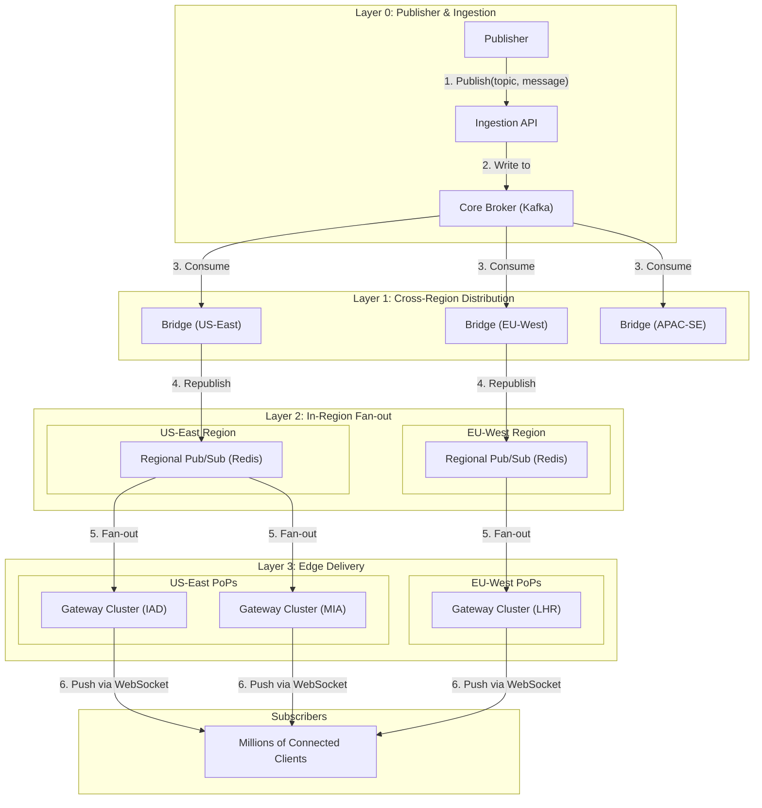

# High-Level Design: Message Broadcasting System

## 1. Document Information

- **Document Title**: Message Broadcasting System - High-Level Design
- **Version**: 1.0
- **Date**: 2025-08-30
- **Author**: Jules (AI Agent)
- **Status**: Draft

---

## 2. Executive Summary

### 2.1 Purpose
This document outlines the high-level design for a Message Broadcasting System. The system is designed for the specific purpose of delivering a single message to a massive number of subscribers (millions or tens of millions) with the lowest possible latency. This is a "one-to-many" system, ideal for use cases like breaking news alerts, live sports score updates, or stock price notifications.

### 2.2 Scope

**In Scope:**
-   A topic-based subscription model.
-   An API for publishing a message to a specific topic.
-   A highly scalable, multi-layered fan-out architecture to deliver the message.
-   A persistent connection layer for clients (e.g., WebSockets, MQTT, or Server-Sent Events).
-   Management of topic subscriptions.

**Out of Scope:**
-   The client application.
-   User authentication.
-   Message history or persistence (the system is for ephemeral, real-time broadcasting).
-   "Many-to-many" group chat functionality.

### 2.3 High-Level Architecture Overview
The architecture is a multi-tiered fan-out tree designed to minimize latency and distribute load. A **Publisher** sends a message for a specific **Topic** to an **Ingestion API**. The message is immediately published to a **Regional Pub/Sub System** (e.g., Redis) in the primary region. A fleet of **Bridge Services** subscribes to these topics. The job of a Bridge is to forward the message from the primary region's pub/sub to the pub/sub systems in all other geographic regions. Within each region, a large fleet of **Gateway** nodes subscribes to the regional pub/sub topics. These Gateways manage the persistent connections from millions of clients. When a Gateway receives a message for a topic, it forwards it down the appropriate connections to all of its clients who are subscribed to that topic.

---

## 3. System Overview

### 3.1 Business Context
Many applications need to send time-sensitive information to a very large audience simultaneously. For example, a media company sending a breaking news alert, a financial app broadcasting a major market move, or a sports app sending a goal notification. The ability to deliver this information to millions of users in seconds is a critical feature and a significant engineering challenge.

### 3.2 System Purpose
To provide a highly scalable, low-latency infrastructure for broadcasting messages to a massive concurrent audience. The system prioritizes speed and fan-out capacity above all else.

### 3.3 Success Criteria
-   **End-to-End Latency**: P99 latency from message publication to receipt by a client should be under 2 seconds, globally.
-   **Fan-out Capacity**: The system must be able to deliver a single message to over 10 million concurrent subscribers.
-   **High Availability**: The system must be resilient to failures of individual components or even entire regions.
-   **Scalability**: The system must be able to handle a growing number of topics and subscribers.

### 3.4 Assumptions
-   Messages are relatively small and ephemeral. There is no need to store them after delivery.
-   Clients can maintain a persistent connection.
-   The number of topics is large, but the number of *active* topics at any one time is manageable.

### 3.5 Constraints
-   **The "Thundering Herd" Problem**: The system is entirely designed around this problem. A single message triggers a massive cascade of network traffic.
-   **Connection Management at Scale**: Managing tens of millions of persistent connections is a major challenge.
-   **Global Latency**: Delivering a message to users across the globe within a tight latency budget requires a globally distributed infrastructure.
-   **Cost**: The bandwidth and compute resources required for this scale are significant.

---

## 4. Requirements Analysis

### 4.1 Functional Requirements
-   **FR-001 (Topic Creation)**: An administrator must be able to create new broadcast topics.
-   **FR-002 (Client Subscription)**: A client must be able to subscribe to one or more topics to receive messages.
-   **FR-003 (Client Unsubscription)**: A client must be able to unsubscribe from a topic.
-   **FR-004 (Message Publishing)**: A trusted publisher must be able to publish a message to a specific topic via an API.
-   **FR-005 (Real-time Broadcasting)**: A message published to a topic must be delivered in near real-time to all currently subscribed clients.
-   **FR-006 (No Persistence Guarantee)**: The system is not required to store messages or deliver them to offline users. It is a real-time, ephemeral system.

### 4.2 Non-Functional Requirements
-   **Extreme Low Latency**: The primary NFR.
-   **Massive Scalability**: Must handle millions of subscribers per topic.
-   **High Availability**: The system must be resilient to node and regional failures.
-   **Global Distribution**: The infrastructure must be globally distributed to serve a global audience.
-   **Efficiency**: The fan-out mechanism should be as efficient as possible to minimize resource usage and cost.
-   **Security**: The publishing API must be secured to prevent unauthorized broadcasts.

---

### 5. Core Architecture

The architecture is a multi-layered, geographically distributed fan-out tree, optimized to propagate a single message to millions of endpoints with minimal delay.

- **Layer 0: Ingestion & Core Publishing**
  - **Publisher API:** A simple, highly available REST API service where trusted publishers submit messages. It validates the message and the publisher's credentials.
  - **Core Pub/Sub:** Upon validation, the API service publishes the message to a topic in a central, highly reliable message broker like Apache Kafka. This provides a durable, ordered entry point for all broadcasts.

- **Layer 1: Regional Fan-out**
  - **Bridge Service:** A fleet of services that subscribe to the core Kafka topics. Each Bridge is responsible for a specific geographic region (e.g., `us-east-1-bridge`, `eu-west-1-bridge`).
  - When a Bridge receives a message from Kafka, its sole job is to immediately republish it to a regional, low-latency Pub/Sub system.
  - **Regional Pub/Sub (e.g., Redis Cluster):** Each geographic region has its own Redis Pub/Sub cluster. This acts as the fan-out hub for that region.

- **Layer 2: Local/PoP Fan-out (The Edge)**
  - **Gateway Cluster:** A large fleet of stateful servers distributed across multiple Points of Presence (PoPs) within each region. These servers manage the persistent connections from clients (WebSockets, MQTT, etc.).
  - **Subscription Management:** When a client connects to a Gateway and subscribes to a topic (e.g., `news-breaking`), the Gateway subscribes to the corresponding `news-breaking` channel on its regional Redis Pub/Sub cluster. It maintains a local map of `topic -> list of connected clients`.
  - **Message Delivery:** When the Gateway receives a message from a Redis channel it's subscribed to, it iterates through its local list of clients for that topic and writes the message to their connection sockets.

**The Fan-out Path:**
1.  **1x Write:** Publisher sends 1 message to the API.
2.  **1x Write:** API writes 1 message to Kafka.
3.  **~5-10x Fan-out:** A few Bridge services consume the message.
4.  **~5-10x Write:** Each Bridge writes 1 message to its regional Redis.
5.  **~10,000x Fan-out:** Redis fans out the message to thousands of Gateway nodes in that region.
6.  **~1,000x Fan-out (per Gateway):** Each Gateway fans out the message to the thousands of clients it serves.
7.  Total Fan-out: `1 -> 10,000,000+`



### 6. Data Schema and Models

- **Publish API Request:**
  ```json
  {
    "topic": "breaking-news",
    "payload": {
      "title": "...",
      "body": "..."
    }
  }
  ```
- **Subscription Message (Client to Gateway):**
  ```json
  { "action": "subscribe", "topic": "breaking-news" }
  ```
- **Broadcast Message (Gateway to Client):**
  ```json
  { "topic": "breaking-news", "payload": { ... } }
  ```

### 7. API Design

- **`POST /api/v1/publish`**:
  - **Usage:** The secure, internal API for publishing a broadcast message.
  - **Body:** The Publish API Request object.
  - **Response:** `202 Accepted`.
- **WebSocket/MQTT API:** A simple protocol for clients to `subscribe` and `unsubscribe` to topics. The server pushes broadcast messages.

### 8. Scalability and Performance

- **Multi-Layer Fan-out:** This is the key to scalability. No single component is responsible for delivering the message to all 10 million clients. The load is progressively distributed at each layer of the tree (Core -> Regional -> Local).
- **Connection Management:** The Gateway layer is the most resource-intensive. It is scaled horizontally by adding more nodes. A global load balancing solution (GeoDNS) directs clients to the nearest PoP to minimize connection latency.
- **Technology Choices:** Kafka is used at the core for its durability and ordering guarantees. Redis is used at the regional level for its extremely high-performance, in-memory pub/sub capabilities.

### 9. Reliability and Fault Tolerance

- **Core Reliability:** The Kafka cluster at the core is deployed across multiple AZs and provides the durability guarantee for the initial publication.
- **Regional Isolation:** A failure in one region's Redis cluster or Bridge service will not affect other regions.
- **Gateway Failure:** If a Gateway node fails, clients connected to it will disconnect. They must have automatic reconnection logic to connect to another healthy Gateway in the same PoP. Upon reconnection, they re-subscribe to their topics. Since the system is ephemeral, they will have missed any messages sent during the disconnect.

### 10. Security Considerations

- **Publishing API:** This API must be strictly protected and only accessible to trusted internal services. A compromised publisher could send malicious or incorrect information to millions of users.
- **Client Connections:** All client connections must be over an encrypted protocol (WSS for WebSockets, TLS for MQTT).

### 11. Monitoring and Observability

- **End-to-End Latency:** This is the most important metric. A tracer ID can be injected into the message at publication time. When clients receive the message, a small percentage can report back the tracer ID and the total time taken. This provides a real-world view of global delivery latency.
- **Fan-out Propagation Delay:** Monitor the time it takes for a message to propagate through each layer of the fan-out tree.
- **Subscription Counts:** Track the number of subscribers per topic and per Gateway node.

### 12. Deployment and Operations

- **Global Infrastructure:** Managing a globally distributed system requires significant automation via Infrastructure as Code (IaC).
- **Capacity Planning:** The system must be provisioned to handle peak expected load (e.g., a major world event). This may require keeping significant "hot spare" capacity in the Gateway and Redis layers.

### 13. Cost Estimation

- **Dominant Driver:** Network Egress. The cost of sending the same message data from the Gateways to millions of clients across the globe is by far the largest expense.
- **Compute:** The cost of the very large fleet of Gateway servers needed to hold open millions of connections.
- **Pub/Sub:** The cost of the regional Redis clusters.

### 14. Risks and Mitigations

- **"Thundering Herd" on Publish:**
  - **Risk:** A single message creates a massive, simultaneous load on all parts of the system.
  - **Mitigation:** The architecture is designed for this. The key is to ensure each layer is scaled to handle the load passed to it from the layer above. Extensive load testing is critical.
- **Regional Pub/Sub Failure:**
  - **Risk:** A regional Redis cluster fails, preventing delivery to all users in that region.
  - **Mitigation:** Run the Redis cluster in a high-availability configuration. The Bridge service can be designed to detect a failed regional cluster and attempt to buffer messages or fail over to another region's pub/sub (at the cost of higher latency).
- **Incorrect Fan-out:**
  - **Risk:** A bug in the subscription logic causes a message to be sent to the wrong topic's subscribers.
  - **Mitigation:** Rigorous testing of the subscription and publishing logic. Strong isolation between topics in the Pub/Sub system.

### 15. Final Considerations

A message broadcasting system is an exercise in designing for massive fan-out. The multi-tiered, tree-like architecture is a proven pattern for achieving this at a global scale. It works by ensuring no single component bears the full load, instead distributing it geographically and logically. While the concept is simple, the operational complexity of managing a global, stateful, low-latency infrastructure is significant, and the primary cost consideration will always be the network bandwidth required to deliver the data.
