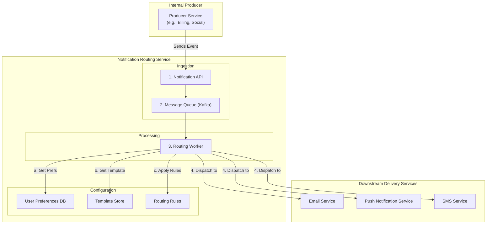

# High-Level Design: Notification Routing Service

## 1. Document Information

- **Document Title**: Notification Routing Service - High-Level Design
- **Version**: 1.0
- **Date**: 2025-08-30
- **Author**: Jules (AI Agent)
- **Status**: Draft

---

## 2. Executive Summary

### 2.1 Purpose
This document outlines the high-level design for a centralized Notification Routing Service. The purpose of this system is to provide a single, intelligent service that other microservices can use to send notifications to users. The service ingests a generic "notification event," consults user preferences and other rules, formats the message for the appropriate channel (e.g., email, push notification, SMS), and dispatches it to the correct downstream delivery service.

### 2.2 Scope

**In Scope:**
-   An API for internal services to trigger a notification for a user.
-   Management of user notification preferences (e.g., "disable email notifications for 'new follower' alerts").
-   A templating engine to format messages for different channels.
-   A routing engine to decide which channel(s) a notification should be sent to.
-   Integration with downstream delivery services (e.g., an Email Service, an SMS Gateway, a Push Notification Service).
-   A queuing system for resilient, asynchronous processing.

**Out of Scope:**
-   The downstream delivery services themselves (e.g., the service that actually sends the email).
-   The user interface where users manage their notification preferences.
-   The internal services that generate the initial notification events.

### 2.3 High-Level Architecture Overview
The system is an event-driven workflow. An internal **Producer Service** sends a generic notification event (e.g., `{user_id: 123, event_type: 'new_follower', data: {...}}`) to the **Notification Router's API**. The API validates the event and enqueues it into a **Message Queue**. A fleet of **Routing Workers** consumes these events. For each event, the worker fetches the `user_id`'s **Notification Preferences** from a database. It then applies a **Rules Engine** to decide the final destination channel(s). It fetches the appropriate **Message Template**, personalizes it, and then dispatches the formatted notification to the specific downstream **Delivery Service** (e.g., Push Notification Service, Email Service).

---

## 3. System Overview

### 3.1 Business Context
In a large application, dozens of different services may need to send notifications to users. Without a central service, each team would have to build its own logic for handling user preferences, formatting messages, and integrating with delivery APIs. This leads to duplicated effort, inconsistent user experiences, and difficulty in managing notification policies globally. A central routing service solves this by providing a single point of control and a consistent developer experience.

### 3.2 System Purpose
To decouple application logic from notification delivery logic, providing a centralized, manageable, and user-preference-aware system for dispatching all user-facing notifications.

### 3.3 Success Criteria
-   **Reliability**: The system must reliably process and dispatch notifications with at-least-once delivery semantics.
-   **Correctness**: The system must always respect user preferences and routing rules. Sending a notification to a user who has opted out is a critical failure.
-   **Scalability**: The system must scale to handle millions of notification events per day.
-   **Extensibility**: It should be easy to add new notification channels (e.g., a new chat app) or new routing rules.
-   **Low Latency**: The time from event ingestion to dispatch should be low for time-sensitive notifications.

### 3.4 Assumptions
-   A user profile service exists where notification preferences can be stored and retrieved.
-   Downstream services for delivering email, push, and SMS messages exist and expose their own APIs.
-   Notification events have a predefined, structured format.

### 3.5 Constraints
-   **Complex Logic**: The combination of user preferences, channel availability (e.g., does the user have the mobile app installed?), and business rules can create complex routing logic.
-   **State Management**: The system needs to manage state for user preferences and message templates.
-   **Dependency on Downstream Services**: The system's ability to deliver notifications is dependent on the availability of the downstream email, push, and SMS services.

---

## 4. Requirements Analysis

### 4.1 Functional Requirements
-   **FR-001 (Event Ingestion)**: The system must provide an API for internal services to submit notification events.
-   **FR-002 (User Preference Management)**: The system must be able to store and retrieve user preferences for different notification types and channels.
-   **FR-003 (Templating)**: The system must use templates to render the final message content for each channel, allowing for personalization.
-   **FR-004 (Routing Logic)**: The system must have a rules engine that decides the final channel(s) based on event type, user preferences, and other contextual data.
-   **FR-005 (Dispatching)**: The system must be able to dispatch the formatted notification to the correct downstream delivery service.
-   **FR-006 (Notification Bundling/Throttling)**: The system should be able to bundle multiple, similar notifications into a single message (e.g., "You have 5 new likes") to avoid overwhelming the user.
-   **FR-007 (Multi-Channel Support)**: The system must support at least Email, Push Notification, and SMS as destination channels.

### 4.2 Non-Functional Requirements
-   **High Availability**: The ingestion API and processing pipeline must be highly available.
-   **Scalability**: The system must be horizontally scalable to handle high event volumes.
-   **Fault Tolerance**: The system must be resilient to failures in downstream delivery services.
-   **Low Latency**: For transactional or time-sensitive alerts.
-   **Observability**: The system should provide a clear trace of how a routing decision was made for any given notification.
-   **Extensibility**: Easy to add new channels and rules.

---

### 5. Core Architecture

The architecture is a decoupled, queue-based workflow that separates event ingestion from the complex routing and dispatching logic.

- **Ingestion Layer:**
  - **Notification API:** A stateless REST API service. Internal services send generic notification events here.
  - The API validates the event against a schema, authenticates the calling service, and then places the event into a central **Message Queue**.

- **Processing Layer:**
  - **Message Queue (e.g., Kafka, RabbitMQ):** A durable queue that buffers all incoming notification events, allowing the processing logic to be scaled independently and providing resilience.
  - **Routing Workers:** A fleet of stateless workers that consume events from the queue. Each worker executes the core routing logic for one event:
    1.  **Fetch Preferences:** It queries a **User Preferences Service/DB** to get the notification settings for the target `user_id`.
    2.  **Apply Rules:** It passes the event data and user preferences to a **Rules Engine**. The engine evaluates a set of rules to determine the final list of channels and templates. (e.g., `IF event_type == 'new_message' AND user.push_enabled == true THEN use_channel('push')`).
    3.  **Fetch Templates:** It retrieves the appropriate message templates (e.g., push notification text, email HTML) from a **Template Store**.
    4.  **Render Message:** It uses a templating library to render the final message content, personalizing it with data from the event payload.
    5.  **Dispatch:** It makes an API call to the appropriate downstream delivery service (e.g., calls the Email Service API).

- **Data & Configuration Stores:**
  - **User Preferences Database (e.g., PostgreSQL, DynamoDB):** Stores user-specific settings for which notifications they want to receive on which channels.
  - **Template Store (e.g., S3, Git repository):** Stores the message templates for all channels and languages.
  - **Routing Rules Configuration:** A configuration file or database that defines the logic for the rules engine.

- **Downstream Delivery Services (External Dependencies):**
  - **Push Notification Service:** A service responsible for sending push notifications via APNS and FCM.
  - **Email Service:** A service for sending transactional emails.
  - **SMS Gateway Service:** The gateway for sending SMS messages.



### 6. Data Schema and Models

- **Notification Event Schema (in Message Queue):**
  ```json
  {
    "event_id": "uuid",
    "user_id": "...",
    "event_type": "friend_request_received",
    "payload": {
      "from_user_name": "Alice",
      "from_user_id": "..."
    }
  }
  ```
- **User Preferences Schema:**
  - `user_id` (Primary Key)
  - `preferences` (JSONB), e.g., `{ "friend_request_received": { "email": true, "push": false, "sms": false } }`
- **Template Example (Email):**
  - Subject: `You have a new friend request from {{from_user_name}}!`
  - Body: `Hi, you can accept or decline the request from Alice here: ...`

### 7. API Design

- **`POST /api/v1/notifications` (Ingestion API):**
  - **Usage:** Called by internal services to create a notification.
  - **Body:** The Notification Event object.
  - **Response:** `202 Accepted`.
- **`PUT /api/v1/users/{id}/preferences` (Preferences API):**
  - **Usage:** Called by a user-facing settings page to update notification preferences.
  - **Body:** The user preferences JSON object.
  - **Response:** `200 OK`.

### 8. Scalability and Performance

- **Horizontal Scaling:** The stateless API and worker components can be scaled out independently to handle high volumes of events.
- **Asynchronous Processing:** The queue-based architecture allows the system to handle massive bursts of notification events without slowing down the upstream services that produce them.
- **Caching:** User preferences and message templates can be heavily cached in the Routing Workers to reduce database load and improve processing speed.

### 9. Reliability and Fault Tolerance

- **Durable Queue:** The message queue ensures that notification events are not lost if the routing workers are down.
- **Retries and Circuit Breakers:** The Routing Worker must implement retry logic with exponential backoff when calling downstream delivery services. A circuit breaker should be used to stop calling a failing service for a period of time to allow it to recover.
- **Dead Letter Queue (DLQ):** If a notification event fails processing repeatedly (e.g., due to malformed data or a bug), it is moved to a DLQ for manual inspection, so it doesn't block the main queue.

### 10. Security Considerations

- **Authentication:** The ingestion API must be an internal-only endpoint, and it should authenticate the calling service (e.g., via mTLS or an internal service token) to prevent unauthorized notification spam.
- **PII Handling:** The service handles PII (email addresses, phone numbers) when dispatching. This data should be handled securely and logged minimally.
- **Template Security:** Templates should be validated to prevent injection attacks if they allow complex logic.

### 11. Monitoring and Observability

- **End-to-End Pipeline Monitoring:** Track the lifecycle of a notification event.
  - **Queue Depth:** Monitor the number of events waiting in the queue.
  - **Processing Latency:** Measure the time it takes for a worker to process an event.
  - **Dispatch Rate:** Track the number of notifications dispatched per channel.
- **Downstream Service Errors:** Monitor the error rates for API calls to the downstream email, push, and SMS services.

### 12. Deployment and Operations

- **Template Management:** Templates should be stored in a version-controlled repository (like Git) and deployed via a CI/CD pipeline.
- **Rule Management:** The routing rules should be manageable via a configuration file or an admin interface to allow for dynamic changes without a full service redeployment.

### 13. Cost Estimation

- **Primary Drivers:**
  - **Compute:** The cost of the worker fleet, which scales with the number of notification events.
  - **Message Queue:** The cost of the managed queuing service.
  - **Databases:** The cost of storing user preferences and templates.

### 14. Risks and Mitigations

- **Notification Storms:**
  - **Risk:** A bug or a cascading event causes a massive number of events to be generated, potentially overwhelming users with notifications.
  - **Mitigation:** Implement global rate limiting and throttling. The bundling/collapsing feature is key here, allowing the system to aggregate many events (e.g., "100 people liked your post") into a single notification.
- **Misconfigured Rules:**
  - **Risk:** A bad rule is deployed, causing notifications to be dropped or sent to the wrong channel.
  - **Mitigation:** Implement a staging environment to test rule changes. Have a quick rollback mechanism for the routing rule configuration.
- **Stale Preference Cache:**
  - **Risk:** A user updates their preferences, but a worker uses a stale cached version and sends a notification the user had disabled.
  - **Mitigation:** Use a cache with a reasonably short TTL (e.g., 5 minutes). Implement a cache invalidation mechanism where the preferences service publishes update events to a pub/sub topic that the workers subscribe to.

### 15. Final Considerations

A Notification Routing Service is a powerful force multiplier in a microservices ecosystem. It centralizes complex, cross-cutting logic, providing a single point of control for managing how the company communicates with its users. The key to a successful design is the decoupling of components via message queues, which provides scalability and resilience, and a flexible rules engine that can adapt to changing product requirements and user preferences.
