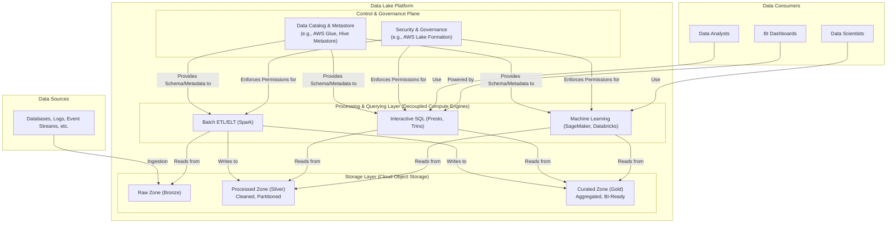

# High-Level Design: Data Lake Architecture

## 1. Document Information

- **Document Title**: Data Lake Architecture - High-Level Design
- **Version**: 1.0
- **Date**: 2025-08-30
- **Author**: Jules (AI Agent)
- **Status**: Draft

---

## 2. Executive Summary

### 2.1 Purpose
This document outlines the high-level design for a Data Lake architecture. A data lake is a centralized repository that allows an organization to store all its structured, semi-structured, and unstructured data at any scale. Unlike a data warehouse, which stores data in a predefined schema, a data lake stores data in its raw format. This design focuses on using cloud object storage as the foundation, with a metadata catalog and multiple query engines providing a flexible and cost-effective platform for data exploration, analytics, and machine learning.

### 2.2 Scope

**In Scope:**
-   A centralized storage foundation using a cloud object store (e.g., Amazon S3).
-   A data ingestion framework for bringing data into the lake from various sources.
-   A metadata catalog and schema management service (e.g., Hive Metastore, AWS Glue Catalog).
-   Multiple, decoupled query and processing engines (e.g., Spark, Presto, Dremio) for different workloads.
-   Data partitioning and storage layout strategies for efficient access.
-   A security and governance layer to manage access to the data.

**Out of Scope:**
-   The specific data sources or analytical applications that use the data lake.
-   The underlying cloud infrastructure.
-   The implementation of the query engines themselves.
-   A detailed ETL/ELT pipeline design (this is a complementary but separate system).

### 2.3 High-Level Architecture Overview
The architecture is layered and modular. At the bottom is the **Storage Layer**, typically a cloud object store like Amazon S3, which holds all data in various zones (e.g., raw, processed, curated). On top of this sits the **Data Catalog**, a central metadata repository that provides table-like abstractions over the files in the object store. The **Processing Layer** consists of multiple, independent, and often ephemeral compute engines (like Spark for batch processing, Presto for interactive SQL) that read data from the storage layer, use the data catalog to find and understand the data, and execute their tasks. A unified **Security & Governance Layer** enforces access control policies across all engines. Users and applications interact with the data lake through the various tools in the processing layer.

---

## 3. System Overview

### 3.1 Business Context
As data volumes and variety grow, organizations need a flexible and cost-effective way to store and analyze everything, without being forced to structure the data upfront. A data lake provides this flexibility. It allows data scientists to explore raw data for machine learning, data engineers to build robust data pipelines, and analysts to query curated datasets, all from a single, centralized repository. This "store now, analyze later" approach accelerates innovation and prevents data silos.

### 3.2 System Purpose
To provide a single, scalable, and durable repository for all of an organization's data assets, and to enable a diverse set of analytical workloads on that data by decoupling storage from compute.

### 3.3 Success Criteria
-   **Scalability**: The storage layer must scale to exabytes of data.
-   **Durability**: Data stored in the lake must be highly durable.
-   **Flexibility**: The architecture must support a variety of data formats and processing engines.
-   **Cost-Effectiveness**: The total cost of ownership should be significantly lower than a traditional data warehouse of the same scale.
-   **Discoverability**: It must be easy for users to find, understand, and query the datasets available in the lake.
-   **Security**: Access to data must be securely managed and auditable.

### 3.4 Assumptions
-   The organization uses a major cloud provider that offers scalable object storage.
-   A diverse set of users (data scientists, engineers, analysts) will use the lake.
-   Not all data is structured; the system must handle JSON, logs, images, and other formats.

### 3.5 Constraints
-   **Data Swamp Risk**: Without strong governance and metadata management, a data lake can easily become a "data swamp"—a repository of undocumented, low-quality, and unusable data.
-   **Query Performance**: Query performance can be lower than a purpose-built data warehouse, as data is read from object storage, which has higher latency than local disks.
-   **Consistency**: Object stores are eventually consistent, which can introduce challenges for some transactional workloads (though modern table formats like Iceberg/Delta Lake address this).
-   **Complexity**: Managing a data lake ecosystem with its many components can be complex.

---

## 4. Requirements Analysis

### 4.1 Functional Requirements
-   **FR-001 (Centralized Storage)**: The system must use a cloud object store as its primary storage layer.
-   **FR-002 (Data Ingestion)**: The system must provide mechanisms to ingest data in batches or streams from various sources.
-   **FR-003 (Multi-Format Storage)**: The system must be able to store data in any format, including structured (CSV, Parquet), semi-structured (JSON, Avro), and unstructured (images, text files).
-   **FR-004 (Metadata Catalog)**: A central catalog must store schema information and partition metadata for all "tabled" datasets.
-   **FR-005 (Schema-on-Read)**: The system must support "schema-on-read," where the structure of the data is applied by the query engine at query time, not when the data is written.
-   **FR-006 (Decoupled Compute)**: The system must allow multiple, independent compute clusters to access the same data simultaneously.
-   **FR-007 (Unified Access Control)**: A single security framework must be able to define and enforce access permissions across different query engines.
-   **FR-008 (Data Lifecycle Management)**: The system should support policies for moving data between storage tiers (e.g., S3 Standard to Glacier) or deleting it.

### 4.2 Non-Functional Requirements
-   **Durability**: High data durability (e.g., 11 nines offered by S3).
-   **Availability**: High availability of the storage and catalog services.
-   **Scalability**: Near-infinite scalability of the storage layer. Elastic scalability of the compute layer.
-   **Performance**: Query performance should be optimized through techniques like partitioning, columnar formats, and predicate pushdown.
-   **Governance**: The system must provide tools for data lineage, quality monitoring, and auditing.
-   **Discoverability**: The data catalog should be searchable, allowing users to discover relevant datasets.

---

### 5. Core Architecture

The architecture is a set of layered, independent services that operate on data in a central storage repository.

- **Storage Layer (e.g., Amazon S3):**
  - The foundation of the data lake.
  - Data is organized into zones or layers to represent its refinement level.
    - **Raw Zone (or Bronze Zone):** Contains data in its original, immutable format from source systems.
    - **Processed/Staged Zone (or Silver Zone):** Contains data that has been cleaned, transformed, partitioned, and converted to an optimal format like Apache Parquet.
    - **Curated/Trusted Zone (or Gold Zone):** Contains highly refined, aggregated data used for business intelligence and reporting.
  - Data is partitioned using a logical directory structure, e.g., `/processed/sales/year=2023/month=08/`.

- **Cataloging & Metadata Layer (e.g., AWS Glue Data Catalog, Hive Metastore):**
  - This layer provides a relational database-like view over the files in the object store.
  - It stores metadata for each "table," including its schema, the location of its files in S3, and its partitioning information.
  - When a query engine wants to query a table, it first contacts the catalog to get the schema and a list of file paths to read.

- **Processing & Querying Layer (Decoupled Compute):**
  - This is a suite of tools that users can choose from based on their needs. They all read data from the storage layer and use the catalog layer for metadata.
  - **Batch ETL/ELT (e.g., Apache Spark):** Used for large-scale data transformation, cleaning, and enrichment. Reads from the raw/processed zones and writes to the processed/curated zones.
  - **Interactive SQL (e.g., Presto, Trino, Athena):** Used by data analysts for fast, interactive SQL queries directly on the data in S3.
  - **Data Warehousing (e.g., Redshift Spectrum, Snowflake):** A data warehouse can also be a client of the data lake, querying data in-place or loading it for further analysis.
  - **Machine Learning (e.g., SageMaker, Databricks):** ML frameworks can read data directly from the lake to train models.

- **Governance & Security Layer (e.g., Apache Ranger, AWS Lake Formation):**
  - A centralized service for managing permissions.
  - It provides a single place to define policies like "Role 'analyst' can only see columns A and B from the `customers` table."
  - The query engines are integrated with this layer to enforce these policies at query time.

### 6. Data Schema and Models

- **Schema-on-Read:** The defining principle. No schema is enforced when data is written to the lake. The schema is defined and validated by the tool that reads the data. The data catalog stores the "official" schema for tabled data, but users are free to read the raw files with a different schema.
- **Open Table Formats (e.g., Apache Iceberg, Delta Lake):** These are modern additions to the data lake architecture. They are metadata layers that sit on top of files in S3 and bring ACID transactions, time travel (querying data as of a past date), and reliable schema evolution to the data lake, making it behave more like a traditional database.

### 7. API Design

The data lake does not have a single API. Instead, each component in the processing layer exposes its own API.
- **Spark:** A programmatic API (Scala, Python, R).
- **Presto/Trino:** A JDBC/ODBC endpoint for standard SQL clients.
- **Metadata Catalog:** A Thrift or REST API for managing tables (e.g., `create_table`, `get_partitions`).
- **Storage Layer:** A standard S3-compatible REST API.

### 8. Scalability and Performance

- **Storage Scalability:** The object store provides virtually limitless scalability for storage.
- **Compute Scalability:** The compute layer is elastically scalable. A user can spin up a massive Spark cluster for a heavy ETL job and tear it down hours later. Another user can run a query on a small, persistent Presto cluster simultaneously.
- **Performance Optimizations:**
  - **Columnar Formats (Parquet/ORC):** Drastically reduces I/O by only reading the columns required for a query.
  - **Partition Pruning:** Query engines use the partition information from the catalog to read only the necessary directories/files.
  - **Predicate Pushdown:** The query engine pushes filter conditions down to the data reading layer, allowing it to filter data as it's being read, further reducing I/O.

### 9. Reliability and Fault Tolerance

- **Durability:** Inherited from the cloud object store, which is designed for extreme durability by replicating data across multiple facilities.
- **Compute Fault Tolerance:** The distributed processing engines have their own fault tolerance mechanisms. Spark, for example, can recover from worker node failures by re-executing the lost tasks.
- **Catalog HA:** The metadata catalog must be deployed in a high-availability configuration.

### 10. Security Considerations

- **Centralized Governance:** Using a tool like AWS Lake Formation allows security policies to be defined once and enforced across all integrated query engines.
- **Encryption:** Data is encrypted at rest in S3 and in transit between all components.
- **Fine-Grained Access Control:** The governance layer can enforce column-level and row-level security.

### 11. Monitoring and Observability

- **Storage Metrics:** Monitor storage volume, number of objects, and access patterns in the object store.
- **Compute Metrics:** Monitor resource utilization (CPU, memory) and job/query performance for each of the processing engines.
- **Data Lineage:** Use data lineage tools to track how data flows from its source through various transformation jobs to its final destination. This is critical for debugging and governance.

### 12. Deployment and Operations

- **Infrastructure as Code:** The entire data lake infrastructure is provisioned and managed using Terraform.
- **DataOps:** The practice of applying DevOps principles to data pipelines. This includes automated testing of data quality, CI/CD for ETL code, and proactive monitoring.

### 13. Cost Estimation

- **Storage:** Very low cost per GB, billed monthly for data stored in the object store.
- **Compute:** Billed per-second or per-hour for the compute resources used by query engines like Spark and Presto. This is often the largest component of the cost but is highly elastic.
- **Data Scans:** Some services (like Athena) are priced based on the amount of data scanned per query.
- **API Calls:** High number of `LIST` and `GET` requests to the object store can incur costs.

### 14. Risks and Mitigations

- **Data Swamp Creation:**
  - **Risk:** The lake becomes a dumping ground for undocumented and low-quality data that no one can use.
  - **Mitigation:** Implement strong data governance from day one. Mandate that all datasets be registered in the data catalog with clear ownership, documentation, and schema. Implement data quality checks in ingestion pipelines.
- **Small Files Problem:**
  - **Risk:** Ingesting lots of small files (kilobytes in size) is very inefficient for distributed file systems and object stores, leading to slow query performance.
  - **Mitigation:** Implement a "compaction" process in the ETL pipeline that periodically merges small files into larger, more optimal ones (e.g., 128MB-1GB).
- **Inconsistent Analysis:**
  - **Risk:** Two different users or tools apply different schemas or cleaning logic to the same raw data, leading to inconsistent analytical results.
  - **Mitigation:** Promote the use of the curated/gold zone as the single source of truth for business reporting. Use the data catalog to publish and certify official datasets.

### 15. Final Considerations

A data lake architecture offers unparalleled flexibility and scalability for modern data needs. Its core strength lies in decoupling storage from compute, allowing organizations to store everything cheaply and choose the right tool for the job when it comes to processing. However, this flexibility comes with the responsibility of strong governance. Without a robust data catalog, quality checks, and clear data ownership, a data lake can fail to deliver on its promise. The adoption of open table formats like Apache Iceberg is further evolving the data lake, adding reliability and transactional capabilities that blur the lines between data lakes and data warehouses.
