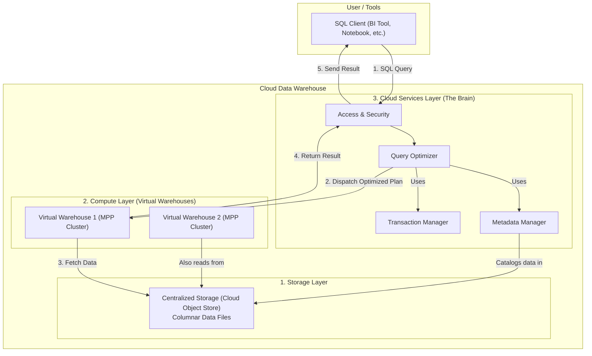

# High-Level Design: Cloud Data Warehouse

## 1. Document Information

- **Document Title**: Cloud Data Warehouse - High-Level Design
- **Version**: 1.0
- **Date**: 2025-08-30
- **Author**: Jules (AI Agent)
- **Status**: Draft

---

## 2. Executive Summary

### 2.1 Purpose
This document outlines the high-level design for a modern cloud-native data warehouse, architecturally similar to systems like Snowflake, BigQuery, or Redshift Spectrum. The core design principle is the **separation of storage and compute**, which allows for independent scaling of resources, providing greater flexibility and cost-effectiveness than traditional, monolithic data warehouses. The system is designed for large-scale analytical queries (OLAP) over massive, structured, and semi-structured datasets.

### 2.2 Scope

**In Scope:**
-   A decoupled storage layer using a cloud object store (like S3).
-   A columnar data format for efficient storage and retrieval.
-   An elastic, multi-cluster compute layer for executing queries (Massively Parallel Processing - MPP).
-   A cloud services layer for managing transactions, security, metadata, and query optimization.
-   A standard SQL interface for querying data.
-   Caching at multiple levels to improve performance.

**Out of Scope:**
-   The underlying cloud infrastructure (e.g., S3, EC2).
-   Data ingestion tools and ETL/ELT pipelines that load data into the warehouse.
-   Business Intelligence (BI) and visualization tools that connect to the warehouse.
-   Real-time streaming ingestion (the focus is on large-scale batch analytics).

### 2.3 High-Level Architecture Overview
The architecture is composed of three distinct, independently scalable layers:
1.  **Storage Layer:** All data is stored centrally in a cloud object store (e.g., Amazon S3) in an optimized, compressed, columnar format (like Parquet or a proprietary format). This layer is durable, scalable, and cost-effective.
2.  **Compute Layer:** This layer consists of clusters of virtual machines (or "virtual warehouses") that are provisioned on-demand to execute queries. These clusters are stateless, as they don't store any data locally besides temporary data for query execution. Multiple clusters of different sizes can operate on the same data simultaneously without contention.
3.  **Cloud Services Layer:** This is the "brain" of the system. It's a collection of services that manage the entire data warehouse, including authentication, access control, query planning and optimization, transaction management, and metadata management (tracking where data for each table is stored in the object store).

---

## 3. System Overview

### 3.1 Business Context
Businesses need to analyze vast amounts of historical data to make strategic decisions, understand customer behavior, and generate reports. Traditional data warehouses coupled storage and compute, meaning resources had to be scaled together, often leading to paying for expensive compute power 24/7 even when idle. A cloud-native architecture decouples these, allowing businesses to pay for storage cheaply and only spin up (and pay for) compute resources when they are actively running queries.

### 3.2 System Purpose
To provide a highly scalable, elastic, and performant platform for large-scale data analytics using standard SQL. The system must handle petabyte-scale datasets and complex analytical queries efficiently and cost-effectively.

### 3.3 Success Criteria
-   **Performance**: Complex analytical queries over terabytes of data should complete in seconds to minutes.
-   **Scalability**: Storage and compute should scale independently and near-infinitely (up to the cloud provider's limits).
-   **Concurrency**: The system must support a high number of concurrent users and queries without performance degradation.
-   **Cost-Effectiveness**: Users should pay only for the storage and compute resources they actually use.
-   **Ease of Use**: The system should be accessible via a standard SQL interface.
-   **Reliability**: The system should be highly available and durable, leveraging the underlying cloud infrastructure.

### 3.4 Assumptions
-   The system is deployed within a single cloud provider's ecosystem.
-   Workloads are primarily OLAP (few, complex queries over large datasets) rather than OLTP (many, simple, transactional queries).
-   Data is structured or semi-structured (e.g., Parquet, ORC, JSON, Avro).

### 3.5 Constraints
-   **Query Latency**: While fast for analytical queries, the system is not designed for low-latency point lookups, as there is overhead in spinning up compute and reading from object storage.
-   **Network Dependency**: Performance is highly dependent on the network bandwidth between the compute layer and the storage layer.
-   **Data Freshness**: The architecture is better suited for batch-loaded data than for real-time analytics, as data needs to be formatted and written to the object store.
-   **Consistency Model**: Achieving ACID compliance in a decoupled architecture requires a sophisticated transaction manager in the services layer.

---

## 4. Requirements Analysis

### 4.1 Functional Requirements
-   **FR-001 (Decoupled Storage)**: The system must store all persistent data in a central object store.
-   **FR-002 (Columnar Storage)**: Data must be stored in a columnar format to optimize analytical query performance.
-   **FR-003 (Elastic Compute)**: Users must be able to provision, resize, and terminate virtual compute clusters on-demand.
-   **FR-004 (SQL Interface)**: The system must provide a standard SQL dialect (e.g., ANSI SQL) for all data manipulation and querying.
-   **FR-005 (Semi-Structured Data Support)**: The system must be able to natively query semi-structured data (like JSON) stored in columns.
-   **FR-006 (Metadata Management)**: The system must maintain a metadata catalog about the stored data (e.g., table schemas, file locations, statistics).
-   **FR-007 (ACID Transactions)**: The system must support multi-statement ACID transactions.
-   **FR-008 (Security)**: The system must provide robust role-based access control (RBAC), authentication, and data encryption.

### 4.2 Non-Functional Requirements
-   **Performance**: High-speed query execution via Massively Parallel Processing (MPP).
-   **Scalability**: Independent scaling of storage and compute.
-   **Concurrency**: Support for high concurrency by allowing different virtual warehouses to access the same data without interference.
-   **Availability**: The system should be highly available, leveraging the redundancy of the cloud services and storage layers.
-   **Durability**: Data durability should be inherited from the underlying cloud object store (e.g., 99.999999999%).
-   **Ease of Management**: The system should require minimal administration (e.g., no need to manage indexes or vacuum tables).

---

### 5. Core Architecture

The architecture is a multi-tiered, service-oriented design that decouples the major functions of a database.

- **1. Data Storage Layer:**
  - This is the single source of truth. All data (tables, partitions) is stored as immutable, compressed, columnar files (e.g., Parquet, or a custom format) in a cloud object store like Amazon S3 or Google Cloud Storage.
  - The data is partitioned by keys (e.g., date) to enable efficient pruning.
  - This layer handles durability, scalability of storage, and data encryption at rest.

- **2. Compute Layer (Virtual Warehouses):**
  - This layer consists of clusters of stateless compute nodes (e.g., EC2 instances).
  - Users can provision multiple, independent virtual warehouses of different sizes (e.g., Small, Large, 2X-Large).
  - Each warehouse is a Massively Parallel Processing (MPP) cluster. When a query is executed, the work is distributed across all nodes in the cluster.
  - Each node in the cluster fetches the specific data files it needs directly from the storage layer, processes its portion of the data, and shuffles intermediate results with other nodes as needed.
  - This layer is purely for computation and maintains no persistent state, allowing it to be started, stopped, and resized instantly.

- **3. Cloud Services Layer (The Brain):**
  - This is a collection of stateless services that coordinates the entire system.
  - **Query Optimizer & Planner:** Parses incoming SQL, consults the metadata manager, and generates an optimized, distributed execution plan. It decides which files to read, how to distribute work among the compute nodes, and which join algorithms to use.
  - **Metadata Manager:** A highly available, transactional key-value store (e.g., built on FoundationDB or Spanner) that holds all metadata: table schemas, partitions, file locations in object storage, statistics about the data (e.g., min/max values per column per file), user information, and transaction logs. This metadata is crucial for query planning and data pruning.
  - **Transaction Manager:** Uses the metadata manager to manage concurrency and ensure ACID properties. It tracks which data files are associated with which version of a table.
  - **Security Manager:** Handles authentication, enforces access control policies, and manages encryption keys.
  - **Access Layer:** Provides the endpoints for user connections (e.g., via JDBC/ODBC drivers).

### 6. Data Schema and Models

- **Columnar File Format:** Data is stored in a format like Apache Parquet.
  - Each file (or "micro-partition") contains a chunk of a table's rows.
  - Within the file, data is stored column by column.
  - The file header contains metadata, including statistics for each column (min/max values, null count). The query planner uses this metadata to perform "data skipping" or "pruning" (e.g., if a query asks `WHERE year = 2023` and a file's metadata says its year column ranges from 2020-2022, the file can be skipped entirely).
- **Metadata:** The metadata manager stores information like:
  - `Table(name, schema, owner)`
  - `File(table_id, object_store_path, row_count, column_stats)`

### 7. API Design

- **Primary Interface:** Standard SQL via a JDBC/ODBC driver.
  - `SELECT`, `INSERT`, `UPDATE`, `DELETE`, `COPY`, `CREATE TABLE`, etc.
- **Management API (RESTful):**
  - `POST /v1/warehouses`: Create a new virtual warehouse.
  - `POST /v1/warehouses/{id}/suspend`: Stop a warehouse (stops billing for compute).
  - `POST /v1/warehouses/{id}/resume`: Restart a warehouse.
  - `PUT /v1/warehouses/{id}`: Resize a warehouse.

### 8. Scalability and Performance

- **Independent Scaling:** The key advantage. If storage needs grow, no compute changes are needed. If query load increases, the compute warehouse can be scaled up, or additional warehouses can be created, without touching storage.
- **MPP Query Execution:** Complex queries are broken down and executed in parallel across dozens or hundreds of CPUs in a virtual warehouse, providing massive performance gains.
- **Concurrency:** Different teams (e.g., Marketing and Data Science) can run queries on their own isolated virtual warehouses against the same data without competing for resources.
- **Caching:** Caching is used at multiple levels:
  - **Results Cache (Services Layer):** Caches the final result of a query. If the exact same query is run again, the result is returned instantly.
  - **Local Disk Cache (Compute Layer):** Compute nodes cache data they've recently fetched from object storage on their local SSDs. Subsequent queries that need the same data can read it from the fast local cache instead of the slower object store.

### 9. Reliability and Fault Tolerance

- **Storage Durability:** Inherited from the underlying cloud object store, which typically offers 11 nines of durability.
- **Stateless Compute:** If a compute node fails mid-query, the query may fail, but it can be retried by the user without any data loss or corruption, as no state is stored on the node.
- **Services Layer HA:** The cloud services layer is built as a set of highly available, distributed microservices, often running across multiple availability zones. The metadata manager uses a distributed consensus protocol to ensure its own durability and consistency.

### 10. Security Considerations

- **End-to-End Encryption:** Data is encrypted in transit (TLS), at rest in the object store (e.g., SSE-S3), and optionally on the local disks of compute nodes.
- **Role-Based Access Control (RBAC):** A comprehensive RBAC model controls access to all objects (tables, schemas, warehouses).
- **Network Policies:** The system can be deployed within a Virtual Private Cloud (VPC) to restrict network access.

### 11. Monitoring and Observability

- **Query History:** The services layer logs every query executed, its execution plan, performance statistics (e.g., data scanned, time spent in each stage), and credits consumed.
- **Resource Monitoring:** The system provides dashboards to monitor storage usage and compute credit consumption over time.

### 12. Deployment and Operations

- **Zero-Admin Goal:** The system is designed to be a managed service. Tasks like vacuuming, managing indexes, and data placement are handled automatically.
- **Continuous Deployment:** The stateless nature of the compute and services layers allows for easy, zero-downtime updates.

### 13. Cost Estimation

- **Decoupled Pricing Model:**
  - **Storage Costs:** Charged per TB/month, based on the low cost of the underlying object store.
  - **Compute Costs:** Charged on a per-second basis, only when a virtual warehouse is running. The cost depends on the size of the warehouse.
- This model is highly predictable and cost-effective, as users are not charged for idle compute capacity.

### 14. Risks and Mitigations

- **Network as the Bottleneck:**
  - **Risk:** The performance of the entire system is gated by the network throughput between the compute and storage layers.
  - **Mitigation:** Deploy compute clusters in the same cloud region as the storage. Use instances with high network bandwidth. Maximize the effectiveness of the local disk cache to reduce network traffic.
- **Suboptimal Query Plans:**
  - **Risk:** The query planner makes a poor decision (e.g., choosing the wrong join order), leading to a very slow query.
  - **Mitigation:** The metadata manager must collect detailed statistics on the data to inform the planner. Provide tools for users to analyze query plans and give hints to the optimizer if needed.

### 15. Final Considerations

The modern cloud data warehouse architecture represents a paradigm shift from traditional, monolithic systems. By disaggregating storage and compute, it provides unparalleled flexibility, scalability, and cost-efficiency. The "brain" of the system is the sophisticated Cloud Services layer, which orchestrates everything from query planning to transaction management, while leveraging the scale and durability of commodity cloud object storage and compute. This design allows organizations to store all of their data in one place and provide tailored, performant compute resources for a wide variety of analytical workloads.
