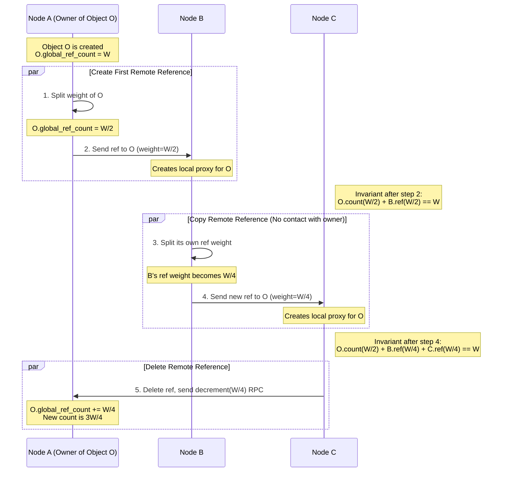

# High-Level Design: Distributed Garbage Collection

## 1. Document Information

- **Document Title**: Distributed Garbage Collection - High-Level Design
- **Version**: 1.0
- **Date**: 2025-08-30
- **Author**: Jules (AI Agent)
- **Status**: Draft

---

## 2. Executive Summary

### 2.1 Purpose
This document provides a high-level design for a Distributed Garbage Collection (DGC) system. The goal of DGC is to automatically identify and reclaim memory for objects that are no longer referenced by any node in a distributed system. This is crucial for long-running distributed applications, such as object-oriented databases, distributed virtual machines, and large-scale simulations, to prevent memory leaks. This design will focus on a common approach: distributed reference counting.

### 2.2 Scope

**In Scope:**
-   A system of "spaces" (or nodes/processes) that can hold objects.
-   Objects that can hold references to other objects, both locally and remotely.
-   A mechanism for tracking references that cross process boundaries.
-   A protocol for nodes to coordinate to determine when an object is no longer reachable globally.
-   The design will focus on a reference counting approach, a popular choice for DGC.

**Out of Scope:**
-   The specific application or programming language runtime that this DGC is integrated with.
-   Local garbage collection within a single node (we assume each node has its own local GC, e.g., a standard mark-and-sweep or generational GC). DGC is only concerned with inter-process references.
-   Handling network partitions and node failures (these significantly complicate DGC and will be discussed as an extension).
-   Detecting and collecting distributed cycles of garbage (a known weakness of simple reference counting).

### 2.3 High-Level Architecture Overview
The architecture is based on augmenting a local garbage collector with mechanisms to handle remote references. Each **Node** (or process) in the distributed system manages its own set of objects. When a node `A` creates a reference to an object on node `B`, it notifies `B`. Node `B` maintains a **reference count** for each of its objects that has remote references. When a remote reference is dropped, the original node `A` notifies `B` to decrement the count. When an object's local *and* remote reference counts drop to zero, it can be safely collected. This requires a reliable communication layer and a protocol to ensure reference count updates are not lost.

---

## 3. System Overview

### 3.1 Business Context
In complex distributed systems, manual memory management is extremely difficult and error-prone. A developer cannot easily know if an object on one server is still needed by another server. Distributed Garbage Collection automates this process, improving developer productivity and system stability by preventing distributed memory leaks, which can silently degrade performance and eventually crash a system.

### 3.2 System Purpose
To automatically and safely reclaim memory of objects in a distributed system that are no longer accessible from any "root" object (e.g., a global variable or an active thread's stack) anywhere in the system.

### 3.3 Success Criteria
-   **Safety**: The collector must never reclaim a live object (an object that is still reachable).
-   **Liveness**: The collector must eventually reclaim all garbage objects (objects that are unreachable). Note: Simple reference counting fails this for cyclic garbage.
-   **Scalability**: The overhead of the DGC protocol should be manageable as the number of nodes and objects grows.
-   **Low Overhead**: The DGC mechanism should impose minimal performance penalty on normal program execution (e.g., object creation and method invocation).

### 3.4 Assumptions
-   The underlying network is reliable and ordered (or we use a protocol like TCP that provides this).
-   Nodes do not fail, and the network does not partition. (This is a simplifying assumption for the core design).
-   Each node can identify its local "root" objects.
-   Each object has a globally unique ID.

### 3.5 Constraints
-   **Communication Latency**: The time it takes for reference count updates to travel between nodes is a fundamental challenge. An object might be deleted locally before a remote node's reference to it has been registered, or vice versa.
-   **Concurrency**: Multiple nodes may attempt to create and delete references to the same object concurrently, requiring careful synchronization.
-   **Cyclic Structures**: A simple reference counting scheme cannot collect distributed cycles of garbage (e.g., object `A` on node 1 points to object `B` on node 2, and `B` points back to `A`, but nothing else points to them).
-   **No Global State**: It is impractical to "stop the world" across an entire distributed system to perform garbage collection, so the algorithm must run concurrently with the application.

---

## 4. Requirements Analysis

### 4.1 Functional Requirements
-   **FR-001 (Remote Reference Tracking)**: When a node `A` creates a reference to an object `O` on node `B`, the system must record this remote reference.
-   **FR-002 (Reference Deletion Tracking)**: When node `A` drops its reference to object `O` on node `B`, the system must ensure this is communicated to `B`.
-   **FR-003 (Garbage Identification)**: An object must be identified as garbage if and only if it is not reachable from any root in any node of the system.
-   **FR-004 (Garbage Reclamation)**: Identified garbage objects must be reclaimed by their local node's memory manager.
-   **FR-005 (Object Location)**: The system needs a way to locate an object given its unique ID, which may involve querying a location service or using structured object IDs.

### 4.2 Non-Functional Requirements
-   **Correctness (Safety)**: No live objects should be collected. This is the most critical requirement.
-   **Efficiency**: The DGC should not introduce significant latency to normal operations. The volume of DGC-related network traffic should be minimized.
-   **Scalability**: The algorithm should scale to a large number of nodes without relying on global synchronization.
-   **Concurrency**: The DGC must operate concurrently with the application, without requiring it to halt.
-   **Fault Tolerance (Advanced)**: The system should eventually be able to handle node crashes and network partitions without compromising safety.

---

### 5. Core Architecture

This design uses a **Weighted Reference Counting** algorithm. This is a well-known DGC technique that avoids the heavy network traffic associated with simple reference counting for creating and deleting references.

- **Object:** An entity in the system. Each object has a `global_ref_count` (an integer weight) in addition to its local reference count.
- **Node (or Space):** A process that hosts objects. Each node has its own local garbage collector.
- **Remote Reference:** A reference from an object on one node to an object on another. A remote reference is represented by a local **proxy object** (or "stub") and has a `weight` associated with it.
- **Total Weight:** A large, constant integer, `W` (e.g., 2^16).

**Core Invariant:** For any given object, the value of its `global_ref_count` plus the sum of the `weight`s of all remote references pointing to it must always equal `W`.
`object.global_ref_count + sum(all incoming remote_ref.weight) == W`

**Protocol Rules:**
1.  **Object Creation:** When an object is created and is first made available for remote access, its `global_ref_count` is initialized to `W`. Its remote reference count is 0.
2.  **Creating a Remote Reference:**
    -   Node `A` wants to give a reference to its object `O_A` to Node `B`.
    -   `O_A`'s `global_ref_count` is split in half. Half remains with `O_A`, and the other half becomes the `weight` of the new remote reference sent to `B`.
    -   `O_A.global_ref_count` becomes `W/2`.
    -   Node `B` receives a reference to `O_A` with `weight = W/2`. `B` creates a local proxy for `O_A` to manage this.
3.  **Copying a Remote Reference:**
    -   Now, Node `B` wants to give its reference to `O_A` to Node `C`.
    -   `B` splits its reference's weight (`W/2`) in half. It keeps `W/4` for its own reference and sends a new reference to `C` with `weight = W/4`.
    -   The invariant is maintained: `O_A.global_ref_count (W/2) + B_ref.weight (W/4) + C_ref.weight (W/4) == W`.
    -   **This requires no communication with the original node `A`**, which is the primary advantage of this algorithm.
4.  **Deleting a Remote Reference:**
    -   When Node `C` no longer needs its reference to `O_A`, it sends a "decrement" message to the home node `A` with the weight of its reference (`W/4`).
    -   Node `A` adds this weight back to `O_A.global_ref_count`.
    -   `O_A.global_ref_count` is now `W/2 + W/4 = 3W/4`.
5.  **Garbage Collection:** An object can be collected by its local GC if its local reference count is 0. It can be collected by the distributed GC if its `global_ref_count` becomes equal to `W`. This means there are no outstanding remote references to it.

### 6. Data Schema and Models

- **Object Table (on each node):**
  - `object_id` (globally unique)
  - `local_ref_count` (integer)
  - `global_ref_count` (integer, a.k.a. its weight)
  - `data` (bytes)
- **Remote Reference / Proxy Table (on each node):**
  - `object_id` (ID of the remote object)
  - `home_node_address` (address of the node that owns the object)
  - `weight` (integer)
  - `local_proxy_object` (the local object that represents the remote one)

### 7. API Design

This "API" consists of the internal RPCs used by the DGC protocol.

- **`create_reference(target_obj_id, weight) -> new_ref`:**
  - Called by a node on itself when it needs to create a new remote reference to an object it holds a reference to. It splits its own weight and returns a new reference object.

- **`decrement_weight(target_obj_id, weight_to_add_back)`:**
  - RPC from a node that is deleting a reference to the home node of the object.

- **Indirection for Low Weights:**
  - When a reference's weight becomes 1, it cannot be split further. To copy it, the node must ask the home node for a new reference with a large weight, creating an "indirection" reference in its place. This adds complexity but is necessary.

### 8. Scalability and Performance

- **Reduced Network Traffic:** Creating and copying references does not require immediate communication with the home node, which significantly reduces latency and network overhead compared to simple DGC.
- **Message Overhead:** Deleting references still requires an RPC.
- **Scalability:** The protocol is decentralized and scales well, as most operations are local. There is no central coordinator.

### 9. Reliability and Fault Tolerance

- **Message Loss:** The protocol relies on a reliable transport layer (like TCP) to ensure `decrement_weight` messages are not lost. If a message is lost, the weight is never returned to the object, and it will never be collected (a memory leak). This is a "safe" failure but violates liveness.
- **Node Failure:** This is the hardest problem. If a node holding a reference fails, it cannot send the `decrement_weight` message. The object's weight will never be returned.
  - **Mitigation (Advanced):** Requires a higher-level protocol. For example, nodes can be monitored by a failure detector. When a node is declared dead, a recovery protocol can attempt to account for the weights held by that node, but this is extremely complex and often imperfect.

### 10. Security Considerations

- **Malicious Nodes:** A malicious node could refuse to send `decrement_weight` messages, causing memory leaks. It could also misuse the protocol to create invalid weights.
- **Mitigation:** The DGC protocol must run in a trusted environment. There is no simple way to make it secure against malicious internal nodes.

### 11. Monitoring and Observability

- **DGC Metrics (per node):**
  - Number of remote reference creations/deletions.
  - Volume of `decrement_weight` RPC traffic.
  - Number of objects with outstanding remote references.
- **Global Health:** It is very difficult to observe the global state. One could track the total number of objects over time to look for trends that might indicate a widespread memory leak.

### 12. Deployment and Operations

- **Integration:** DGC is not a standalone service but a library or a feature deeply integrated into a distributed programming language runtime or object database.
- **Tuning:** The initial total weight `W` is a key tuning parameter. It must be large enough to allow for many subdivisions.

### 13. Cost Estimation

- **Overhead:** The primary cost is the performance overhead on the application.
  - **Memory:** Storing proxy objects, weight tables, etc.
  - **CPU:** The logic for splitting and managing weights.
  - **Network:** The traffic for deleting references.

### 14. Risks and Mitigations

- **Distributed Cycles:**
  - **Risk:** The reference counting scheme cannot detect and collect garbage that forms a cycle across multiple nodes.
  - **Mitigation:** This is the fundamental weakness of reference counting. It must be augmented with a separate, less frequent cycle detector, often based on a distributed mark-and-sweep algorithm. This backup collector is complex and expensive to run.
- **Lost Decrement Messages:**
  - **Risk:** A network failure causes a `decrement_weight` message to be lost, leading to a memory leak.
  - **Mitigation:** Use a reliable, acknowledged messaging protocol. Implement application-level acknowledgements for weight updates.
- **Complexity:**
  - **Risk:** The protocol logic, especially with indirections and failure handling, is extremely complex and easy to get wrong.
  - **Mitigation:** Rigorous formal verification and extensive testing are required.

### 15. Final Considerations

Distributed Garbage Collection is one of the most challenging problems in distributed systems. Weighted Reference Counting offers an elegant solution that avoids many of the performance pitfalls of simpler schemes. However, it is not a complete solution. Its inability to handle cycles and its fragility in the face of node failures mean that in practice, it must be combined with other, more robust (and more expensive) backup mechanisms. The choice of a DGC algorithm is a trade-off between performance, complexity, and completeness.
