# High-Level Design: Distributed Hash Table (DHT)

## 1. Document Information

- **Document Title**: Distributed Hash Table (DHT) - High-Level Design
- **Version**: 1.0
- **Date**: 2025-08-30
- **Author**: Jules (AI Agent)
- **Status**: Draft

---

## 2. Executive Summary

### 2.1 Purpose
This document outlines the high-level design for a Distributed Hash Table (DHT), a decentralized, peer-to-peer (P2P) key-value storage system. The design is based on the principles of the Chord protocol, providing a method to map keys to a dynamic set of participating nodes (peers) and efficiently look up the node responsible for a given key. The system is designed for massive scalability and resilience to node churn (nodes frequently joining and leaving).

### 2.2 Scope

**In Scope:**
-   A peer-to-peer overlay network where each node has a small amount of routing information.
-   Consistent hashing to map keys and nodes to a shared identifier space.
-   A "finger table" or similar routing table on each node to enable efficient key lookups.
-   Logic for nodes joining and leaving the network, including the transfer of key-value pairs.
-   A stabilization protocol to keep routing tables up-to-date as the network changes.
-   A basic GET/PUT API for key-value data.

**Out of Scope:**
-   The underlying network transport (assumed to be TCP/IP).
-   A specific application using the DHT (e.g., a file-sharing system like BitTorrent).
-   Advanced security features to prevent malicious nodes from disrupting the network.
-   Complex queries beyond simple key lookups.
-   Replication of data for higher durability (though the design can be extended to include this).

### 2.3 High-Level Architecture Overview
The system is a pure peer-to-peer network with no central server. Using **consistent hashing**, both nodes and data keys are mapped to points on a logical **identifier ring** (e.g., using SHA-1 to produce a 160-bit ID). A key is stored at its **successor** node, which is the first node encountered when moving clockwise around the ring from the key's position. To perform lookups efficiently without knowing all other nodes, each node maintains a small routing table called a **finger table**. This table contains the addresses of a few other nodes at exponentially increasing distances around the ring. When a node needs to find the successor for a key, it queries the node in its finger table that is closest to the key, which in turn does the same. This results in a lookup process that takes O(log N) hops, where N is the number of nodes in the system.

---

## 3. System Overview

### 3.1 Business Context
Decentralized systems are becoming increasingly important for applications that require extreme scalability, censorship resistance, and resilience without relying on a central, trusted authority. DHTs form the foundational routing and storage layer for many well-known P2P systems, including BitTorrent's trackerless mode, the InterPlanetary File System (IPFS), and some cryptocurrencies.

### 3.2 System Purpose
To provide a scalable, self-organizing, and fault-tolerant mechanism for storing and retrieving key-value pairs in a fully decentralized network. The primary goal is to ensure that any node in the network can efficiently find the value associated with any key.

### 3.3 Success Criteria
-   **Lookup Efficiency**: Key lookups must complete in a small number of hops, scaling logarithmically with the number of nodes (O(log N)).
-   **Scalability**: The system must be able to scale to millions of participating nodes.
-   **Self-Healing**: The network must automatically correct its routing tables and re-distribute data when nodes join or leave gracefully/unexpectedly.
-   **Correctness**: A lookup for a key must always resolve to the same responsible node, assuming the network is in a stable state.
-   **Decentralization**: No single node should be critical for the operation of the network.

### 3.4 Assumptions
-   Nodes can communicate with each other over the internet.
-   Nodes are ephemeral and may join and leave frequently (high churn).
-   There is a mechanism for a new node to "bootstrap" into the network by knowing the address of at least one existing node.
-   The number of keys is much larger than the number of nodes.

### 3.5 Constraints
-   **Eventual Consistency**: Due to the nature of node churn, routing tables may be temporarily inconsistent. Lookups might fail or be slow during periods of high churn until the network stabilizes.
-   **Lookup Latency**: While the number of hops is low, the geographic latency between hops can be high, leading to slower lookups compared to a centralized system.
-   **Security**: The basic DHT design is vulnerable to various attacks (e.g., Sybil attacks, routing poisoning) if not augmented with security mechanisms.
-   **No Ordering or Range Queries**: The hash-based key distribution means there is no concept of key ordering, making range queries impossible.

---

## 4. Requirements Analysis

### 4.1 Functional Requirements
-   **FR-001 (Node Join)**: A new node must be able to join the DHT network, initialize its routing table, and accept responsibility for a range of keys.
-   **FR-002 (Node Leave)**: A node must be able to gracefully leave the network, transferring its keys to its successor node.
-   **FR-003 (Data Storage - PUT)**: A client must be able to store a key-value pair in the DHT. The request should be routed to the correct node responsible for that key.
-   **FR-004 (Data Retrieval - GET)**: A client must be able to retrieve the value for a given key from the DHT.
-   **FR-005 (Key Lookup)**: Any node must be able to find the successor node responsible for any given key ID.
-   **FR-006 (Routing Maintenance)**: Each node must periodically run a stabilization protocol to update its routing information (successor, predecessor, and finger table) to reflect the current state of the network.
-   **FR-007 (Failure Handling)**: The network must be able to recover from the unexpected failure of a node (e.g., a crash).

### 4.2 Non-Functional Requirements
-   **Scalability**: The per-node state (routing table size) and lookup path length must scale logarithmically with the total number of nodes.
-   **Resilience**: The network should remain connected and functional despite continuous node churn.
-   **Decentralization**: No single point of failure.
-   **Load Balancing**: Keys should be distributed roughly evenly among all participating nodes.
-   **Simplicity**: The rules for routing and stabilization should be simple and implementable on each node.

---

### 5. Core Architecture

The design is based on the Chord protocol, a classic DHT algorithm.

- **Identifier Ring:** A logical ring representing the entire hash space (e.g., 0 to 2^160 - 1). Both nodes and keys are hashed onto this ring.
- **Node:** A peer in the P2P network. Each node has:
  - A unique Node ID, determined by hashing its IP address or a public key.
  - A simple key-value store for the data it manages.
  - A **Successor** pointer: The address of the next node on the ring.
  - A **Predecessor** pointer: The address of the previous node on the ring.
  - A **Finger Table:** A routing table with up to `m` entries, where `m` is the number of bits in the hash ID (e.g., 160). The `i`-th entry in the table for node `n` stores the address of the first node that succeeds `(n + 2^(i-1)) mod 2^m`. This structure allows jumps of exponentially increasing size around the ring.
- **Successor Rule:** A key `k` is stored on the node whose ID is the immediate successor of `k`'s ID on the ring. This node is denoted `successor(k)`.

**Lookup (`find_successor(id)`) Workflow:**
The core operation of the DHT. To find the node responsible for `id`:
1.  The querying node first checks if `id` falls between its own ID and its successor's ID. If so, its successor is the answer.
2.  Otherwise, the node searches its finger table for the node `n` whose ID most closely precedes `id`.
3.  It then makes an RPC call to that node `n`, asking it to perform the same `find_successor(id)` lookup.
4.  This process repeats, with each hop getting logarithmically closer to the target, until the successor is found. The path length is O(log N).

**Node Join Workflow:**
1.  A new node `n` bootstraps by contacting any existing node `n'`.
2.  `n` asks `n'` to find `successor(n)`.
3.  `n` sets its successor pointer to `successor(n)`.
4.  `n` notifies its successor that it is now its predecessor.
5.  The new node `n` then inherits all keys from its successor that now belong to `n`.
6.  `n` initializes its finger table and runs the stabilization protocol in the background.

**Stabilization Protocol:**
A background process run periodically by every node to keep the network consistent.
-   It verifies the node's immediate successor and predecessor pointers.
-   It updates entries in its finger table.
-   It handles the failure of its successor by connecting to the next-best successor from its finger table.

```mermaid
graph TD
    subgraph "Identifier Ring (m=6, space=0-63)"
        N8["Node 8"]
        N14["Node 14"]
        N21["Node 21"]
        N32["Node 32"]
        N38["Node 38"]
        N42["Node 42"]
        N48["Node 48"]
        N56["Node 56"]

        N8 -- successor --> N14
        N14 -- successor --> N21
        N21 -- successor --> N32
        N32 -- successor --> N38
        N38 -- successor --> N42
        N42 -- successor --> N48
        N48 -- successor --> N56
        N56 -- successor --> N8
    end

    subgraph "Lookup from Node 8 for Key 54"
        Start["Start: Node 8 wants to find owner of Key 54"]
        Hop1["Hop 1: Use finger table, jump to Node 42"]
        Hop2["Hop 2: Node 42 finds successor"]
        Result["Result: Node 56 is responsible for Key 54"]

        Start --> Hop1 --> Hop2 --> Result
    end

    %% Define the lookup path on the ring diagram
    N8 -- "1. find_successor(54)" --> N8
    N8 -- "2. Check finger table, find closest predecessor is n+32 -> Node 42" --> N42
    N42 -- "3. Check my successor (N48). 54 is not between 42 and 48." --> N42
    N42 -- "4. Check my successor's successor (N56). 54 is between 48 and 56. Successor is N56." --> N56
```

### 6. Data Schema and Models

- **Key-Value Store:** Each node maintains a simple hash map on disk or in memory: `map<hash_id, value_bytes>`.
- **Finger Table Entry:** A struct containing `{ start_id, node_address }`.
- **Node State:** Each node stores its `id`, `successor`, `predecessor`, and `finger_table`.

### 7. API Design

The API is based on RPC calls between nodes.

- **`PUT(key, value)`:**
  1.  The receiving node hashes the `key` to get `key_id`.
  2.  It calls `find_successor(key_id)` to find the responsible node `n`.
  3.  It then makes an RPC call `n.store(key_id, value)` to that node.

- **`GET(key) -> value`:**
  1.  The receiving node hashes the `key` to get `key_id`.
  2.  It calls `find_successor(key_id)` to find the responsible node `n`.
  3.  It then makes an RPC call `n.retrieve(key_id)` to get the value.

- **Internal RPCs:**
  - `find_successor(id) -> node_address`
  - `get_predecessor() -> node_address`
  - `notify(node)` (Used by a node to tell its successor that it might be its new predecessor).

### 8. Scalability and Performance

- **Logarithmic Scaling:** The O(log N) scaling of lookups and the O(log N) size of the finger tables are the key to massive scalability. Each node only needs to know about a tiny fraction of the network.
- **Load Balancing:** Consistent hashing ensures that keys are, on average, spread evenly across the participating nodes. If a node leaves or joins, only a small fraction of keys (`K/N`) needs to be moved.
- **Performance:** Lookup performance is dominated by network latency between peers. It is not a low-latency system in the traditional sense but is efficient in the number of hops.

### 9. Reliability and Fault Tolerance

- **Self-Healing:** The stabilization protocol is the core of the system's fault tolerance. When a node fails, other nodes' pointers to it will fail. Their stabilization protocols will eventually time out and find a new, correct successor, routing around the failed node.
- **Data Loss:** In this basic design, if a node fails, the keys it stores become unavailable.
  - **Mitigation (Extension):** To prevent data loss, data must be replicated. A common strategy is to store a key not only on its successor but also on the next `r` successors on the ring. When a node fails, its data can be recovered from its replicas.

### 10. Security Considerations

- **Sybil Attack:** An attacker can create a large number of fake nodes to gain control over a significant fraction of the ID space, allowing them to intercept or block traffic.
- **Routing Poisoning:** A malicious node can intentionally return incorrect addresses in its finger table, disrupting lookups.
- **Mitigations:** These are active areas of research. Solutions often involve requiring nodes to solve puzzles (proof of work) to join, building trust metrics, or using redundant routing paths.

### 11. Monitoring and Observability

- **Decentralized Nature:** Monitoring a DHT is challenging. There is no central point to collect logs or metrics.
- **Approach:** Monitoring is typically done from the outside by a set of probe nodes. These probes can perform random GET/PUT operations and measure success rates and lookup latency to gauge the overall health of the network. Each node can also maintain local stats on its uptime and routing table consistency.

### 12. Deployment and Operations

- **Bootstrap Node:** A new node needs to know the address of at least one "bootstrap node" that is likely to be online. This can be a hardcoded list of well-known peers.
- **No Central Operations:** The system is designed to run without manual intervention.

### 13. Cost Estimation

- **No Central Cost:** The cost is distributed among all participants. Each participant pays for their own bandwidth and compute.
- **Application Dependent:** The cost is highly dependent on the application built on top of the DHT (e.g., the amount of data stored and transferred in a file-sharing application).

### 14. Risks and Mitigations

- **Network Churn:**
  - **Risk:** In a network with very high churn (many nodes joining/leaving per second), the stabilization protocol may not be able to keep up, leading to a high rate of failed lookups.
  - **Mitigation:** Make the stabilization protocol more aggressive (run more frequently), but this increases overhead traffic. Implement client-side retries for lookups.
- **Network Partitions:**
  - **Risk:** A major network partition could split the DHT ring into two or more disconnected segments.
  - **Mitigation:** The DHT itself cannot solve this. It relies on the underlying IP network being connected. Nodes within each partition would continue to function as smaller, independent DHTs.

### 15. Final Considerations

The Distributed Hash Table is a powerful primitive for building fully decentralized applications. Its elegance lies in providing a deterministic way to find data in a constantly changing network with minimal per-node state. The design prioritizes scalability and resilience over consistency and low latency. While the basic Chord protocol is simple, building a production-ready, secure, and highly available system requires significant extensions, particularly for data replication and security against malicious peers.
