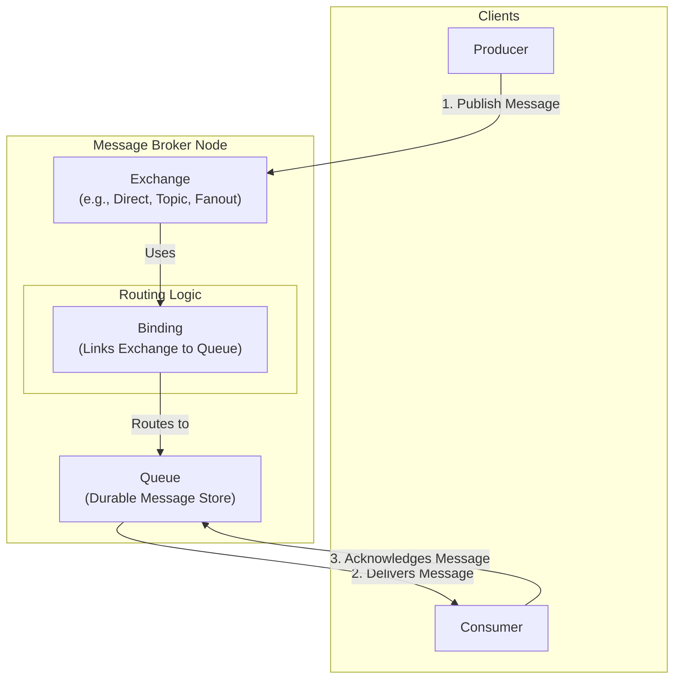

# High-Level Design: Distributed Messaging Queue

## 1. Document Information

- **Document Title**: Distributed Messaging Queue - High-Level Design
- **Version**: 1.0
- **Date**: 2025-08-30
- **Author**: Jules (AI Agent)
- **Status**: Draft

---

## 2. Executive Summary

### 2.1 Purpose
This document outlines the high-level design for a Distributed Messaging Queue system, architecturally similar to AMQP-based brokers like RabbitMQ. The system is designed to provide reliable, asynchronous communication between microservices. It focuses on flexible message routing, delivery guarantees, and message durability, catering to a wide variety of messaging patterns like work queues, pub/sub, and RPC.

### 2.2 Scope

**In Scope:**
-   A "smart broker" that handles message routing, queueing, and delivery.
-   The core components: Exchanges, Queues, and Bindings.
-   Support for multiple exchange types (Direct, Fanout, Topic) for flexible routing logic.
-   Message durability (persisting messages to disk).
-   Consumer acknowledgements (at-least-once delivery).
-   A cluster of brokers for high availability and scalability.

**Out of Scope:**
-   The client-side producer and consumer libraries (we design the protocol they implement, e.g., AMQP).
-   Advanced features like consumer priorities, message TTL (Time-To-Live), and dead-letter exchanges.
-   Federation or plugins for connecting to other systems.
-   The specific consensus mechanism for managing cluster state (we will assume one exists).

### 2.3 High-Level Architecture Overview
The system follows the Advanced Message Queuing Protocol (AMQP) model. **Producers** do not send messages directly to queues. Instead, they send messages to an **Exchange**. An exchange is responsible for routing the messages to different **Queues** based on rules called **Bindings** and the exchange type. **Consumers** subscribe to and receive messages from queues. The core components (exchanges, queues, messages) are managed by a cluster of **Broker** nodes. For high availability, queues can be mirrored across multiple brokers, ensuring that if one broker fails, the messages are not lost and another broker can continue serving consumers.

---

## 3. System Overview

### 3.1 Business Context
In a microservices architecture, services need a reliable way to communicate asynchronously. A message queue decouples services, so if a recipient service is down or slow, the sender can still publish its message and move on. This improves the overall resilience and scalability of the application. It enables patterns like background job processing, event-driven notifications, and reliable data replication.

### 3.2 System Purpose
To provide a robust and flexible messaging backbone for distributed systems. Unlike a simple log (like Kafka), this system provides more complex routing capabilities and per-message delivery tracking, making it ideal for task distribution and traditional message-oriented middleware workloads.

### 3.3 Success Criteria
-   **Reliability**: Acknowledged messages should never be lost, even if a broker restarts.
-   **Flexibility**: The system must support various messaging patterns through different exchange types.
-   **High Availability**: The failure of a single broker node should not lead to service unavailability for mirrored queues.
-   **Scalability**: The system should be able to scale horizontally to handle higher message volume and more queues/consumers.
-   **Correct Routing**: Messages must always be routed to the correct queues according to the exchange and binding rules.

### 3.4 Assumptions
-   The number of queues and exchanges is high, but not infinite.
-   Message order is guaranteed within a single queue for a single consumer, but not globally across all consumers of a queue.
-   Clients will implement a reconnection and retry logic in case of broker failure.

### 3.5 Constraints
-   **Smart Broker, Dumb Client**: Most of the logic (routing, queueing) resides on the broker. This makes the client simpler but can make the broker a performance bottleneck.
-   **State Management**: The broker is highly stateful, tracking queues, bindings, and individual message states (e.g., "delivered but not yet acknowledged"). This makes clustering and replication complex.
-   **Performance Trade-offs**: Providing per-message persistence and acknowledgements has a higher performance overhead than the simple log-append model of an event streaming platform.
-   **Message Size**: The system is optimized for relatively small messages (kilobytes). Large messages can degrade performance.

---

## 4. Requirements Analysis

### 4.1 Functional Requirements
-   **FR-001 (Publishing)**: Producers must be able to publish a message to a specific exchange with a routing key.
-   **FR-002 (Queue Declaration)**: Consumers must be able to declare a queue, specifying properties like durability.
-   **FR-003 (Exchange Declaration)**: Clients must be able to declare an exchange, specifying its type (Direct, Fanout, Topic).
-   **FR-004 (Binding)**: Clients must be able to create a binding between an exchange and a queue, with an optional binding key.
-   **FR-005 (Message Consumption)**: Consumers must be able to subscribe to a queue and receive messages.
-   **FR-006 (Consumer Acknowledgement)**: Consumers must be able to acknowledge the successful processing of a message (or negatively acknowledge it). The broker will not delete the message from the queue until it is positively acknowledged.
-   **FR-007 (Message Persistence)**: Producers must be able to mark messages as "persistent". The broker must write these messages to disk.
-   **FR-008 (Queue Mirroring)**: Queues must be configurable to be mirrored across multiple brokers in the cluster for high availability.

### 4.2 Non-Functional Requirements
-   **Durability**: Persistent messages acknowledged by the broker must survive a broker restart.
-   **High Availability**: For mirrored queues, if the master broker for the queue fails, one of the mirrors should be promoted to master automatically with minimal service interruption.
-   **Scalability**: The system must be able to distribute queues across multiple brokers to scale throughput.
-   **Data Consistency**: The state of mirrored queues must be kept consistent across replicas.
-   **Fair Dispatch**: The broker should distribute messages from a work queue fairly among multiple consumers.
-   **Security**: The system must support authentication and authorization (e.g., which users can access which queues).

---

### 5. Core Architecture

The architecture is centered around a cluster of brokers that manage the core messaging entities.

- **Broker:** A node in the cluster. It hosts exchanges, queues, and manages their state.
- **Exchange:** Receives messages from producers and routes them. It's a routing table.
  - **Direct Exchange:** Routes a message to the queue whose binding key exactly matches the message's routing key.
  - **Fanout Exchange:** Routes a message to all queues bound to it, ignoring the routing key. Ideal for broadcast/pub-sub.
  - **Topic Exchange:** Routes a message to queues based on a wildcard match between the routing key and the binding key (e.g., a binding of `stocks.*` would match a routing key of `stocks.nyse`).
- **Queue:** A persistent, ordered buffer that stores messages. A queue is hosted on a single "master" broker but can be mirrored to other "slave" brokers.
- **Binding:** A rule that links an exchange to a queue.
- **Cluster Manager:** A component, often using a distributed consensus protocol like Raft or Paxos (or leveraging an external one like ZooKeeper/etcd), that manages cluster membership, schema (definitions of exchanges, queues), and queue mastership.
- **Replication Protocol:** For mirrored queues, a protocol is used to replicate messages from the master queue to its slaves. The master sends a message to consumers and, in parallel, forwards it to its slaves. A message is only deleted from the master's log after it has been acknowledged by the consumer *and* replicated to the slaves.

**Message Flow:**
1.  A Producer establishes a connection to a broker and publishes a message to an Exchange with a routing key.
2.  The Exchange looks up its bindings.
3.  Based on the exchange type and the binding/routing keys, it determines the target queue(s).
4.  The message is appended to the target queue(s). If the queue is durable and the message is persistent, it's written to a persistent log.
5.  A Consumer subscribed to the queue receives the message from the queue's master broker.
6.  The broker marks the message as "unacknowledged".
7.  The Consumer processes the message and sends an acknowledgement (`ack`) back to the broker.
8.  Upon receiving the `ack`, the broker permanently deletes the message from the queue.

### 6. Data Schema and Models

- **Message Schema:**
  - **Headers:** A set of key-value metadata (e.g., `content-type`, `timestamp`).
  - **Properties:** Standard properties like `delivery-mode` (persistent or transient), `priority`.
  - **Payload:** The actual message body (binary data).
- **Queue Storage:**
  - **Message Store:** An append-only log file on disk where persistent messages are stored.
  - **In-Memory Index:** An index held in memory that maps message IDs to their location in the message store and tracks their state (ready, unacknowledged). This index is periodically snapshotted to disk.
- **Cluster Metadata Store:** The Cluster Manager stores the definitions of all exchanges, queues, bindings, and which broker is the master for each queue. This must be a strongly consistent store.

### 7. API Design

The API is defined by a protocol like AMQP.

- **Connection Commands:** `connection.start`, `connection.tune`, `connection.open`, `connection.close`.
- **Channel Commands:** `channel.open`, `channel.close`. (Channels are lightweight multiplexed connections).
- **Exchange Commands:** `exchange.declare`, `exchange.delete`.
- **Queue Commands:** `queue.declare`, `queue.bind`, `queue.unbind`, `queue.delete`.
- **Basic (Message) Commands:**
  - `basic.publish`: Producer publishes a message.
  - `basic.consume`: Consumer starts a subscription.
  - `basic.deliver`: Broker delivers a message to a consumer.
  - `basic.ack`: Consumer acknowledges a message.
  - `basic.nack`: Consumer negatively acknowledges a message (e.g., requeue it).
  - `basic.get`: Consumer fetches a single message.

### 8. Scalability and Performance

- **Distributing Load:** While a single queue's performance is limited by its master broker, overall system throughput is scaled by distributing different queues across different brokers in the cluster.
- **Consumer Parallelism:** A single queue can deliver messages to multiple consumers in a round-robin fashion, allowing for parallel processing of a work queue.
- **Prefetching:** Brokers can send a "prefetch" buffer of multiple messages to a consumer at once to reduce network round-trips and keep the consumer saturated with work.
- **Memory Management:** The broker must carefully manage memory, paging messages out to disk if queues become very long and consumers are slow.

### 9. Reliability and Fault Tolerance

- **Acknowledgements:** `ack`s ensure at-least-once delivery. If a consumer receives a message but crashes before acknowledging it, the broker will redeliver the message to another consumer.
- **Persistence:** Durable queues and persistent messages ensure that data survives a broker restart.
- **Queue Mirroring and Failover:**
  1.  A queue has one master and one or more slaves. All writes go to the master.
  2.  The master replicates all commands (writes, acks) to the slaves.
  3.  The Cluster Manager monitors the health of the master broker.
  4.  If the master fails, the Cluster Manager promotes the most up-to-date slave to be the new master.
  5.  Clients are notified of the new master and automatically reconnect.

### 10. Security Considerations

- **Authentication:** Clients must authenticate with the cluster, typically via SASL (username/password).
- **Authorization:** An ACL system controls user permissions (e.g., configure, write, read) on a per-virtual-host or per-resource basis.
- **Encryption:** Communication should be secured using TLS.
- **Resource Management:** The broker should impose quotas on memory usage or queue length to prevent a single misbehaving client from impacting the entire system.

### 11. Monitoring and Observability

- **Queue Metrics:** Number of messages in a queue (ready and unacknowledged), message rates (incoming, outgoing, acks).
- **Broker Metrics:** Memory usage, disk I/O, file descriptors used.
- **Cluster Metrics:** Cluster partition status, health of individual nodes.

### 12. Deployment and Operations

- **Cluster Formation:** Brokers must be configured with a way to discover each other and the Cluster Manager to form a cluster.
- **Upgrades:** Rolling upgrades are performed one broker at a time.
- **Backup:** The persistent message store and cluster configuration should be periodically backed up.

### 13. Cost Estimation

- **Primary Drivers:**
  - **Memory:** Brokers can be memory-intensive, especially with many queues or long, unconsumed queues.
  - **Disk I/O:** The performance of the message store is critical, requiring fast disks (SSDs).
  - **Compute:** CPU is needed for routing logic and managing client connections.

### 14. Risks and Mitigations

- **"Slow Consumer" Problem:**
  - **Risk:** A consumer is very slow, causing its queue to grow indefinitely, potentially exhausting memory or disk space on the broker.
  - **Mitigation:** Implement message TTLs or queue length limits. Monitor queue depths and alert when they exceed a threshold.
- **Split-Brain in Cluster:**
  - **Risk:** A network partition causes two sets of brokers to think they are the primary for a resource, leading to inconsistent state.
  - **Mitigation:** Use a consensus system (like Raft) that requires a strict quorum (`(N/2)+1`) to make decisions. This prevents split-brain scenarios.
- **Message Ordering Anomalies:**
  - **Risk:** With multiple consumers on one queue, or with redeliveries after a failure, messages may not be processed in the exact order they were sent.
  - **Mitigation:** This is an inherent property of the model. If strict ordering is required, ensure only one consumer is subscribed to the queue. For stricter ordering guarantees, a system like Kafka is more appropriate.

### 15. Final Considerations

This design for a Distributed Messaging Queue emphasizes flexibility and reliability for traditional messaging workloads. Its "smart broker" architecture, with rich routing via exchanges and per-message tracking, provides powerful primitives for building complex, decoupled systems. This comes at the cost of higher per-message overhead compared to a commit log system. The most complex part of the design is the stateful clustering and replication needed to provide high availability for queues, which requires a robust distributed consensus mechanism.
