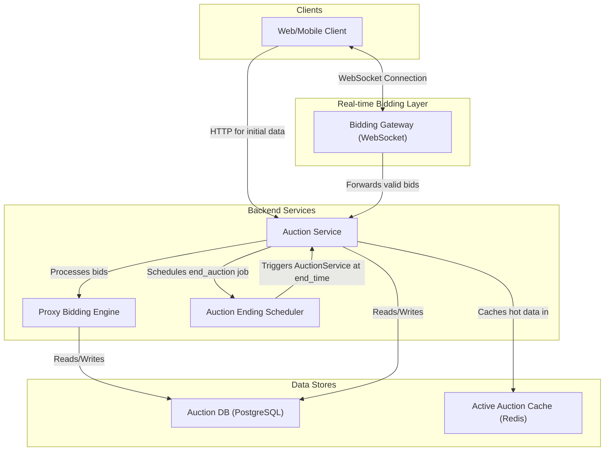
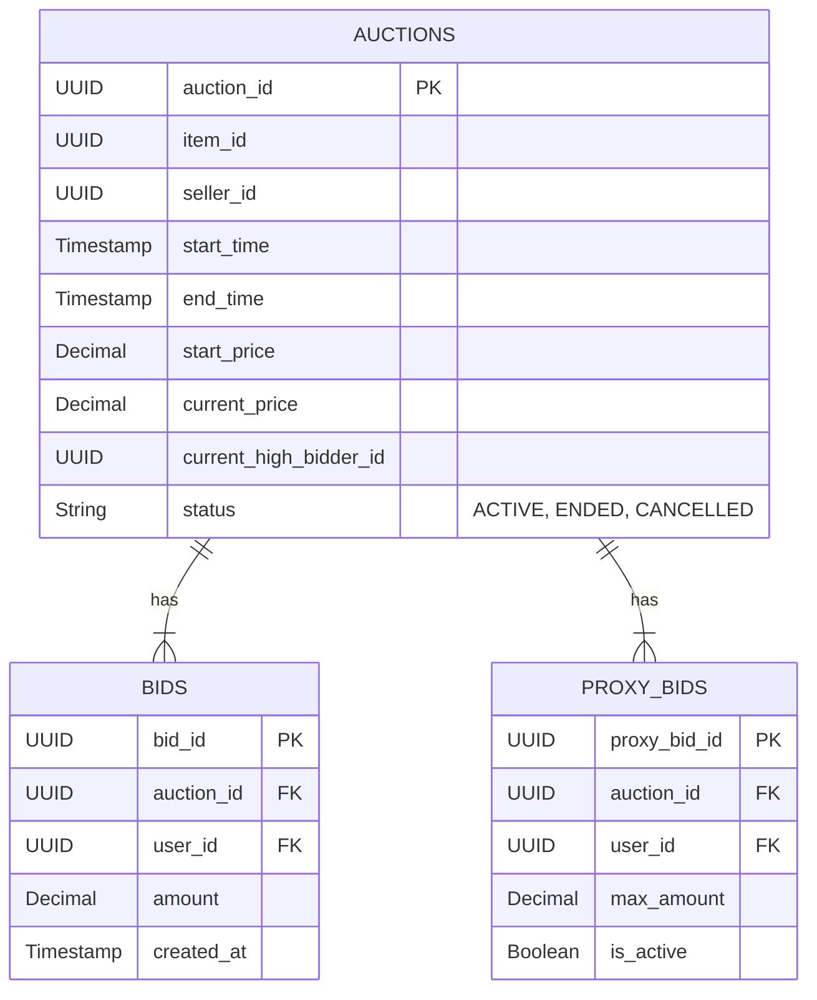
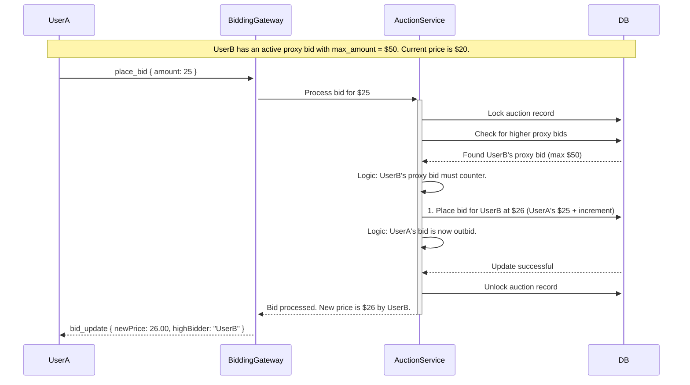

# HLD: Auction System

## 1. Document Information
- **Document Title**: High-Level Design for a Real-Time Auction System
- **Version**: 1.0
- **Date**: 2025-08-31
- **Author**: Jules (AI Agent)
- **Status**: Draft

---

## 2. Executive Summary
This document outlines the high-level design for a real-time Auction System, similar to the core functionality of eBay. The system is designed to manage time-bound bidding on items, handle concurrent bid placements from many users, and reliably determine a winner. The architecture prioritizes low-latency communication for a responsive bidding experience, strong consistency for processing bids, and temporal accuracy for managing auction lifecycles.

---

## 3. Scope

### 3.1 In-Scope
-   **Auction Creation**: Allowing sellers to list items for auction with a start price, duration, and end time.
-   **Live Bidding**: Allowing buyers to place bids on active auctions.
-   **Real-time Updates**: Broadcasting new bids to all participants of an auction in real-time.
-   **Proxy Bidding**: Automatically placing bids for a user up to their specified maximum amount.
-   **Winner Determination**: Identifying and declaring the highest bidder as the winner when the auction concludes.
-   **Notifications**: Notifying the winner and seller after the auction ends.

### 3.2 Out-of-Scope
-   **Payment & Shipping**: This is handed off to the Order Management and Fulfillment services post-auction.
-   **User Reputation System**: A separate service would manage seller and buyer ratings.
-   **Different Auction Types**: This design focuses on standard English auctions. Other types like Dutch or Vickrey auctions are not included.

---

## 4. Core Functional Requirements
-   **FR-001**: A seller must be able to create an auction for an item with a defined end time.
-   **FR-002**: A buyer must be able to place a bid on an active auction.
-   **FR-003**: The system must reject any bid that is not higher than the current winning bid.
-   **FR-004**: All users viewing an auction must receive immediate updates when a new higher bid is placed.
-   **FR-005**: A buyer can place a "max bid" (proxy bid), and the system will automatically bid on their behalf up to that amount.
-   **FR-006**: At the exact end time, the auction must be closed, and the highest bidder declared the winner.

---

## 5. Key Non-Functional Requirements (NFRs)
-   **Latency**: **Very low latency is critical for bidding.** Bid placement and the subsequent broadcast to other clients should have a p99 latency of < 200ms.
-   **Consistency**: **Strong consistency** is required for bid processing to avoid race conditions and ensure there is only one valid high bidder at any time.
-   **Temporal Accuracy**: The system's time must be synchronized and accurate to end auctions fairly and precisely.
-   **Availability**: 99.95% uptime for the bidding and auction services.
-   **Scalability**: Must handle many concurrent auctions and high bidding traffic, especially in the final minutes of popular auctions ("sniping").

---

## 6. High-Level Architecture Diagram

---

## 7. Component Breakdown
-   **Bidding Gateway (WebSocket)**: A stateful service that maintains persistent WebSocket connections with clients. It's responsible for receiving bids and broadcasting real-time price updates to subscribed users.
-   **Auction Service**: The core backend service. It handles the business logic of creating auctions, validating bids, and executing the winner determination logic.
-   **Proxy Bidding Engine**: A component within the Auction Service that manages the logic for proxy bids. When a new bid is placed, this engine checks against existing proxy bids to see if a counter-bid needs to be automatically placed.
-   **Auction Ending Scheduler**: A distributed, time-based scheduler (e.g., built on Quartz, or using Kafka with delayed topics). It is responsible for invoking the Auction Service to end an auction at its precise `end_time`.
-   **Auction DB (PostgreSQL)**: The source of truth for all auction and bid data. A relational database is chosen for its strong transactional capabilities.
-   **Active Auction Cache (Redis)**: Caches details of currently active auctions to reduce database read load.

---

## 8. Technology Stack
-   **Backend Services**: **Java/Kotlin (Spring)** or **Go**.
-   **Real-time Layer**: A WebSocket library like `gorilla/websocket` (Go) or Spring WebFlux.
-   **Database**: **PostgreSQL**.
-   **Cache**: **Redis**.
-   **Scheduler**: A robust library like **Quartz**, or a custom implementation using a message broker.

---

## 9. Data Schema / Data Model

---

## 10. API Endpoints & WebSocket Events
-   `POST /api/v1/auctions`: (HTTP) Create a new auction.
-   `GET /api/v1/auctions/{auctionId}`: (HTTP) Get static details about an auction.
-   `POST /api/v1/auctions/{auctionId}/proxy_bid`: (HTTP) Set or update a user's max proxy bid.

-   **WebSocket Events (Client -> Server)**:
    -   `subscribe_auction { "auctionId": "..." }`
    -   `place_bid { "auctionId": "...", "amount": 120.50 }`

-   **WebSocket Events (Server -> Client)**:
    -   `bid_update { "auctionId": "...", "newPrice": 120.50, "highBidder": "user123" }`
    -   `auction_ended { "auctionId": "...", "finalPrice": 150.00, "winner": "user456" }`
    -   `error { "message": "Bid too low" }`

---

## 11. Core Logic / User Flows (Proxy Bidding)

---

## 12. Scalability and Performance Design
-   **Separation of Concerns**: The WebSocket gateways are separated from the core auction logic, allowing each to be scaled independently.
-   **Database Contention**: For very popular auctions, the corresponding row in the `auctions` table will be a hot spot. Operations must be very fast, using row-level locking. For extreme scale, consider sharding auctions by ID.
-   **Reliable Scheduler**: The scheduler must be horizontally scalable and fault-tolerant to manage millions of auction end times.
-   **Fan-out on Write**: A single bid is written to the DB, but the update is fanned out to many clients via the WebSocket gateway.

---

## 13. Security and Resilience
-   **Security**:
    -   All bid placements must be authenticated.
    -   The system must prevent users from bidding on their own items.
    -   Implement rate limiting to prevent bidding bots from overwhelming the system.
-   **Resilience**:
    -   **Idempotent End-Auction**: The process to end an auction must be idempotent. If a worker fails mid-process, another can safely re-run it.
    -   **Scheduler Reliability**: Use a persistent job store for the scheduler so that jobs are not lost if a scheduler node goes down.
    -   **Transactional Integrity**: All bid processing and state changes must occur within a single database transaction.

---

## 14. Monitoring and Observability
-   **Metrics**:
    -   WebSocket connection count.
    -   Bid processing latency (from receipt to broadcast).
    -   Scheduler job execution lag and failure rate.
    -   Database lock wait times.
-   **Alerting**:
    -   Alert if an auction is not processed within a few seconds of its scheduled end time.
    -   Alert on high bid rejection rates.

---

## 15. Deployment and CI/CD
-   The Bidding Gateway and Auction Service can be deployed independently.
-   Rigorous testing of the proxy bidding logic and the auction-ending process is critical. This includes tests for race conditions and temporal accuracy.
-   A canary deployment strategy can be used to roll out new versions of the bidding logic to a small subset of users first.
