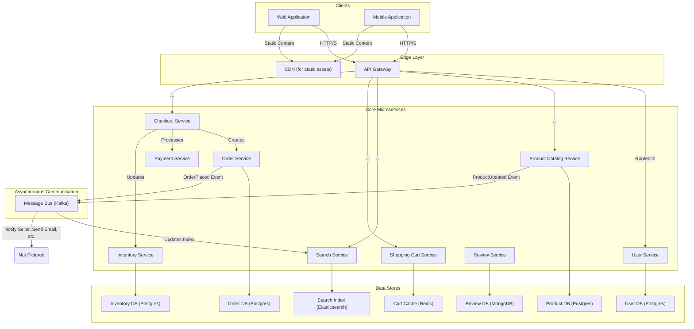
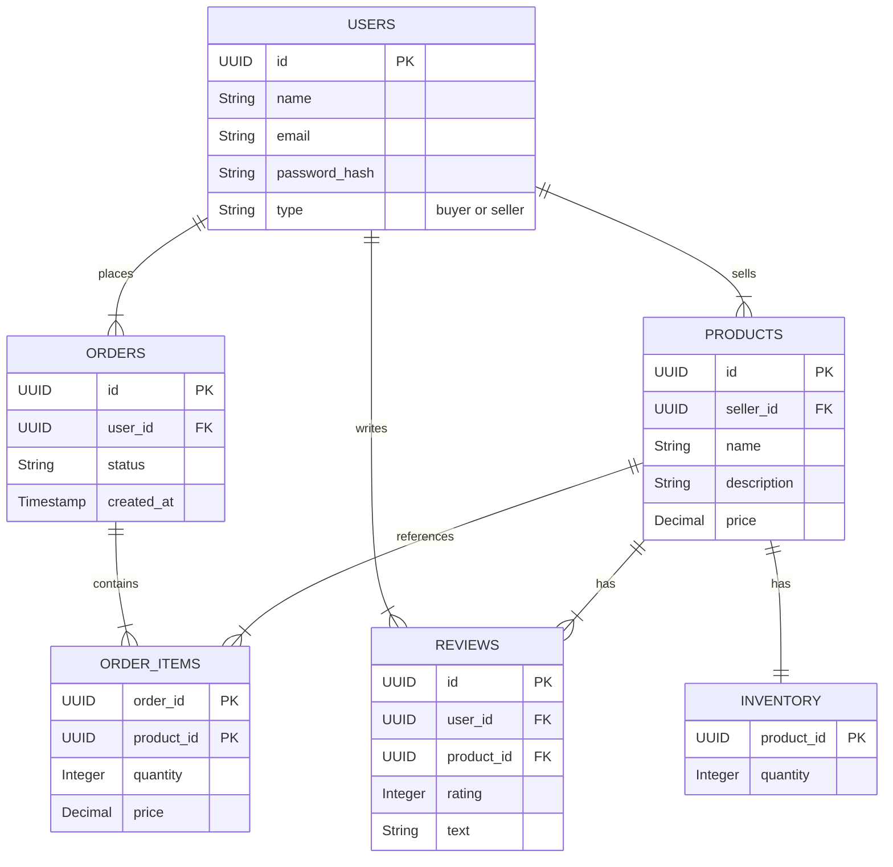
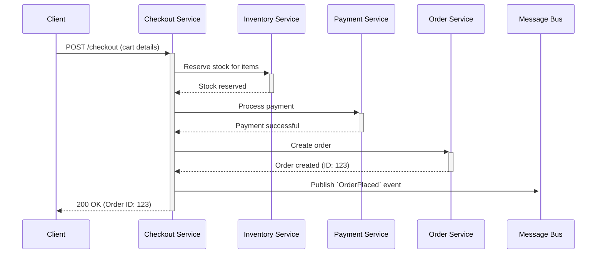

# HLD: E-commerce Platform

## 1. Document Information
- **Document Title**: High-Level Design for a Scalable E-commerce Platform
- **Version**: 1.0
- **Date**: 2025-08-31
- **Author**: Jules (AI Agent)
- **Status**: Draft

---

## 2. Executive Summary
This document outlines the high-level design for a large-scale E-commerce Platform, similar in scope to Amazon or eBay. The platform is designed as a set of distributed, loosely-coupled microservices to support millions of users and products. It provides functionalities for product discovery, purchasing, and order management for buyers, as well as inventory and sales management for sellers. The architecture prioritizes scalability, availability, and resilience to handle high traffic loads and seasonal peaks.

---

## 3. Scope

### 3.1 In-Scope
-   **User Management**: Separate registration/login for buyers and sellers.
-   **Product Catalog**: Service for creating, retrieving, and managing product information.
-   **Search & Discovery**: Functionality for users to search for products.
-   **Shopping Cart**: Service to manage items a user intends to purchase.
-   **Checkout & Payments**: Secure process for placing orders and processing payments.
-   **Order Management**: Tracking order status from placement to delivery.
-   **Inventory Management**: Service for sellers to manage product stock levels.
-   **Ratings & Reviews**: System for users to rate and review products.

### 3.2 Out-of-Scope
-   Advertising and recommendation engine (can be a separate HLD).
-   Seller-specific dashboards and analytics.
-   Logistics and fulfillment network details.
-   Customer support and ticketing systems.

---

## 4. Core Functional Requirements
-   **FR-001**: Users shall be able to register and log in as either a buyer or a seller.
-   **FR-002**: Sellers shall be able to list products for sale and manage their inventory.
-   **FR-003**: Buyers shall be able to search for products using keywords and filters.
-   **FR-004**: Buyers shall be able to view product details, including descriptions, prices, and reviews.
-   **FR-005**: Buyers shall be able to add/remove items from their shopping cart.
-   **FR-006**: Buyers shall be able to place an order and complete payment.
-   **FR-007**: Buyers shall be able to view their order history.
-   **FR-008**: Sellers shall be notified of new orders and be able to manage them.

---

## 5. Key Non-Functional Requirements (NFRs)
-   **Availability**: 99.99% uptime for critical services (Checkout, Payment, Order). 99.9% for others.
-   **Latency**: p99 latency for product page loads < 200ms. p99 for checkout API calls < 500ms.
-   **Scalability**: The system must handle 10 million active users and seasonal traffic spikes (e.g., 5x normal load during holidays).
-   **Consistency**: Strong consistency for inventory and payment transactions. Eventual consistency is acceptable for search indexing and reviews.
-   **Durability**: No loss of order or payment data.

---

## 6. High-Level Architecture Diagram

---

## 7. Component Breakdown
-   **API Gateway**: Single entry point for all clients. Handles routing, rate limiting, and authentication.
-   **User Service**: Manages user profiles, credentials, and authentication.
-   **Product Catalog Service**: The source of truth for all product information.
-   **Search Service**: Provides fast, text-based search over products. Consumes data from the Product Catalog Service.
-   **Shopping Cart Service**: Manages user shopping carts. Highly available and often backed by a distributed cache.
-   **Checkout Service**: Orchestrates the checkout process, coordinating with the Payment, Order, and Inventory services.
-   **Order Service**: Manages the lifecycle of an order after it has been placed.
-   **Payment Service**: Integrates with third-party payment gateways to process payments securely.
-   **Inventory Service**: Manages stock levels for all products. Requires strong consistency.
-   **Review Service**: Manages user-submitted reviews and ratings.
-   **Message Bus**: Enables asynchronous, event-driven communication between services.

---

## 8. Technology Stack
-   **Languages**: Java (Spring Boot), Go, Node.js (for BFFs).
-   **Databases**: PostgreSQL (for transactional data), MongoDB (for reviews), Redis (for caching), Elasticsearch (for search).
-   **Message Bus**: Apache Kafka.
-   **Infrastructure**: Docker, Kubernetes, AWS/GCP/Azure.
-   **Monitoring**: Prometheus, Grafana, Jaeger.

---

## 9. Data Schema / Data Model
A simplified ERD for core entities.

---

## 10. API Endpoints
-   `GET /products`: Search for products.
-   `GET /products/{productId}`: Get details for a specific product.
-   `GET /cart`: Retrieve the current user's shopping cart.
-   `POST /cart/items`: Add an item to the cart.
-   `POST /checkout`: Initiate the checkout process.
-   `GET /orders`: Get the current user's order history.
-   `POST /products/{productId}/reviews`: Submit a review.

---

## 11. Core Logic / User Flows (Checkout Process)

---

## 12. Scalability and Performance Design
-   **Horizontal Scaling**: All microservices are stateless and can be scaled horizontally using Kubernetes.
-   **Caching**: A multi-layer caching strategy will be used: CDN for static assets, Redis for hot data (e.g., user sessions, carts), and application-level caching.
-   **Database Scaling**: Use read replicas for PostgreSQL to handle high read loads. Shard databases by domain or user ID if necessary.
-   **Asynchronous Processing**: Offload non-critical tasks (e.g., sending emails, updating search index) to background workers via the message bus.

---

## 13. Security and Resilience
-   **Security**:
    -   **Authentication**: JWT-based authentication for all API calls.
    -   **Authorization**: Role-based access control (RBAC) enforced at the API Gateway and service level.
    -   **Payment Security**: Adherence to PCI-DSS standards. Payment Service is isolated in a secure VPC.
    -   **Data Encryption**: TLS for data in transit and encryption-at-rest for all databases.
-   **Resilience**:
    -   **Circuit Breakers**: Use circuit breakers (e.g., Resilience4j) to prevent cascading failures.
    -   **Retries**: Implement exponential backoff and retry mechanisms for transient failures.
    -   **Idempotency**: Ensure that write operations (especially payment and order creation) are idempotent.

---

## 14. Monitoring and Observability
-   **Metrics**: Each service will expose key metrics (latency, error rate, throughput) via a `/metrics` endpoint for Prometheus to scrape.
-   **Logging**: Centralized logging using the ELK stack (Elasticsearch, Logstash, Kibana) or Loki. A correlation ID will be passed through all service calls for traceability.
-   **Tracing**: Distributed tracing using OpenTelemetry and Jaeger to visualize request flows across microservices.
-   **Alerting**: Alertmanager will be configured to fire alerts for critical issues (e.g., high error rates, high latency).

---

## 15. Deployment and CI/CD
-   **CI/CD Pipeline**: Automated pipelines using Jenkins or GitLab CI.
-   **Process**: On commit to `main`, the pipeline will automatically build the Docker image, run unit and integration tests, and push the image to a container registry.
-   **Deployment Strategy**: Blue-green or canary deployments will be used to deploy new versions to the Kubernetes cluster with zero downtime.
-   **Infrastructure as Code (IaC)**: Terraform will be used to manage all cloud infrastructure.
