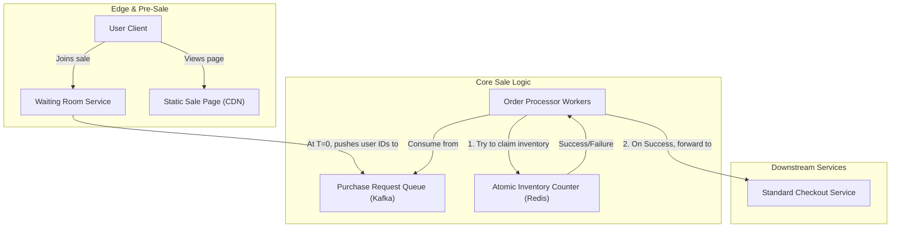
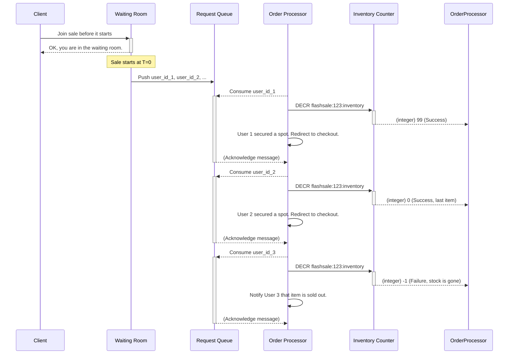

# HLD: Flash Sale System

## 1. Document Information
- **Document Title**: High-Level Design for a High-Traffic Flash Sale System
- **Version**: 1.0
- **Date**: 2025-08-31
- **Author**: Jules (AI Agent)
- **Status**: Draft

---

## 2. Executive Summary
This document details the architecture for a Flash Sale System designed to handle massive, simultaneous traffic spikes for limited-quantity products. The core challenge is the "thundering herd" problem, where a vast number of users attempt to purchase an item at the exact same moment. This design prioritizes system availability, performance, and fairness by implementing a request queuing pattern that serializes incoming demand, protecting downstream services from being overwhelmed.

---

## 3. Scope

### 3.1 In-Scope
-   **Sale Event Management**: Admin interface to create and schedule flash sale events.
-   **User Waiting Room**: A pre-sale area to hold users and manage entry into the purchase flow.
-   **Request Queuing**: A system to fairly and orderly process purchase intents.
-   **Atomic Inventory Management**: A highly concurrent, in-memory inventory counter to prevent overselling.
-   **Real-time User Feedback**: Informing users of their status (in queue, your turn, sold out).

### 3.2 Out-of-Scope
-   **Main Product Catalog & User Authentication**: These are considered existing, separate services.
-   **Payment Processing & Order Fulfillment**: The flash sale system's responsibility ends once a user's spot is secured and they are handed off to the standard checkout service.
-   **Advanced Bot Detection**: While basic protections are mentioned, a dedicated bot detection system is a separate domain.

---

## 4. Core Functional Requirements
-   **FR-001**: Admins must be able to schedule a flash sale for a product with a specific start time and a limited quantity.
-   **FR-002**: Users attempting to join the sale before it starts shall be placed in a virtual waiting room.
-   **FR-003**: At the sale's start time, users from the waiting room shall be allowed to make a purchase request in a fair manner (e.g., first-come, first-served or lottery).
-   **FR-004**: The system must strictly prevent overselling the limited-quantity item.
-   **FR-005**: Users must receive real-time feedback on their status.

---

## 5. Key Non-Functional Requirements (NFRs)
-   **Scalability**: **The highest priority.** The system must handle an extreme, sudden traffic spike without failing.
-   **Availability**: 99.95%. The system must remain stable and available throughout the sale event.
-   **Performance**: The core inventory-claiming operation must be extremely low-latency.
-   **Fairness**: The system should be designed to give human users a fair chance against bots.

---

## 6. High-Level Architecture Diagram

---

## 7. Component Breakdown
-   **Waiting Room Service**: The first point of contact for users. It gathers user IDs before the sale starts. When the sale begins, it feeds these users into the request queue in a controlled manner.
-   **Purchase Request Queue (Kafka)**: This is the system's shock absorber. It converts the massive, concurrent user demand into a serialized stream of requests that backend workers can process at a sustainable pace.
-   **Atomic Inventory Counter (Redis)**: The heart of the system. A single Redis key holding the available quantity. Workers use atomic commands (`DECRBY` or a Lua script) to claim an item, guaranteeing that the stock is not oversold.
-   **Order Processor Workers**: A fleet of stateless workers that perform the core logic: consume a user ID from the queue, attempt to claim an item from Redis, and (if successful) hand the user off to the standard checkout flow.

---

## 8. Technology Stack
-   **Services**: **Go**, **Elixir**, or **Rust** (excellent for high concurrency).
-   **Queue**: **Apache Kafka** or **RabbitMQ**.
-   **In-Memory Store**: **Redis** (for its atomic operations and performance).
-   **Infrastructure**: Kubernetes for orchestration, with pre-scaled capacity for the event.

---

## 9. Data Schema / Data Model
The data models are minimal, with most state being transient and managed in Redis.

-   **Redis Key for Inventory**:
    -   Key: `flashsale:{sale_id}:inventory`
    -   Type: `Integer`
-   **Redis Set for Processed Users** (to prevent duplicates):
    -   Key: `flashsale:{sale_id}:processed_users`
    -   Type: `Set`
-   **Waiting Room** (can be a Redis List or Set):
    -   Key: `flashsale:{sale_id}:waiting_room`
    -   Type: `Set`

---

## 10. API Endpoints & Real-time Communication
-   `POST /api/v1/flash-sales/{saleId}/join`: A user registers their interest, adding them to the waiting room.
-   `GET /api/v1/flash-sales/{saleId}/status`: A client-side poller to check the user's status. This is often replaced by a WebSocket push.
-   **WebSocket Push**: The Waiting Room service can push status updates (`WAITING`, `YOUR_TURN`, `SOLD_OUT`) to clients.

---

## 11. Core Logic / User Flows (The Sale Process)

---

## 12. Scalability and Performance Design
-   **Request Queuing**: The core pattern. It protects all downstream systems by serializing the massive request spike.
-   **In-Memory Atomic Operations**: Using Redis `DECR` is the fastest possible way to manage a shared counter concurrently, avoiding the overhead of database transactions and locking.
-   **Static Content Delivery**: The main sale page should be static HTML/JS served entirely from a CDN to absorb the initial wave of page loads.
-   **Decoupling**: The flash sale components are almost entirely decoupled from the main e-commerce platform, preventing the sale from impacting regular operations.

---

## 13. Security and Resilience
-   **Bot Protection**: Employ CAPTCHAs, edge rate limiting (WAF), and account verification (e.g., must have an account older than 24 hours) to deter bots.
-   **Idempotency**: The Order Processor must be idempotent. If it crashes after decrementing inventory but before handing off to checkout, a retry must not decrement the inventory again. This can be achieved by checking if the user ID is already in a `processed_users` Redis set.
-   **Fairness**: The waiting room can implement a lottery system or a First-Come-First-Served queue to determine the order in which users are let into the purchase queue.

---

## 14. Monitoring and Observability
-   **Key Metrics**:
    -   **Queue Depth**: The number of messages in the purchase request queue is the most critical metric to monitor.
    -   **Consumer Lag**: How far behind the workers are from the latest messages.
    -   **Inventory Level**: Real-time graph of the Redis inventory counter.
    -   **API Error Rates**: Errors from the `join` endpoint.
-   **Alerting**: Alert aggressively if consumer lag increases or if queue depth grows uncontrollably.

---

## 15. Deployment and CI/CD
-   **Infrastructure as Code**: The entire flash sale infrastructure should be defined in code (e.g., Terraform) and should be scaled up specifically for an event and then scaled down.
-   **Pre-event Readiness**: All systems must be deployed and thoroughly tested (including load testing) well in advance of the sale. No deployments should occur on the day of the event.
-   **Canary releases are not suitable** for this kind of "big bang" event.
