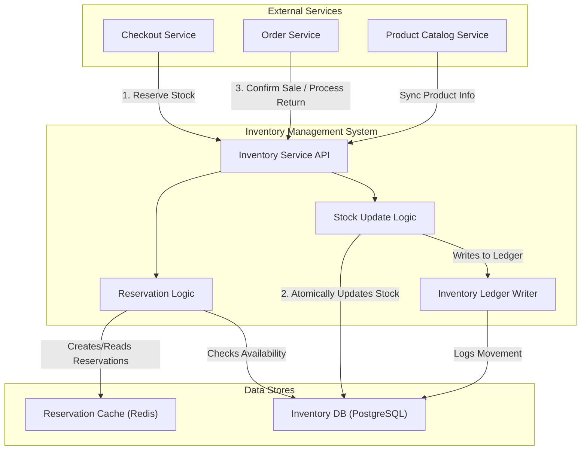
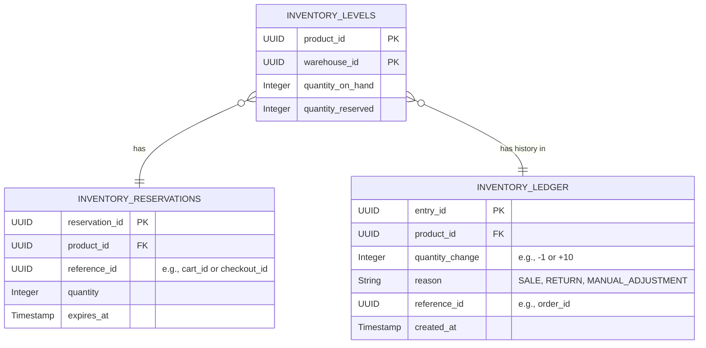

# HLD: Inventory Management System

## 1. Document Information
- **Document Title**: High-Level Design for an E-commerce Inventory Management System
- **Version**: 1.0
- **Date**: 2025-08-31
- **Author**: Jules (AI Agent)
- **Status**: Draft

---

## 2. Executive Summary
This document details the high-level design for a centralized Inventory Management System. This system is a critical backend component of a larger e-commerce platform, responsible for tracking product stock levels in real-time. Its core purpose is to provide an accurate, consistent source of truth for inventory to prevent overselling and enable efficient stock management. The design prioritizes strong consistency, high availability, and low-latency responses for stock queries and reservations.

---

## 3. Scope

### 3.1 In-Scope
-   **Real-time Stock Tracking**: Maintaining an accurate count of available units for each product SKU.
-   **Stock Reservations**: Temporarily holding stock for users during the checkout process.
-   **Atomic Updates**: Ensuring that stock level changes (due to sales, returns, or adjustments) are atomic and durable.
-   **Multi-location Support**: Tracking inventory across different warehouses or fulfillment centers.
-   **Inventory Ledger**: Maintaining an immutable log of all stock movements for auditing purposes.

### 3.2 Out-of-Scope
-   **Warehouse Management**: Physical bin locations, picking, packing, and shipping logistics.
-   **Supply Chain Management**: Purchase orders, supplier relationships, and inbound logistics.
-   **Demand Forecasting**: Predicting future stock needs based on sales trends.
-   **Drop-shipping Integration**: Managing inventory held by third-party suppliers.

---

## 4. Core Functional Requirements
-   **FR-001**: The system must decrease stock levels atomically when an order is successfully placed.
-   **FR-002**: The system must increase stock levels when a return is processed or new stock is added.
-   **FR-003**: The system must provide an API to query the current "available-to-sell" quantity for a product.
-   **FR-004**: The system must support the creation of short-lived, temporary stock reservations to hold items during checkout.
-   **FR-005**: The system must automatically release reservations that have expired.
-   **FR-006**: Admins shall be able to perform manual stock adjustments with an audit trail.

---

## 5. Key Non-Functional Requirements (NFRs)
-   **Consistency**: **Strong consistency is the highest priority.** The system must never allow selling more stock than is available. All operations must be atomic.
-   **Availability**: 99.99% uptime. An outage of this service would block all sales.
-   **Latency**: p99 latency for stock check/reservation APIs must be < 50ms.
-   **Scalability**: The system must handle high-frequency updates for popular products during flash sales.
-   **Auditability**: All changes to stock levels must be logged in an immutable ledger.

---

## 6. High-Level Architecture Diagram



---

## 7. Component Breakdown
-   **Inventory Service API**: The synchronous entry point for other services. It exposes endpoints for checking, reserving, and updating stock.
-   **Reservation Logic**: Manages the lifecycle of stock reservations. It uses a combination of a fast in-memory store (Redis) for reservation data and the main database for availability checks.
-   **Stock Update Logic**: Handles the core business logic of atomically modifying stock levels in the database.
-   **Inventory Ledger Writer**: Appends a record to an immutable ledger table for every stock movement, providing a clear audit trail.
-   **Inventory DB (PostgreSQL)**: The source of truth for stock levels. A relational database is chosen for its strong transactional guarantees (ACID).
-   **Reservation Cache (Redis)**: Stores temporary reservation data with a TTL. This offloads the main database from handling transient reservation state.

---

## 8. Technology Stack
-   **Language**: **Go** or **Java** (for performance, concurrency, and strong typing).
-   **Database**: **PostgreSQL** (for ACID compliance and transactions).
-   **Cache/Locking**: **Redis** (for managing distributed locks on SKUs and caching reservations).
-   **Infrastructure**: Docker, Kubernetes.

---

## 9. Data Schema / Data Model


*Note: `available_quantity` is calculated dynamically as `quantity_on_hand - quantity_reserved`.*

---

## 10. API Endpoints
-   `GET /api/v1/inventory/{productId}`: Retrieves the available stock for a product.
-   `POST /api/v1/inventory/reservations`: Creates a stock reservation.
    -   Body: `{ "productId": "...", "quantity": 1, "referenceId": "cart123", "ttl": 300 }`
-   `DELETE /api/v1/inventory/reservations/{referenceId}`: Commits or cancels a reservation, adjusting stock accordingly.
-   `POST /api/v1/inventory/adjustments`: Manually adjusts stock levels (for admin use).
    -   Body: `{ "productId": "...", "quantityChange": 10, "reason": "NEW_STOCK" }`

---

## 11. Core Logic / User Flows (Reserving Stock)

```mermaid
sequenceDiagram
    participant CheckoutSvc as Checkout Service
    participant InventorySvc as Inventory Service
    participant Redis
    participant PostgreSQL as Inventory DB

    CheckoutSvc->>+InventorySvc: POST /reservations (product, quantity)
    InventorySvc->>+Redis: SETNX lock:product_id (Acquire Lock)
    Redis-->>-InventorySvc: Lock Acquired
    InventorySvc->>+PostgreSQL: SELECT quantity_on_hand, quantity_reserved FROM inventory_levels WHERE product_id = ?
    PostgreSQL-->>-InventorySvc: Returns quantities
    InventorySvc->>InventorySvc: if (on_hand - reserved) >= requested_quantity
    InventorySvc->>+Redis: CREATE reservation record with TTL
    Redis-->>-InventorySvc: OK
    InventorySvc->>+PostgreSQL: UPDATE inventory_levels SET quantity_reserved = quantity_reserved + ?
    PostgreSQL-->>-InventorySvc: OK
    InventorySvc-->>-CheckoutSvc: 201 Created (Reservation OK)
    else
    InventorySvc-->>-CheckoutSvc: 409 Conflict (Insufficient Stock)
    end
    InventorySvc->>+Redis: DEL lock:product_id (Release Lock)
    Redis-->>-InventorySvc: Lock Released
```

---

## 12. Scalability and Performance Design
-   **Locking Strategy**: Use a distributed lock (via Redis or Zookeeper) on a per-product basis to prevent race conditions during concurrent updates.
-   **Database Optimization**: Keep transactions short and focused. Index tables on `product_id`.
-   **Connection Pooling**: Use a properly configured connection pool to manage database connections efficiently.
-   **Optimistic Concurrency**: For very high-contention items, consider using optimistic concurrency control with a version number to reduce lock times.
-   **CQRS**: For extreme scale, consider separating read and write paths (CQRS). Reads query a denormalized cache, while writes go through the transactional path.

---

## 13. Security and Resilience
-   **Security**: The API is internal-facing but must be secured using service-to-service authentication (e.g., mTLS). Admin adjustment endpoints must have strict authorization.
-   **Resilience**:
    -   **Idempotency**: All write operations must be idempotent. For example, processing an `OrderPlaced` event twice should only decrement stock once.
    -   **Compensating Actions**: The system must support compensating transactions. If a payment fails after a reservation is made, the Checkout Service is responsible for calling the Inventory Service to release the reservation.
    -   **Dead Letter Queue**: Failed stock update events should be moved to a DLQ for manual inspection.

---

## 14. Monitoring and Observability
-   **Key Metrics**:
    -   Latency of stock check/reservation APIs.
    -   Rate of failed reservations (insufficient stock).
    -   Database lock contention and transaction duration.
    -   Size of reservation table/cache.
-   **Alerting**:
    -   Alert when latency for critical endpoints exceeds a threshold.
    -   Alert on a high rate of optimistic locking failures.
    -   Alert when a product's stock level drops below a configurable threshold.

---

## 15. Deployment and CI/CD
-   A standard CI/CD pipeline will be used.
-   **Testing**: Due to the critical nature of this service, the pipeline must include a comprehensive suite of integration tests that cover race conditions, atomicity, and error handling (e.g., releasing reservations on failure).
-   **Deployment**: A blue-green deployment strategy is recommended to minimize downtime. The database schema must be managed with backward-compatible changes.
