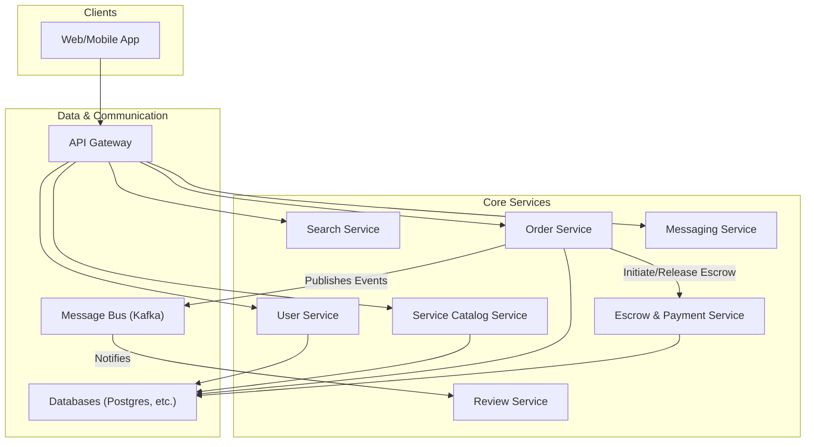
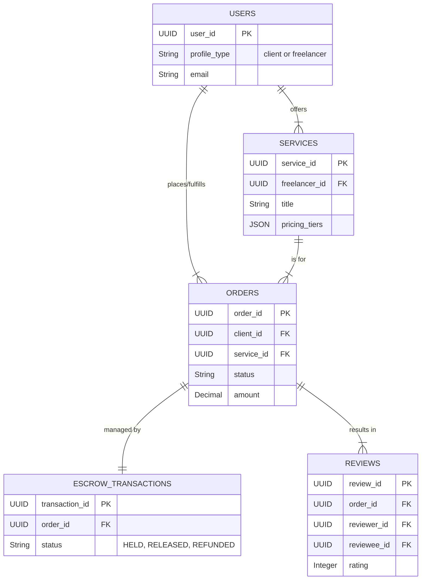
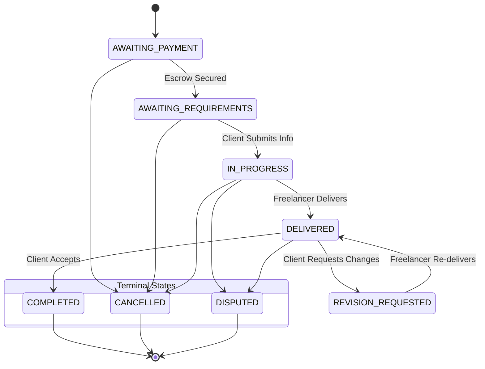

# HLD: Marketplace for Services

## 1. Document Information
- **Document Title**: High-Level Design for a Marketplace for Services (e.g., Fiverr, Upwork)
- **Version**: 1.0
- **Date**: 2025-08-31
- **Author**: Jules (AI Agent)
- **Status**: Draft

---

## 2. Executive Summary
This document outlines the high-level design for a Marketplace for Services, a platform connecting service providers (freelancers) with customers (clients). The system facilitates service discovery, order management, communication, and financial transactions through a secure escrow system. The architecture is designed as a set of microservices to manage the complex workflows and interactions between the two user types, prioritizing trust, security, and reliability.

---

## 3. Scope

### 3.1 In-Scope
-   **Dual User Profiles**: Separate profiles and dashboards for Clients and Freelancers.
-   **Service Listings ("Gigs")**: Freelancers can create, manage, and showcase their services with pricing tiers.
-   **Search & Discovery**: Clients can search for and browse services using filters and categories.
-   **Order Management**: A comprehensive system to manage the order lifecycle from placement to completion.
-   **Escrow Payment System**: Securely holds client payments upon order placement and releases them to the freelancer upon successful delivery.
-   **Order-Specific Messaging**: A private communication channel for each order.
-   **Mutual Review System**: A two-way review system for clients and freelancers after order completion.

### 3.2 Out-of-Scope
-   **Time-Tracking Software**: Desktop applications for tracking hourly work.
-   **Enterprise Client Features**: Advanced features like consolidated billing and team accounts.
-   **A Detailed Dispute Resolution System**: While the system supports a "disputed" state, a full-fledged mediation workflow is out of scope.

---

## 4. Core Functional Requirements
-   **FR-001**: Users shall be able to register as either a "Client" or a "Freelancer".
-   **FR-002**: Freelancers must be able to create and publish service listings with clear deliverables and pricing.
-   **FR-003**: Clients must be able to place an order for a service, at which point payment is captured and held in escrow.
-   **FR-004**: A private messaging channel shall be created for each order between the client and freelancer.
-   **FR-005**: Freelancers must be able to submit completed work through the platform.
-   **FR-006**: Clients must be able to review and accept the delivery, which triggers the release of funds from escrow to the freelancer.
-   **FR-007**: Both parties can leave a review for the other after an order is marked as complete.

---

## 5. Key Non-Functional Requirements (NFRs)
-   **Trust & Security**: This is the highest priority. The system must protect user data and ensure the integrity of financial transactions. The escrow system must be flawless.
-   **Availability**: 99.9% uptime for all user-facing services.
-   **Durability**: All order, transaction, and communication data must be highly durable with no data loss.
-   **Scalability**: The system must scale to support a large number of users, service listings, and in-progress orders.

---

## 6. High-Level Architecture Diagram

---

## 7. Component Breakdown
-   **User Service**: Manages user profiles, roles (client/freelancer), skills, and portfolio information.
-   **Service Catalog Service**: Manages the CRUD lifecycle of service listings ("gigs").
-   **Search Service**: Provides search and filtering capabilities over the service catalog.
-   **Order Service**: The central orchestrator that manages the state machine of an order.
-   **Escrow & Payment Service**: A highly secure service that integrates with payment providers (e.g., Stripe Connect) to manage holding and releasing funds.
-   **Messaging Service**: A real-time service (likely using WebSockets) that provides private communication channels tied to orders.
-   **Review Service**: Manages the mutual review process post-completion.

---

## 8. Technology Stack
-   **Backend**: **Java/Spring Boot** for transactional services (Order, Payment); **Node.js** for real-time services (Messaging).
-   **Database**: **PostgreSQL** for structured data; **MongoDB** or similar for messaging history.
-   **Search**: **Elasticsearch**.
-   **Message Bus**: **Apache Kafka**.

---

## 9. Data Schema / Data Model

---

## 10. API Endpoints
-   `GET /api/v1/services`: Search for services.
-   `POST /api/v1/orders`: A client places an order for a service.
-   `GET /api/v1/orders/{orderId}`: Get order details and status.
-   `GET /api/v1/orders/{orderId}/messages`: Get the chat history for an order.
-   `POST /api/v1/orders/{orderId}/delivery`: A freelancer submits their work.
-   `POST /api/v1/orders/{orderId}/acceptance`: A client accepts the delivery.

---

## 11. Core Logic / User Flows (Order State Machine)

---

## 12. Scalability and Performance Design
-   **Database Scaling**: The `orders` and `messages` tables can grow very large. The database can be scaled with read replicas. For extreme scale, sharding by `user_id` or `order_id` can be implemented.
-   **Messaging Service**: The real-time messaging component must be horizontally scalable. This can be achieved with a cluster of WebSocket servers and a message broker like Redis Pub/Sub or Kafka to route messages.
-   **Asynchronous Workflows**: Use the message bus to handle asynchronous tasks like sending email notifications, updating search indexes, and generating reports.

---

## 13. Security and Resilience
-   **Escrow Integrity**: This is paramount. The Payment Service must use strong transactional logic (e.g., a two-phase commit or a saga pattern with compensating transactions) to ensure that funds are never lost or released incorrectly.
-   **Secure Communication**: All user communication is private and must be protected.
-   **Authorization**: Rigorous checks are needed at the API layer to ensure users can only access and act on their own orders and information.

---

## 14. Monitoring and Observability
-   **Key Metrics**:
    -   Health of the Escrow/Payment Service: transaction success/failure rates.
    -   Number of orders in each state, especially `DISPUTED`.
    -   Latency and uptime of the real-time Messaging Service.
-   **Alerting**:
    -   Alert immediately on any failed escrow transaction.
    -   Alert if a large number of orders enter the `DISPUTED` state.
    -   Alert on high message delivery latency.

---

## 15. Deployment and CI/CD
-   Each microservice will have its own independent CI/CD pipeline.
-   The Escrow & Payment Service should have an extremely rigorous testing suite and a more conservative deployment strategy (e.g., manual promotion to production) due to its critical financial nature.
-   Database schema changes will be managed with a tool like Flyway.
