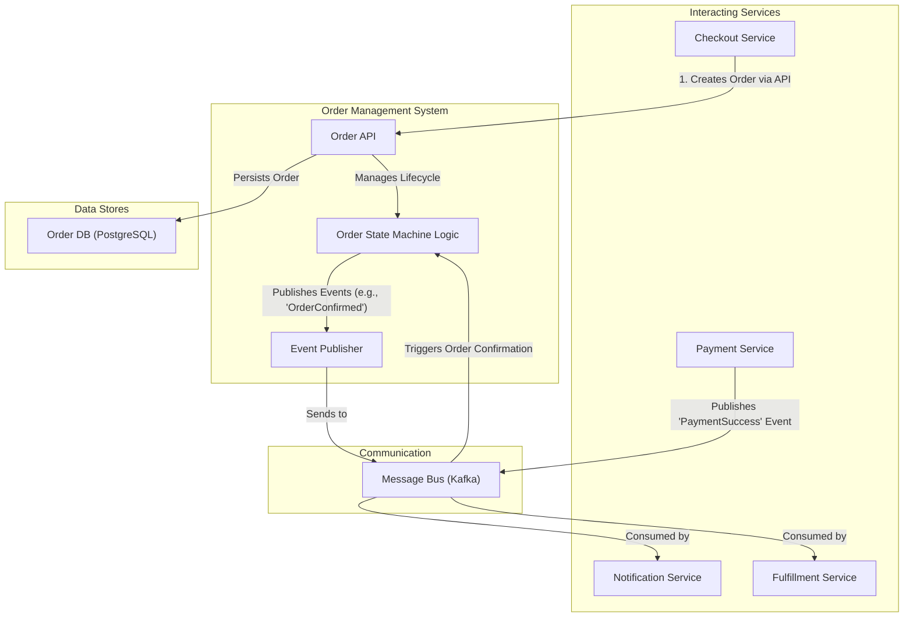
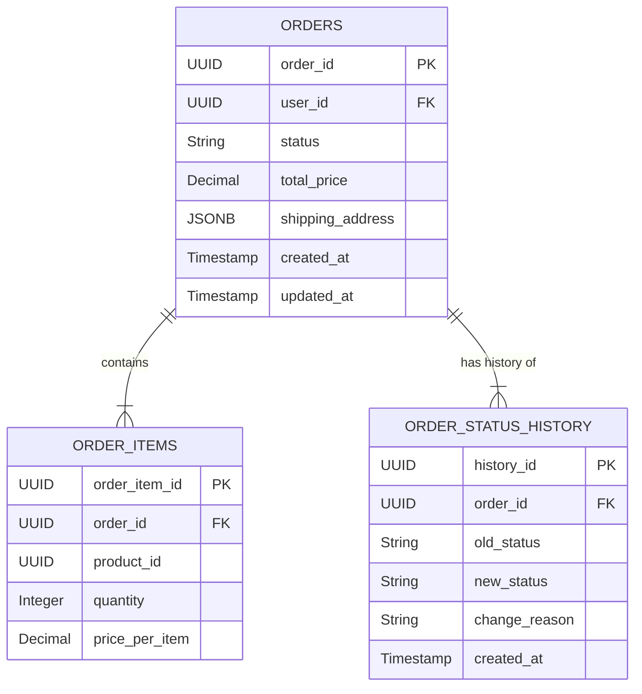
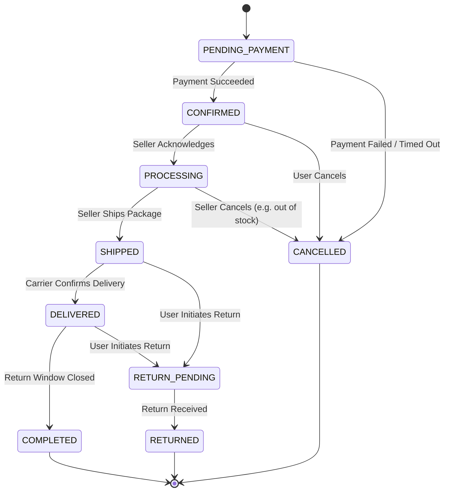

# HLD: Order Management System

## 1. Document Information
- **Document Title**: High-Level Design for an E-commerce Order Management System (OMS)
- **Version**: 1.0
- **Date**: 2025-08-31
- **Author**: Jules (AI Agent)
- **Status**: Draft

---

## 2. Executive Summary
This document outlines the high-level design for an Order Management System (OMS), a core backend service in an e-commerce ecosystem. The OMS is the authoritative source for the entire lifecycle of an order, from the moment it is created after a successful payment until it is fulfilled, delivered, or cancelled. It is designed to be highly reliable and durable, providing a consistent view of order states to customers, sellers, and other internal services.

---

## 3. Scope

### 3.1 In-Scope
-   **Order Creation**: Ingesting new, paid orders from the Checkout Service.
-   **State Management**: Tracking and managing the status of an order through a well-defined lifecycle (e.g., Confirmed, Processing, Shipped, Delivered, Cancelled).
-   **Order Data Storage**: Persisting all order details, including items, pricing, and shipping information.
-   **Order History**: Providing an API for customers and admins to retrieve order history and details.
-   **Event Publication**: Emitting events (e.g., `OrderShipped`) to notify other systems.
-   **Cancellations & Returns**: Handling logic for order cancellations and initiating refund workflows.

### 3.2 Out-of-Scope
-   **Payment Processing**: Handled by the Payment Service.
-   **Inventory Management**: Handled by the Inventory Service.
-   **Shipping & Logistics**: The OMS tracks the 'Shipped' state but does not integrate directly with shipping carriers. This is handled by a separate Fulfillment Service.
-   **Customer Communication**: The OMS publishes events, but a separate Notification Service handles sending emails/SMS.

---

## 4. Core Functional Requirements
-   **FR-001**: The system shall create a new, immutable order record upon receiving a confirmed payment event.
-   **FR-002**: The system must transition orders through a predefined state machine.
-   **FR-003**: The system shall expose an API to retrieve the details and status of any order by its ID.
-   **FR-004**: Customers must be able to view a list of their past and current orders.
-   **FR-005**: Sellers/Admins must be able to update an order's status (e.g., from 'Processing' to 'Shipped').
-   **FR-006**: The system must support order cancellation and trigger a refund process.

---

## 5. Key Non-Functional Requirements (NFRs)
-   **Durability & Reliability**: **This is the highest priority.** Order data must never be lost. The system must guarantee 100% data durability through backups and replication.
-   **Consistency**: Strong consistency is required for the state of an order.
-   **Availability**: 99.95% uptime. While a brief outage doesn't prevent new sales, it severely impacts customer experience and fulfillment operations.
-   **Scalability**: Must scale to handle the full volume of orders generated by the platform, with a focus on write-heavy operations during sales peaks.

---

## 6. High-Level Architecture Diagram

---

## 7. Component Breakdown
-   **Order API**: Exposes RESTful endpoints for creating and managing orders. It's used by other internal services and provides read-only access for clients.
-   **Order State Machine**: The core of the OMS. It contains the business logic for validating and executing state transitions (e.g., an order cannot be 'Shipped' if it is 'Cancelled').
-   **Event Publisher**: Responsible for publishing events to the message bus when significant state changes occur. This decouples the OMS from its downstream consumers.
-   **Order DB (PostgreSQL)**: The source of truth for all order data. PostgreSQL is chosen for its strong ACID compliance, reliability, and support for JSONB data types.

---

## 8. Technology Stack
-   **Language**: **Java / Spring Boot** (mature ecosystem for building robust transactional systems).
-   **Database**: **PostgreSQL**.
-   **Message Bus**: **Apache Kafka**.
-   **Infrastructure**: Docker, Kubernetes.

---

## 9. Data Schema / Data Model

---

## 10. API Endpoints
-   `POST /api/v1/orders`: (Internal) Creates a new order.
-   `GET /api/v1/orders/{orderId}`: Retrieves full details for a specific order.
-   `GET /api/v1/orders`: Retrieves a list of orders for the authenticated user.
-   `PUT /api/v1/orders/{orderId}/status`: (Internal/Admin) Updates the status of an order.
    -   Body: `{ "newStatus": "SHIPPED", "trackingNumber": "..." }`
-   `POST /api/v1/orders/{orderId}/cancellation`: Requests to cancel an order.

---

## 11. Core Logic / User Flows (Order State Machine)

---

## 12. Scalability and Performance Design
-   **Database Scaling**: The `orders` table can grow very large.
    -   **Archiving**: Regularly move old, completed orders (e.g., > 1 year) to a separate archive database or data warehouse to keep the production table smaller and faster.
    -   **Read Replicas**: Use PostgreSQL read replicas to serve read-heavy traffic like customer order history lookups.
-   **Asynchronous Operations**: All post-processing (sending emails, updating analytics) is handled asynchronously via events to keep the core order transaction fast.
-   **Indexing**: The `orders` table must be indexed on `user_id` and `status` to optimize common queries.

---

## 13. Security and Resilience
-   **Security**:
    -   A user must only be able to view their own orders. All API endpoints must enforce this ownership check.
    -   Endpoints for updating order status must be restricted to internal services or users with specific admin roles.
-   **Resilience**:
    -   **Transactional Outbox Pattern**: To ensure that events are published if and only if the database transaction that changes the order state commits, an outbox pattern will be used. The state change and the event to be published are written to the database in the same transaction. A separate process then relays these events to the message bus.
    -   **Idempotent Consumers**: Downstream services consuming order events must be idempotent.

---

## 14. Monitoring and Observability
-   **Metrics**:
    -   Number of orders created per minute/hour.
    -   Latency of API endpoints.
    -   Number of orders currently in each state.
-   **Alerting**:
    -   Alert if an order is stuck in a transient state (e.g., `PENDING_PAYMENT`) for longer than a defined threshold.
    -   Alert on a spike in order cancellations.
    -   Alert on failures in the event publishing mechanism.

---

## 15. Deployment and CI/CD
-   Standard CI/CD pipeline with automated testing.
-   **Database Migrations**: Schema changes must be managed carefully using a tool like Flyway or Liquibase. All migrations must be backward-compatible and applied with zero downtime.
-   **Testing**: Integration tests must cover all valid and invalid state transitions in the order state machine.
