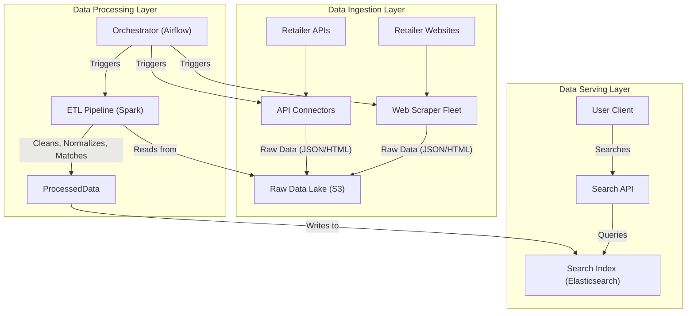
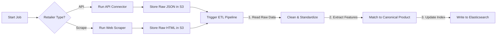

# HLD: Price Comparison Engine

## 1. Document Information
- **Document Title**: High-Level Design for a Price Comparison Engine
- **Version**: 1.0
- **Date**: 2025-08-31
- **Author**: Jules (AI Agent)
- **Status**: Draft

---

## 2. Executive Summary
This document describes the high-level design for a Price Comparison Engine. The system's purpose is to aggregate product and pricing information from numerous third-party retailers, normalize this diverse data, and present it to consumers through a unified search interface. The architecture is centered around a scalable and resilient data ingestion pipeline and a high-performance search platform, enabling users to easily find the best price for a given product.

---

## 3. Scope

### 3.1 In-Scope
-   **Data Ingestion**: Fetching product data from external sources via both web scraping and structured API feeds.
-   **Data Normalization & Product Matching**: Processing raw data and intelligently matching identical products from different retailers into a single canonical entry.
-   **User-Facing Search**: A search interface for users to find products.
-   **Price Display**: A clear comparison of prices for a single product from multiple retailers.

### 3.2 Out-of-Scope
-   **User Accounts & Alerts**: User registration, saved searches, and price drop alerts are not in the initial scope.
-   **Checkout Process**: The engine links out to external retailer websites; no checkout occurs on the platform.
-   **Affiliate Link Management**: While a key business component, the system for managing and tracking affiliate links is considered separate.

---

## 4. Core Functional Requirements
-   **FR-001**: The system must periodically ingest product data (name, price, URL) from a configured list of retailers.
-   **FR-002**: The system must be able to process data from both unstructured web pages and structured partner APIs.
-   **FR-003**: The system must identify and merge offers for the same conceptual product from different retailers.
-   **FR-004**: Users must be able to search for products using keywords.
-   **FR-005**: Search results must clearly display the product and a list of competing offers from various retailers.

---

## 5. Key Non-Functional Requirements (NFRs)
-   **Data Freshness**: Pricing data must be kept reasonably up-to-date. The acceptable lag time for price updates should be configurable per retailer (e.g., every 4 hours).
-   **Scalability**: The data pipeline must scale to handle thousands of retailers and millions of products. The search interface must handle high read throughput.
-   **Extensibility**: The architecture must make it easy to add new retailers to the ingestion pipeline.
-   **Availability**: 99.9% uptime for the user-facing search application.

---

## 6. High-Level Architecture Diagram



---

## 7. Component Breakdown
-   **API Connectors / Scraper Fleet**: These are the data ingestion workers. Each is specialized for a specific retailer. They fetch raw data and dump it into a central data lake.
-   **Orchestrator (Airflow)**: A workflow management tool that schedules and monitors all data pipeline jobs (ingestion, processing, indexing).
-   **Raw Data Lake (S3)**: A cost-effective object store for all raw data collected from retailers before processing.
-   **ETL Pipeline (Spark)**: The core data processing engine. It reads raw data, cleans it, and most importantly, runs the product matching algorithm to group offers correctly.
-   **Search Index (Elasticsearch)**: The serving database. It stores the normalized product data in a way that is optimized for complex search queries.
-   **Search API**: The user-facing API that translates user search requests into Elasticsearch queries.

---

## 8. Technology Stack
-   **Core Language**: **Python** (for Scrapy, Airflow, PySpark, and data science libraries).
-   **Data Processing**: **Apache Spark**.
-   **Orchestration**: **Apache Airflow**.
-   **Search**: **Elasticsearch**.
-   **Data Lake**: **AWS S3**.

---

## 9. Data Schema / Data Model
The primary data model is the document stored in the Elasticsearch search index.

**Elasticsearch Index: `products`**
```json
{
  "canonical_product_id": "UUID",
  "product_name": "Apple iPhone 15 Pro (256GB, Blue)",
  "brand": "Apple",
  "category": "Electronics > Mobile Phones",
  "attributes": {
    "storage": "256GB",
    "color": "Blue"
  },
  "offers": [
    {
      "retailer": "Amazon",
      "price": 999.00,
      "currency": "USD",
      "product_url": "http://amazon.com/...",
      "last_updated": "2025-08-31T10:00:00Z"
    },
    {
      "retailer": "Best Buy",
      "price": 999.99,
      "currency": "USD",
      "product_url": "http://bestbuy.com/...",
      "last_updated": "2025-08-31T11:00:00Z"
    }
  ]
}
```

---

## 10. API Endpoints
-   `GET /api/v1/search?q={query}&category={cat}`: The main user-facing search endpoint.
-   `GET /api/v1/products/{productId}`: Retrieves the details and all current offers for a single canonical product.
-   `(Internal) POST /api/v1/ingestion/jobs`: An endpoint to trigger a new data ingestion job via the orchestrator.

---

## 11. Core Logic / User Flows (Data Pipeline)



**Product Matching**: This is the most complex part of the logic. The pipeline uses a combination of techniques to match products:
-   **Rule-based**: Using standardized identifiers like UPC, EAN, or ISBN.
-   **ML-based**: Using NLP models (e.g., TF-IDF or sentence embeddings) on product titles and descriptions to find semantic similarity.
-   **Image-based**: Using perceptual hashing (pHash) on product images to find visually identical items.

---

## 12. Scalability and Performance Design
-   **Decoupled Pipeline**: The ingestion, processing, and serving layers are fully decoupled, allowing them to be scaled independently based on their respective loads.
-   **Horizontal Scaling**: The scraper fleet and Spark workers are stateless and can be scaled out horizontally to increase data processing throughput.
-   **Search Cluster**: Elasticsearch is natively distributed and can be scaled by adding more nodes to the cluster to handle query load.
-   **Caching**: The Search API can cache results for popular queries in a distributed cache like Redis.

---

## 13. Security and Resilience
-   **Responsible Scraping**: The scraper fleet must be designed to be well-behaved. It should respect `robots.txt`, use randomized and sensible request intervals, and rotate user agents to avoid harming retailer websites or getting blocked.
-   **Pipeline Resilience**: The orchestrator (Airflow) must be configured to handle task failures and retries. A failure in processing data from one retailer should not halt the entire pipeline.
-   **Data Validation**: Implement strong data validation checks in the ETL pipeline to handle malformed data from source sites gracefully.

---

## 14. Monitoring and Observability
-   **Job Health**: Monitor the success, failure, and duration of all jobs in the orchestrator.
-   **Data Freshness**: Track the time lag between the last successful ingestion and the current time for each retailer.
-   **Search Performance**: Monitor query latency and indexing latency in Elasticsearch.
-   **Matching Accuracy**: Periodically sample and manually review the accuracy of the product matching algorithm.
-   **Alerting**: Alert on high rates of job failures, significant data freshness lag, or high search latency.

---

## 15. Deployment and CI/CD
-   The Search API and the data pipeline components are deployed independently.
-   Pipeline jobs (scrapers, ETL logic) are versioned in git. A CI/CD pipeline for the pipeline itself involves running tests on sample data to ensure changes don't break parsing or processing logic before deploying the new job definitions to the orchestrator.
