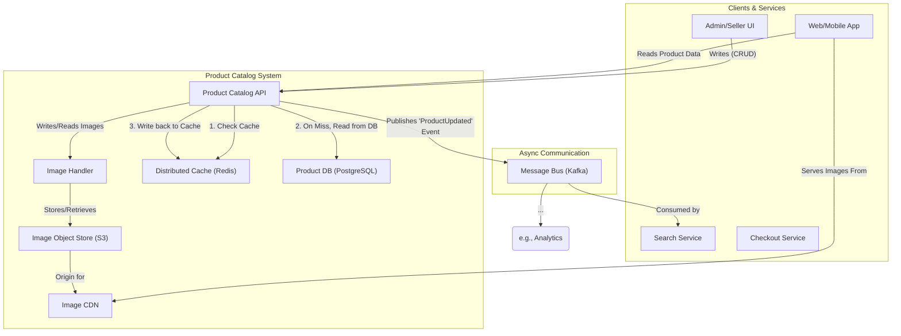
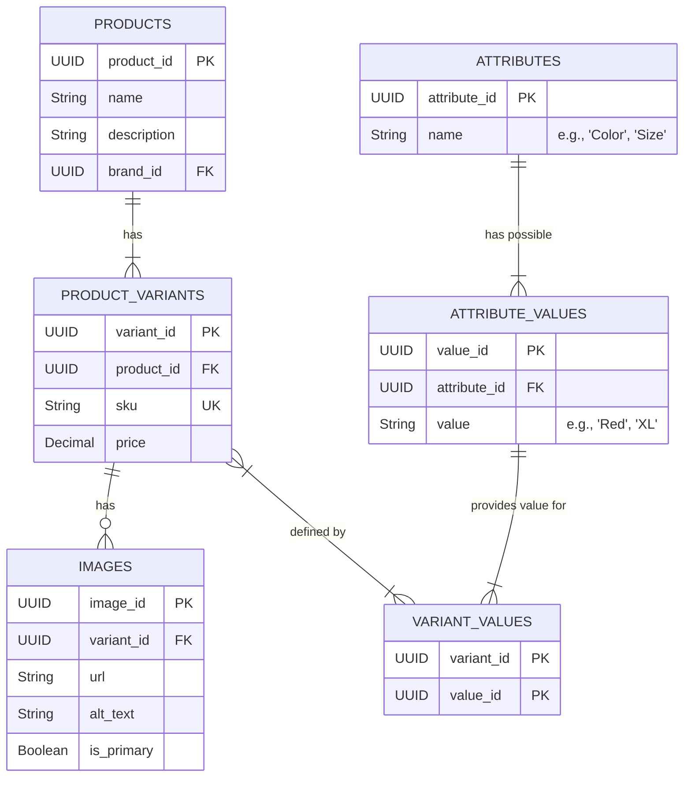
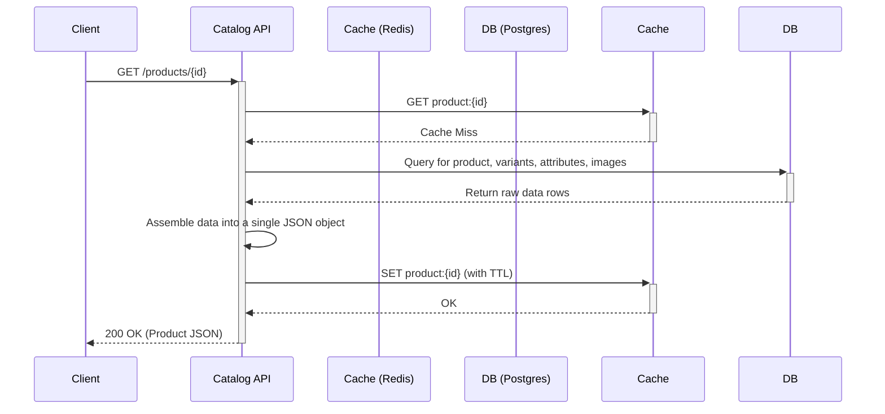

# HLD: Product Catalog Service

## 1. Document Information
- **Document Title**: High-Level Design for a Product Catalog Service
- **Version**: 1.0
- **Date**: 2025-08-31
- **Author**: Jules (AI Agent)
- **Status**: Draft

---

## 2. Executive Summary
This document outlines the high-level design for a Product Catalog Service. This service is the central, authoritative source of truth for all product-related information within an e-commerce platform. It is a read-heavy system, designed to provide fast, reliable access to rich product data, including descriptions, attributes, variants, and images. The architecture prioritizes low read latency and high availability to support a seamless user experience and provide consistent data to other microservices.

---

## 3. Scope

### 3.1 In-Scope
-   **Product CRUD**: Full create, read, update, and delete functionality for products, managed by sellers or admins.
-   **Product Variants**: Support for products with multiple variations, such as size, color, or material (e.g., a T-shirt SKU with different sizes).
-   **Categorization**: Hierarchical categorization of products.
-   **Rich Content**: Management of product descriptions, specifications, and multiple images per product/variant.
-   **Event Publication**: Publishing events when product data is created or updated.

### 3.2 Out-of-Scope
-   **Inventory Management**: Stock levels are managed by a dedicated Inventory Service.
-   **Pricing**: While this service stores a base price, dynamic pricing or sales prices are handled by a separate Pricing Service.
-   **User Reviews & Ratings**: Handled by a dedicated Review Service.
-   **Search Functionality**: The service provides data but does not include a user-facing search engine (handled by a Search Service).

---

## 4. Core Functional Requirements
-   **FR-001**: The system shall provide an API to create, retrieve, update, and delete product information.
-   **FR-002**: The system must support product variants, where each variant has a unique SKU and specific attributes.
-   **FR-003**: The system shall allow products to be assigned to one or more categories.
-   **FR-004**: The system must store and serve multiple high-resolution images for each product variant.
-   **FR-005**: The system must publish a `ProductUpdated` event to a message bus whenever product data changes.

---

## 5. Key Non-Functional Requirements (NFRs)
-   **Latency**: **Low read latency is critical.** p99 latency for fetching a single product's details must be < 100ms.
-   **Availability**: 99.95% uptime. The website's ability to display products depends entirely on this service.
-   **Scalability**: Must handle very high read throughput (millions of requests per minute). Write throughput is significantly lower.
-   **Consistency**: Eventual consistency is acceptable for downstream systems (like search). Read-after-write consistency is required for admin-facing UIs.

---

## 6. High-Level Architecture Diagram

---

## 7. Component Breakdown
-   **Product Catalog API**: The main interface of the service. Exposes REST or GraphQL endpoints for managing and retrieving product data.
-   **Image Handler**: A dedicated component for processing image uploads, such as resizing, optimization, and storing them in an object store.
-   **Distributed Cache (Redis)**: Caches fully assembled product data objects to serve read requests with very low latency.
-   **Product DB (PostgreSQL)**: The source of truth for all structured product data (names, attributes, categories).
-   **Image Object Store (S3)**: A durable, scalable storage solution for product images.
-   **Image CDN**: A Content Delivery Network to serve images globally with low latency.

---

## 8. Technology Stack
-   **Language**: **Node.js** or **Go** (well-suited for I/O-bound, high-throughput read APIs).
-   **Database**: **PostgreSQL** (strong for structured data and can handle JSONB for flexible attributes).
-   **Cache**: **Redis**.
-   **Image Storage**: **AWS S3** or equivalent.
-   **Message Bus**: **Apache Kafka**.

---

## 9. Data Schema / Data Model

---

## 10. API Endpoints
-   `GET /api/v1/products/{productId}`: Retrieves a fully detailed product, including all its variants, attributes, and images.
-   `GET /api/v1/products?category={id}`: Retrieves a paginated list of products in a given category.
-   `POST /api/v1/products`: (Admin) Creates a new base product.
-   `POST /api/v1/products/{productId}/variants`: (Admin) Adds a new variant to a product.
-   `PUT /api/v1/products/{productId}`: (Admin) Updates product details.

---

## 11. Core Logic / User Flows (Read Product Details)

---

## 12. Scalability and Performance Design
-   **Aggressive Caching**: This is the primary scalability strategy. The system will cache the fully constructed product JSON. Cache invalidation will be handled when update events are published.
-   **CDN for all media**: All images will be served via a global CDN to offload traffic from the service and reduce latency.
-   **Database Read Replicas**: The database will be configured with one or more read replicas to handle cache misses and admin-facing traffic without impacting the primary write database.
-   **Stateless Service**: The API service itself is stateless, allowing for easy horizontal scaling.

---

## 13. Security and Resilience
-   **Security**: Write APIs (`POST`, `PUT`, `DELETE`) must be protected by authentication and authorization, ensuring only privileged users (sellers, admins) can modify the catalog. Read APIs are public.
-   **Resilience**:
    -   Multiple replicas of the service will be deployed for high availability.
    -   The transactional outbox pattern will be used to ensure reliable publishing of update events to the message bus.
    -   Graceful degradation: If the database is slow, the service can potentially serve stale data from the cache for a short period to maintain availability.

---

## 14. Monitoring and Observability
-   **Metrics**:
    -   API latency for key endpoints (p95, p99).
    -   Cache hit vs. miss ratio (a critical health metric).
    -   Database query performance and connection pool usage.
    -   Image processing times.
-   **Alerting**:
    -   Alert if the cache hit ratio drops below a certain threshold (e.g., 95%).
    -   Alert on increased API latency or error rates.

---

## 15. Deployment and CI/CD
-   Standard CI/CD pipeline.
-   **Cache Warming**: For major deployments, a cache-warming strategy might be employed, where a script pre-populates the cache with the most popular products to avoid a "thundering herd" of cache misses hitting the database right after deployment.
-   **Zero-downtime Deployments**: Blue-green deployments are recommended.
