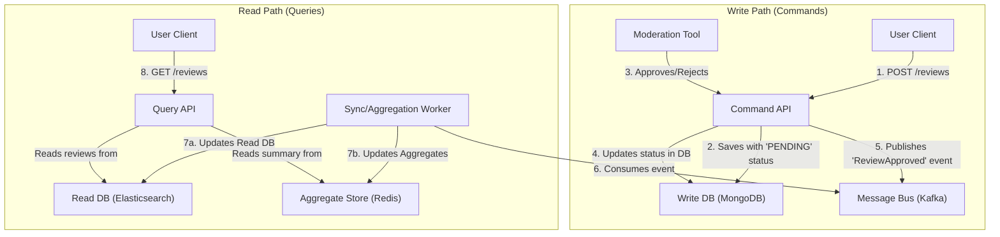
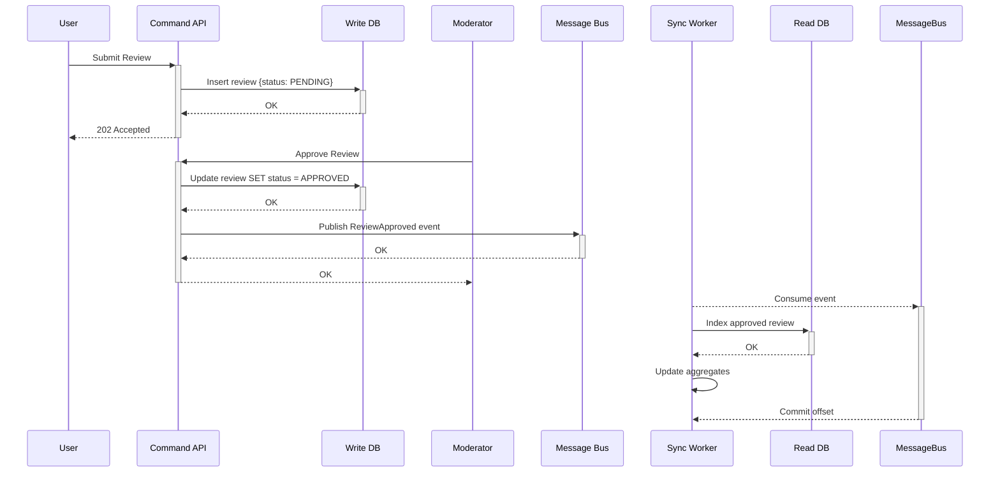

# HLD: Review and Rating System

## 1. Document Information
- **Document Title**: High-Level Design for a Review and Rating System
- **Version**: 1.0
- **Date**: 2025-08-31
- **Author**: Jules (AI Agent)
- **Status**: Draft

---

## 2. Executive Summary
This document outlines the design for a scalable Review and Rating System for an e-commerce platform. The system is responsible for collecting, managing, and displaying user-generated reviews and ratings for products. The architecture uses a Command Query Responsibility Segregation (CQRS) pattern to efficiently handle high-volume writes (new reviews) and high-volume reads (displaying reviews and aggregate scores). This approach ensures that the write path is decoupled from the read path, allowing each to be scaled and optimized independently.

---

## 3. Scope

### 3.1 In-Scope
-   **Review Submission**: Allowing verified purchasers to submit a rating (1-5 stars) and text review.
-   **Review Management**: Allowing users to edit their own reviews.
-   **Moderation Workflow**: A process for internal moderators to approve or reject submitted reviews.
-   **Review Display**: Serving approved reviews on product pages.
-   **Aggregate Calculation**: Calculating and serving aggregate data like average rating and rating distribution.

### 3.2 Out-of-Scope
-   **"Helpful" Voting**: Functionality for users to vote on the helpfulness of reviews.
-   **Q&A Section**: A separate feature for users to ask and answer questions about products.
-   **Advanced Anti-Spam/Fraud Detection**: While basic checks are in place, a dedicated fraud detection system is out of scope.

---

## 4. Core Functional Requirements
-   **FR-001**: A user who has purchased a product must be able to submit one review for that product.
-   **FR-002**: A review must consist of a star rating (1-5) and optional text and images.
-   **FR-003**: Submitted reviews must enter a moderation queue and only be displayed publicly after approval.
-   **FR-004**: The system must display an aggregate rating summary on the product page (e.g., average rating, total count, histogram).
-   **FR-005**: Users must be able to see all approved reviews for a product, with sorting and filtering options.

---

## 5. Key Non-Functional Requirements (NFRs)
-   **Availability**: 99.9% uptime. The system should degrade gracefully (e.g., still show existing reviews even if submission is down).
-   **Latency**: Low read latency is important for user experience. p99 for fetching reviews and aggregates should be < 150ms.
-   **Consistency**: Eventual consistency is acceptable. A newly approved review does not need to appear instantly.
-   **Scalability**: The read path must scale to handle traffic for all product pages. The write path must handle bursts of new reviews.
-   **Durability**: User-submitted content is important and must be stored durably.

---

## 6. High-Level Architecture Diagram (CQRS)



---

## 7. Component Breakdown
-   **Command API**: Handles all write operations: submitting new reviews and updating their status via the moderation tool.
-   **Query API**: Handles all read operations: fetching lists of approved reviews and aggregate rating data.
-   **Write DB (MongoDB)**: The master store for all reviews in all states (pending, approved, rejected). Optimized for writes.
-   **Moderation Tool**: An internal UI that allows moderators to view and act on reviews in the `PENDING` state.
-   **Message Bus (Kafka)**: Decouples the write path from the read path.
-   **Sync/Aggregation Worker**: A background processor that listens for events and updates the read-optimized data stores.
-   **Read DB (Elasticsearch)**: A denormalized data store containing only approved reviews, indexed for fast text search and filtering.
-   **Aggregate Store (Redis)**: Caches pre-calculated aggregate data (average rating, etc.) for extremely fast retrieval.

---

## 8. Technology Stack
-   **Language**: **Python (Django/Flask)** or **Node.js**.
-   **Databases**: **MongoDB** for the write database, **Elasticsearch** for the read database.
-   **Cache**: **Redis** for the aggregate store.
-   **Message Bus**: **Apache Kafka**.

---

## 9. Data Schema / Data Model

### Write DB Schema (MongoDB Collection: `reviews`)
```json
{
  "_id": "ObjectId(...)",
  "review_id": "UUID",
  "product_id": "UUID",
  "user_id": "UUID",
  "rating": 5,
  "text": "This product is amazing!",
  "status": "APPROVED", // PENDING, APPROVED, REJECTED
  "created_at": "ISODate(...)",
  "updated_at": "ISODate(...)"
}
```

### Read DB Schema (Elasticsearch Index: `approved_reviews`)
- Same structure as above, but only contains documents where `status` is `APPROVED`. Indexed on `product_id`, `rating`, and `text`.

### Aggregate Store Schema (Redis Hash)
-   **Key**: `product:aggregates:{product_id}`
-   **Value (Hash)**:
    -   `average_rating`: `4.82`
    -   `total_reviews`: `1254`
    -   `rating_1_count`: `15`
    -   `rating_2_count`: `30`
    -   `rating_3_count`: `150`
    -   `rating_4_count`: `400`
    -   `rating_5_count`: `659`

---

## 10. API Endpoints
-   `POST /api/v1/products/{productId}/reviews`: (Write) Submit a review.
-   `PUT /api/v1/reviews/{reviewId}`: (Write) Edit a review.
-   `GET /api/v1/products/{productId}/reviews`: (Read) Get approved reviews for a product.
-   `GET /api/v1/products/{productId}/reviews/summary`: (Read) Get aggregate rating data.
-   `POST /api/v1/moderation/reviews/{reviewId}/approve`: (Write, Internal) Approve a review.

---

## 11. Core Logic / User Flows (Review Lifecycle)



---

## 12. Scalability and Performance Design
-   **CQRS**: The primary pattern for scalability. The read and write systems can be scaled independently.
-   **Asynchronous Processing**: All data transformation, indexing, and aggregation is handled asynchronously, so it doesn't slow down the user-facing write API.
-   **Dedicated Read Stores**: Using Elasticsearch for reviews and Redis for aggregates allows each data store to be optimized for its specific query patterns.
-   **Caching**: The aggregate data in Redis is a form of pre-computed cache, ensuring summary data is served instantly.

---

## 13. Security and Resilience
-   **Security**:
    -   The system must verify that a user has purchased a product before allowing them to submit a review (by querying the Order Service).
    -   A user can only edit or delete their own review.
    -   Moderation endpoints are internal and require admin privileges.
-   **Resilience**: The system is highly resilient. If the sync worker or read path fails, writes can still be accepted and queued in the message bus. The system can catch up once the read path components are restored.

---

## 14. Monitoring and Observability
-   **Metrics**:
    -   Number of reviews in the moderation queue (queue length).
    -   End-to-end latency: time from review submission to it appearing on the site.
    -   Kafka consumer lag for the sync worker.
    -   API latency and error rates for both command and query APIs.
-   **Alerting**: Alert if the moderation queue exceeds a certain size or if consumer lag is too high.

---

## 15. Deployment and CI/CD
-   The Command API, Query API, and Sync Worker can be deployed as separate microservices.
-   This allows for independent deployment cycles. For example, a change to the aggregation logic only requires deploying the Sync Worker, with no impact on the live APIs.
-   Standard CI/CD pipelines for each service.
