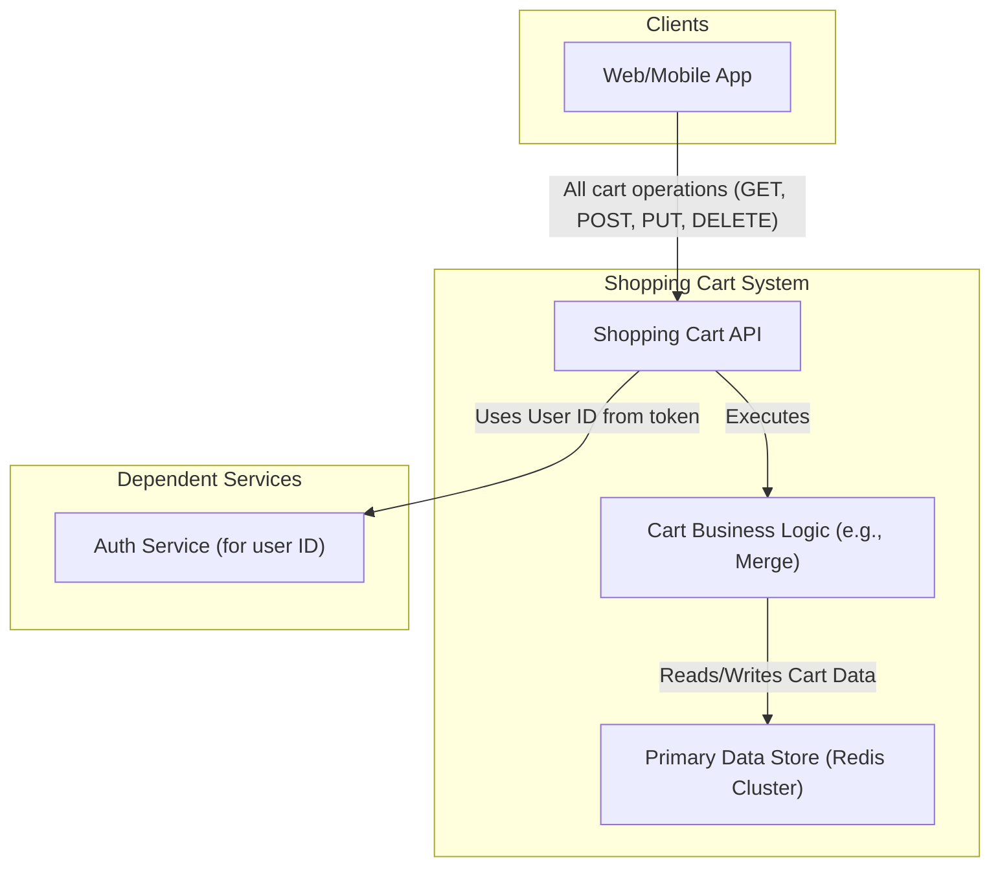
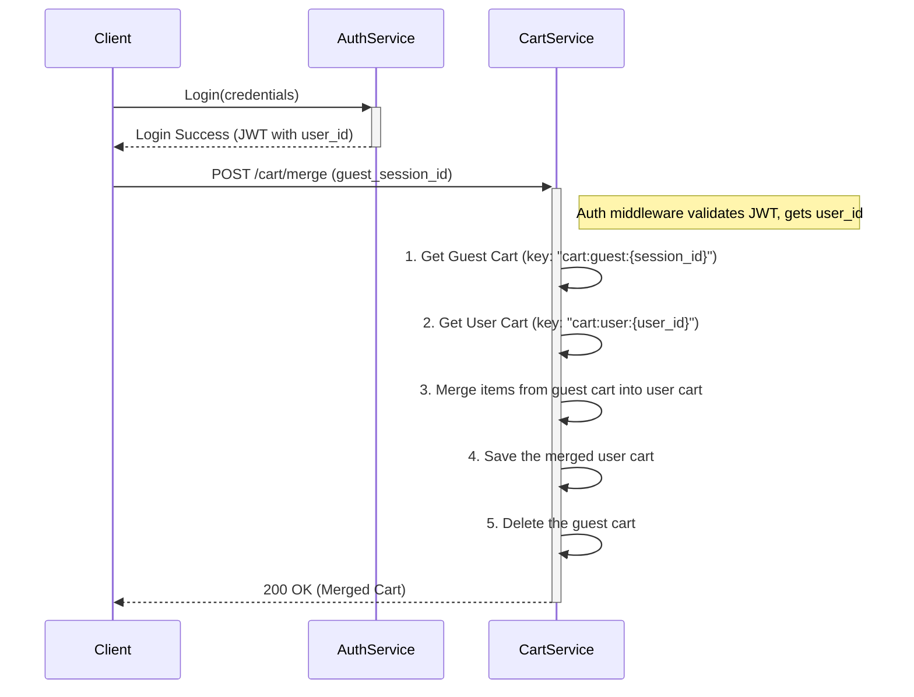

# HLD: Shopping Cart Service

## 1. Document Information
- **Document Title**: High-Level Design for a Shopping Cart Service
- **Version**: 1.0
- **Date**: 2025-08-31
- **Author**: Jules (AI Agent)
- **Status**: Draft

---

## 2. Executive Summary
This document describes the high-level design for a highly available and scalable Shopping Cart Service. This service is responsible for managing the transient state of users' shopping carts. It allows users to add, update, and remove items before proceeding to checkout. The design prioritizes extreme availability and low latency, as it sits on the critical path for all purchases. It is designed as a lightweight, stateless service backed by a high-performance in-memory data store.

---

## 3. Scope

### 3.1 In-Scope
-   **Cart Management**: Full CRUD (Create, Read, Update, Delete) operations on cart items.
-   **Guest & User Carts**: Support for carts for both anonymous (guest) and authenticated users.
-   **Cart Merging**: Logic to merge a guest cart with a user's cart upon login.
-   **Cart Expiration**: Automatic expiration and cleanup of inactive carts using a Time-to-Live (TTL) mechanism.

### 3.2 Out-of-Scope
-   **Checkout Process**: Handled by the Checkout Service.
-   **Inventory Reservation**: Handled by the Inventory Service. The cart service does not lock or reserve stock.
-   **"Save for Later" / Wishlist**: This is considered a separate feature with different durability requirements.
-   **Pricing Information**: The cart service only stores product IDs and quantities. Prices are fetched by the client from the Product Catalog Service.

---

## 4. Core Functional Requirements
-   **FR-001**: A user (guest or authenticated) shall be able to add a specific product variant and quantity to their cart.
-   **FR-002**: A user shall be able to update the quantity of an item already in their cart.
-   **FR-003**: A user shall be able to remove an item from their cart.
-   **FR-004**: The system must retrieve the full contents of a user's cart (list of product IDs and quantities).
-   **FR-005**: When a guest user with items in their cart logs in, their guest cart must be merged with their authenticated user cart.
-   **FR-006**: Carts must automatically expire after a configurable period of inactivity (e.g., 30 days).

---

## 5. Key Non-Functional Requirements (NFRs)
-   **Availability**: **Highest priority (99.99%).** An outage of this service blocks the entire purchase funnel.
-   **Latency**: **Extremely low latency is critical.** All API operations must have a p99 latency of < 50ms.
-   **Scalability**: Must scale to handle millions of concurrent active carts.
-   **Durability**: Data is transient and short-lived. Durability is a secondary concern to availability and performance. Losing a cart is a poor user experience but not a critical system failure.
-   **Consistency**: Eventual consistency is acceptable. The final source of truth for pricing and availability is checked during the checkout process.

---

## 6. High-Level Architecture Diagram

---

## 7. Component Breakdown
-   **Shopping Cart API**: A lightweight API layer that exposes simple endpoints for cart operations. It is responsible for identifying the user (guest or authenticated) and calling the appropriate logic.
-   **Cart Business Logic**: A thin layer containing specific logic that is more complex than a simple CRUD operation, such as the cart merging flow.
-   **Primary Data Store (Redis Cluster)**: This is the core of the service. A Redis Cluster is used as the single source of truth for all cart data. Redis is chosen for its extremely high performance, native support for hash data structures, and TTL capabilities.

---

## 8. Technology Stack
-   **Language**: **Node.js** or **Go** (ideal for high-throughput, non-blocking I/O, perfect for a service that primarily interacts with a cache).
-   **Primary Data Store**: **Redis Cluster**.
-   **Infrastructure**: Docker, Kubernetes.

---

## 9. Data Schema / Data Model
The data is stored in Redis using a Hash data structure for each cart.

-   **Key**: `cart:{user_id}` for authenticated users, or `cart:guest:{session_id}` for guests.
-   **Value**: A Redis Hash mapping `product_variant_id` to `quantity`.

**Example Redis Hash for key `cart:user:12345`:**
| Field (Product Variant ID) | Value (Quantity) |
|----------------------------|------------------|
| `prod_abc_s`               | `2`              |
| `prod_xyz_xl`              | `1`              |
| `last_updated`             | `1677610000`     |

A TTL is set on the entire Redis key to handle automatic cart expiration.

---

## 10. API Endpoints
-   `GET /api/v1/cart`: Retrieves the contents of the current user's cart.
-   `POST /api/v1/cart/items`: Adds a new item to the cart.
    -   Body: `{ "productId": "prod_abc_s", "quantity": 1 }`
-   `PUT /api/v1/cart/items/{itemId}`: Updates the quantity of an existing item.
    -   Body: `{ "quantity": 3 }`
-   `DELETE /api/v1/cart/items/{itemId}`: Removes an item from the cart.
-   `POST /api/v1/cart/merge`: (Internal) Merges a guest cart into a user's cart.
    -   Body: `{ "guestSessionId": "xyz..." }`

---

## 11. Core Logic / User Flows (Cart Merge on Login)

---

## 12. Scalability and Performance Design
-   **In-Memory First**: The entire design is optimized for performance by treating Redis as the primary data store. There is no slower, persistent database in the critical path.
-   **Redis Cluster**: The data is sharded across a Redis Cluster, allowing for horizontal scaling of the data layer and providing high availability.
-   **Stateless Service**: The Cart Service itself is stateless. The number of replicas can be scaled up or down instantly based on traffic.
-   **Lightweight Payloads**: The service only deals with IDs and quantities, keeping network payloads small and fast.

---

## 13. Security and Resilience
-   **Security**: The API must ensure that a user can only ever access their own cart. This is enforced by matching the `user_id` from the JWT token (or the `session_id` from a secure cookie) with the key of the cart being accessed.
-   **Resilience**:
    -   **Redis Cluster**: Provides resilience at the data layer. If a master node fails, a replica is promoted.
    -   **Service Replicas**: Running multiple replicas of the stateless service ensures availability if a single instance fails.
    -   **Graceful Degradation**: In a catastrophic failure of the entire Redis cluster, the API should fail open (return empty carts) or fail closed (return HTTP 503), with alerts firing.

---

## 14. Monitoring and Observability
-   **Redis Metrics**:
    -   Latency of Redis commands.
    -   Memory usage per node.
    -   CPU utilization.
    -   Eviction rates (should be zero, as TTLs are used for expiration).
-   **API Metrics**: Latency and error rates for all endpoints.
-   **Business Metrics**: Number of active carts, number of items added per minute.

---

## 15. Deployment and CI/CD
-   A standard CI/CD pipeline is sufficient.
-   Since the service is stateless and there are no complex database schema migrations, deployments are low-risk and can be performed frequently.
-   A blue-green deployment strategy is effective.
