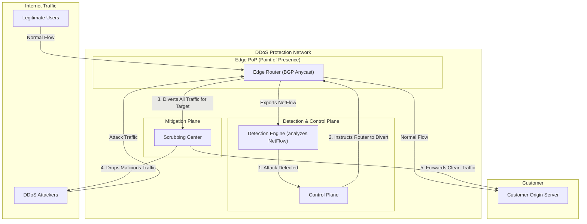

# High-Level Design: DDoS Protection System

## 1. Document Information

- **Document Title**: DDoS Protection System - High-Level Design
- **Version**: 1.0
- **Date**: 2025-08-30
- **Author**: Jules (AI Agent)
- **Status**: Draft

---

## 2. Executive Summary

### 2.1 Purpose
This document outlines the high-level design for a Distributed Denial-of-Service (DDoS) Protection System. This system is designed to defend against large-scale network and transport layer attacks (OSI Layers 3 and 4), such as SYN floods, UDP floods, and amplification attacks. It operates at the edge of the network, inspecting incoming traffic at a massive scale and "scrubbing" malicious traffic before it can reach and overwhelm application infrastructure.

### 2.2 Scope

**In Scope:**
-   A globally distributed network of Points of Presence (PoPs) to ingest traffic close to its source.
-   Network-level traffic analysis to detect anomalous patterns indicative of a DDoS attack.
-   Mitigation techniques like rate limiting, black-holing, and filtering based on packet headers.
-   A central control plane to orchestrate detection and mitigation policies across all PoPs.
-   Protection against common L3/L4 attacks (e.g., UDP floods, SYN floods, ICMP floods).

**Out of Scope:**
-   Protection against application-layer (L7) attacks like SQL injection; this is the job of a Web Application Firewall (WAF).
-   The physical network infrastructure (routers, switches, transit providers).
-   The applications being protected.
-   A detailed implementation of packet inspection hardware/software.

### 2.3 High-Level Architecture Overview
The system is a globally distributed, multi-layered filtering pipeline.
1.  **Edge Network (PoPs):** Traffic is first routed to the nearest Point of Presence (PoP) using BGP Anycast. These PoPs are massive data centers with huge aggregate bandwidth capacity.
2.  **Detection:** Within the PoP, network traffic flow data (e.g., NetFlow, sFlow) is continuously analyzed by a **Detection Engine**. This engine uses a combination of statistical analysis and machine learning to establish a baseline of normal traffic and detect significant deviations that signal an attack.
3.  **Mitigation (Scrubbing):** When an attack is detected, the **Control Plane** activates a mitigation policy. The victim's traffic is diverted to a **Scrubbing Center**, a specialized cluster of high-performance appliances. These appliances perform fine-grained packet inspection and apply filtering rules to drop malicious packets while allowing legitimate traffic to pass through. The clean traffic is then forwarded to the origin application server over a secure tunnel.

---

## 3. System Overview

### 3.1 Business Context
DDoS attacks are a major threat to any online business. A successful attack can render a service completely unavailable to its users, leading to direct revenue loss, reputational damage, and loss of customer trust. A dedicated DDoS protection service is essential infrastructure for maintaining service availability in the face of these common and powerful attacks.

### 3.2 System Purpose
To ensure the availability of online services by automatically detecting and mitigating large-scale DDoS attacks at the network edge, before they can impact the origin servers.

### 3.3 Success Criteria
-   **Mitigation Effectiveness**: The system must successfully mitigate common L3/L4 DDoS attacks, keeping the target service online.
-   **Low False Positives**: The system must not block legitimate traffic during a mitigation action.
-   **Time to Mitigate**: The time from the start of an attack to the system actively mitigating it should be very short (e.g., under 60 seconds).
-   **Massive Scalability**: The system's total bandwidth capacity must exceed that of the largest known DDoS attacks (terabits per second).
-   **Transparency**: The system should have minimal impact on the latency of legitimate traffic when no attack is underway.

### 3.4 Assumptions
-   The service has a globally distributed network with significant bandwidth contracts with transit providers.
-   The service can control network routing for its customers' IP prefixes via BGP.
-   The system can distinguish, with high probability, between legitimate traffic spikes (e.g., a viral marketing campaign) and malicious attacks.

### 3.5 Constraints
-   **Massive Scale**: The system must be built to handle traffic volumes that are orders of magnitude larger than any single application's needs.
-   **High Cost**: Building and maintaining a global network with terabits of capacity is extremely expensive.
-   **"Peacetime" Latency**: Routing traffic through the protection network adds a small amount of latency even when there is no attack.
-   **Encrypted Traffic**: The rise of encryption makes it harder to distinguish malicious from legitimate traffic without performing decryption, which is computationally expensive and has privacy implications.

---

## 4. Requirements Analysis

### 4.1 Functional Requirements
-   **FR-001 (Traffic Ingestion)**: The system must be able to ingest all traffic for a customer's IP address space, typically via BGP routing.
-   **FR-002 (Flow Analysis)**: The system must be able to analyze network flow data (NetFlow/sFlow) to establish traffic baselines.
-   **FR-003 (Attack Detection)**: The system must automatically detect volumetric and protocol-based DDoS attacks.
-   **FR-004 (Traffic Diversion)**: Upon detection, the system must be able to divert traffic destined for the target IP to a scrubbing center.
-   **FR-005 (Packet Filtering)**: The scrubbing appliances must be able to filter packets based on various attributes (source IP, protocol, port, packet length, etc.).
-   **FR-006 (Rate Limiting)**: The system must be able to enforce connection and packet rate limits.
-   **FR-007 (Clean Traffic Forwarding)**: The system must forward legitimate, scrubbed traffic to the origin server, typically over a GRE tunnel.
-   **FR-008 (Reporting)**: The system must provide customers with real-time and historical reports on traffic patterns and mitigated attacks.

### 4.2 Non-Functional Requirements
-   **High Capacity**: Must have a multi-terabit-per-second network capacity.
-   **Low Latency**: Minimal latency impact on clean traffic.
-   **High Availability**: The PoPs and scrubbing centers must be highly available.
-   **Fast Mitigation**: Time-to-mitigate should be in seconds.
-   **Global Presence**: PoPs should be located globally to reduce latency for end-users.
-   **Accuracy**: High true positive rate for detections, very low false positive rate.

---

### 5. Core Architecture

The system is a globally distributed network edge platform with centralized intelligence.

- **Global Edge Network:**
  - A network of **Points of Presence (PoPs)** in dozens of data centers worldwide.
  - **BGP Anycast:** The service announces the customer's IP prefixes from all PoPs. This routes incoming traffic from end-users to the nearest PoP, distributing the load globally. This is the first line of defense against volumetric attacks.
  - **Edge Routers:** High-capacity routers at each PoP that handle the raw traffic. They are configured to export flow data (e.g., NetFlow) to the detection system.

- **Detection Plane:**
  - **Flow Collector:** A service within each PoP that collects and aggregates the vast amount of flow data from the routers.
  - **Detection Engine:** A central or regional big data analytics system that consumes the flow data.
    - It continuously analyzes traffic patterns against historical baselines and known attack signatures.
    - It uses statistical methods to detect anomalies (e.g., a sudden spike in UDP packets to a specific port).
    - When a potential attack is detected, it generates an alert for the Control Plane.

- **Control Plane:**
  - The centralized brain of the system.
  - **Policy Manager:** Stores customer configurations and mitigation policies.
  - **Orchestrator:** When it receives an attack alert from the Detection Engine, it decides on a mitigation strategy.
  - **Action:** It sends commands to the network infrastructure to apply the mitigation. The most common action is to change BGP routes to divert the traffic for the targeted IP address to the nearest Scrubbing Center.

- **Mitigation/Scrubbing Plane:**
  - **Scrubbing Centers:** Specialized, high-capacity clusters co-located with or near the PoPs.
  - **Scrubbing Appliances:** A fleet of high-performance servers or dedicated hardware that receives the diverted, "dirty" traffic.
  - **Filtering Logic:** These appliances apply a series of filters:
    1.  **Stateless Filtering:** Blacklist known bad IPs, filter malformed packets, block non-essential protocols.
    2.  **Stateful Filtering:** Perform TCP SYN authentication (e.g., using SYN cookies) to validate that a connection is from a legitimate client, dropping spoofed SYN flood traffic.
    3.  **Heuristic/Behavioral Filtering:** Apply rate limiting and challenge-response mechanisms to filter more sophisticated attacks.
  - **Clean Traffic Egress:** The filtered, legitimate traffic is then forwarded to the customer's origin server, typically over a secure GRE (Generic Routing Encapsulation) tunnel.

### 6. Data Schema and Models

- **Flow Record (NetFlow/sFlow):** A record containing the "5-tuple" (`source_ip`, `dest_ip`, `source_port`, `dest_port`, `protocol`) plus bytes and packet counts. This is the raw data for the detection engine.
- **Traffic Baseline:** A statistical model (e.g., time-series forecast) of expected traffic volume and protocol mix for a given IP prefix.
- **Mitigation Rule:** A declarative rule applied at the scrubbing layer, e.g., `(protocol == UDP AND dest_port == 53 AND packet_rate > 1Mpps) -> DROP`.

### 7. API Design

The system is primarily managed via a web UI, but key functions are exposed via a REST API for automation.

- **`GET /api/v1/analytics/traffic`**:
  - **Usage:** Get historical traffic data for a given IP prefix.
  - **Query Params:** `ip_prefix`, `start_time`, `end_time`.
- **`GET /api/v1/mitigations`**:
  - **Usage:** Get a list of active and recent DDoS mitigations.
- **`POST /api/v1/mitigations/custom`**:
  - **Usage:** Allow a customer to manually activate a mitigation or adjust its sensitivity.

### 8. Scalability and Performance

- **Massive Bandwidth:** Scalability is achieved by having a massive, globally distributed network footprint that exceeds the capacity of any single attacker.
- **Distributed Ingestion:** Anycast routing naturally distributes the traffic load across all PoPs.
- **Specialized Hardware:** Scrubbing often uses specialized network hardware (FPGAs, NPUs) that can apply filtering rules at line rate (terabits per second).
- **Big Data Analytics:** The detection engine is a large-scale stream processing system capable of analyzing millions of flow records per second.

### 9. Reliability and Fault Tolerance

- **PoP Redundancy:** The Anycast network is inherently fault-tolerant. If a PoP goes offline, BGP automatically re-routes traffic to the next-closest PoP.
- **Scrubbing Center HA:** Scrubbing centers are built with N+1 redundancy for all components.
- **Control Plane HA:** The central control plane is deployed in a highly available configuration, but a failure here would typically only prevent *new* mitigations from being activated, not affect existing ones.

### 10. Security Considerations

- **Protecting the Protector:** The DDoS protection infrastructure itself is a prime target. The control plane and management interfaces must be heavily secured.
- **Amplification Attack Prevention:** The network must be configured to prevent its own servers from being used as part of a reflection/amplification attack (e.g., by implementing BCP 38).
- **False Positives:** The biggest operational security risk is a false positive, where the system incorrectly identifies legitimate traffic as an attack and blocks it, causing an outage for the customer.

### 11. Monitoring and Observability

- **Network Monitoring:** Constant monitoring of traffic volumes, latency, and packet loss across the global network backbone.
- **Detection Efficacy:** Continuously measure the time-to-mitigate and the percentage of malicious traffic successfully dropped.
- **False Positive Rate:** Track how often legitimate traffic is dropped during a mitigation event.

### 12. Deployment and Operations

- **Network Operations Center (NOC):** A 24/7 NOC is required to monitor the network, respond to complex attacks that automated systems cannot handle, and communicate with customers during an incident.
- **Threat Intelligence:** A dedicated security research team is needed to analyze new DDoS attack vectors and develop new mitigation rules and techniques.

### 13. Cost Estimation

- **Dominant Driver:** The massive cost of global network bandwidth and peering agreements with internet service providers.
- **Other Drivers:** The cost of the physical data centers, network hardware (routers, switches, scrubbing appliances), and the large engineering/operations teams.

### 14. Risks and Mitigations

- **Saturation of Network Capacity:**
  - **Risk:** A DDoS attack is larger than the total capacity of the provider's network.
  - **Mitigation:** Continuously invest in increasing network capacity. Have pre-arranged agreements with other large network providers to "black-hole" traffic to a targeted IP address as a last resort.
- **Novel "Zero-Day" Attacks:**
  - **Risk:** An attacker uses a new application-layer attack vector that the L3/L4-focused system does not understand.
  - **Mitigation:** This is why DDoS protection and a WAF are separate, complementary systems. The DDoS system handles the volumetric attack, while the WAF (which sits behind it) handles the L7 attack.
- **Legitimate "Flash Crowd" Event:**
  - **Risk:** The system misinterprets a massive, legitimate traffic spike (e.g., Super Bowl, product launch) as a DDoS attack and starts dropping users.
  - **Mitigation:** The detection engine must be sophisticated enough to look for more than just volume (e.g., protocol distribution, geographic diversity). Allow customers to pre-notify the service of expected large-scale events.

### 15. Final Considerations

A DDoS Protection System is one of the most scaled-out systems in existence, operating at the level of global internet routing. Its architecture is fundamentally about absorbing and filtering massive amounts of traffic far away from the intended target. The use of BGP Anycast for ingestion and a multi-layered detection and scrubbing pipeline is the industry-standard approach. The effectiveness of the system relies not just on the raw capacity of the network, but on the speed and accuracy of the detection engine and the ability to dynamically adapt to the ever-evolving landscape of DDoS attacks.
