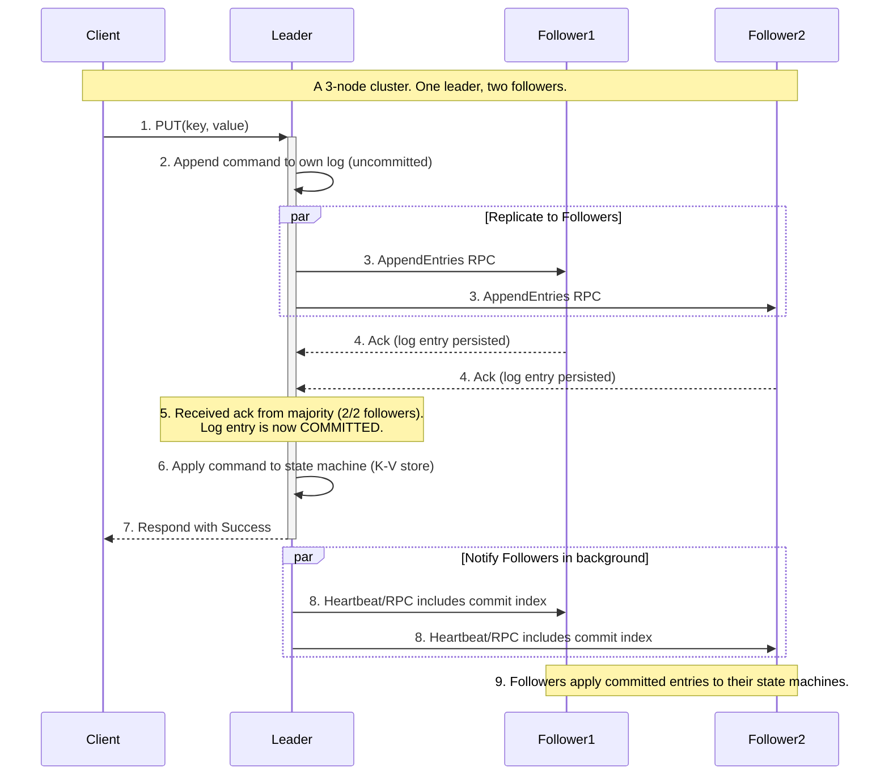

# High-Level Design: Distributed Configuration Management Service

## 1. Document Information

- **Document Title**: Distributed Configuration Management Service - High-Level Design
- **Version**: 1.0
- **Date**: 2025-08-30
- **Author**: Jules (AI Agent)
- **Status**: Draft

---

## 2. Executive Summary

### 2.1 Purpose
This document outlines the high-level design for a Distributed Configuration Management Service, architecturally similar to systems like etcd, Consul, or ZooKeeper. The system is designed to provide a reliable, strongly consistent, and highly available key-value store for holding and distributing critical configuration data, service discovery information, and for coordinating distributed systems (e.g., leader election).

### 2.2 Scope

**In Scope:**
-   A key-value store API for reading and writing configuration data.
-   A distributed consensus algorithm (e.g., Raft) to ensure data consistency and fault tolerance.
-   A "watch" mechanism for clients to subscribe to changes on a key or prefix.
-   Support for Time-To-Live (TTL) on keys for implementing ephemeral nodes and sessions.
-   A cluster of server nodes that form a consensus group.

**Out of Scope:**
-   The clients that connect to the service.
-   A full service mesh implementation (though this system is a key component of one).
-   Large-scale data storage (the system is designed for small, critical metadata, not large blobs).
-   The specific implementation of the consensus algorithm.

### 2.3 High-Level Architecture Overview
The system is a **replicated state machine**. It consists of a small cluster of **Server Nodes** (typically 3 or 5). These servers use a **Consensus Algorithm** (like Raft) to replicate a key-value store. All writes must go through an elected **Leader** node. The leader appends the write to its local log and then replicates it to the **Follower** nodes. A write is only considered "committed" once it has been acknowledged by a majority (a quorum) of the servers. This ensures that the data is safe even if some servers fail. Clients can read from any server, but for strongly consistent reads, they must also go through the leader. A key feature is the **Watch** mechanism, which allows clients to maintain a long-lived connection to a server and be notified almost instantly of any changes to the data they are interested in.

---

## 3. System Overview

### 3.1 Business Context
Managing configuration for a large fleet of servers is a complex problem. Static configuration files are brittle and require a full deployment to change. A distributed configuration service provides a central, reliable, and dynamic source of truth. Services can start up, fetch their configuration, and subscribe to updates, allowing for dynamic reconfiguration of a live system without requiring restarts or deployments. This is also the foundation for service discovery and distributed coordination primitives like leader election.

### 3.2 System Purpose
To provide a highly available and strongly consistent key-value store for the critical metadata of a distributed system, enabling reliable configuration management, service discovery, and coordination.

### 3.3 Success Criteria
-   **Strong Consistency**: A read request should always return the most recently completed write. The system must not return stale data.
-   **High Availability**: The service must remain available for both reads and writes as long as a majority of the server cluster is operational.
-   **Reliability**: Committed data must be durable and never be lost.
-   **Performance**: Reads should be low-latency. Writes will have higher latency due to the consensus protocol.
-   **Watch Reliability**: Clients must be reliably notified of changes.

### 3.4 Assumptions
-   The system runs on a reliable, low-latency network (e.g., within a single data center or cloud region).
-   The total size of the data stored is relatively small (megabytes to a few gigabytes).
-   Clients are "well-behaved" and can handle reconnecting to a different server if their current one fails.

### 3.5 Constraints
-   **Performance vs. Consistency**: The system prioritizes consistency over performance. The consensus protocol adds latency to every write operation.
-   **Cluster Size**: The system works best with a small, odd number of servers (3, 5, or 7). Performance degrades as the cluster size increases due to communication overhead.
-   **Network Sensitivity**: The consensus algorithm is highly sensitive to network latency and partitions.
-   **Small Value Size**: The system is not designed to store large data values.

---

## 4. Requirements Analysis

### 4.1 Functional Requirements
-   **FR-001 (Key-Value API)**: The system must provide basic CRUD (Create, Read, Update, Delete) operations for keys and values.
-   **FR-002 (Prefix Operations)**: The API must support operations on a range of keys with a common prefix (e.g., `GET /v1/keys/config/app1/`).
-   **FR-003 (Distributed Consensus)**: All changes to the key-value store must be committed via a consensus algorithm to ensure linearizability.
-   **FR-004 (Watch Mechanism)**: Clients must be able to subscribe to changes on a key or a key prefix and receive notifications when the data is updated or deleted.
-   **FR-005 (Leases/TTL)**: The system must allow clients to associate a Time-To-Live (TTL) with a key, which will be automatically deleted by the system upon expiry. This is used for leader election and service presence.
-   **FR-006 (Cluster Membership)**: The system must allow for adding and removing nodes from the server cluster.

### 4.2 Non-Functional Requirements
-   **Strong Consistency**: All reads and writes must be linearizable.
-   **High Availability**: The system must tolerate the failure of `(N-1)/2` servers in a cluster of size `N`.
-   **Durability**: Committed writes must be persistent and survive the restart of the entire cluster.
-   **Low-Latency Reads**: Reads should be fast, ideally served from the local leader.
-   **Security**: Communication between clients and servers, and between servers themselves, must be secured with TLS. The API should support authentication and authorization.
-   **Observability**: The system must expose detailed metrics about the health of the cluster and the performance of the consensus algorithm.

---

### 5. Core Architecture

The architecture is that of a replicated state machine, using the Raft consensus algorithm for simplicity and understandability.

- **Server Node:** A single process in the cluster. Each node can be in one of three states: **Leader**, **Follower**, or **Candidate**.
  - **Leader:** At any given time, there is at most one leader. It handles all client write requests, manages log replication, and sends heartbeats to followers.
  - **Follower:** Passively stores the log and state machine. It only accepts requests from the leader or candidates. If it doesn't hear from a leader for a certain election timeout, it becomes a candidate.
  - **Candidate:** A node that is campaigning to become the new leader. It requests votes from other nodes. If it receives votes from a majority, it becomes the leader.

- **Components of a Server Node:**
  - **Consensus Module (Raft):** The core logic for leader election and log replication.
    - **Replicated Log:** An append-only log of all commands (writes, deletes) that have been agreed upon by the cluster. This log is persisted to disk.
    - **State Machine:** The in-memory key-value store. The state machine applies commands from the committed log in order. All nodes applying the same log will have identical state machines.
  - **RPC Module:** Handles communication between server nodes (for voting and log replication) and between clients and servers.
  - **Client-Facing API Server:** Exposes the GET/PUT/DELETE/WATCH API to clients, typically over gRPC or HTTP/REST.

**Write Workflow (Linearizable):**
1.  A client sends a `PUT(key, value)` request to the Leader.
2.  The Leader appends the command to its local log.
3.  The Leader sends `AppendEntries` RPCs with the new command to all Followers.
4.  When a majority of Followers have successfully written the entry to their logs, the entry is considered **committed**.
5.  The Leader applies the command to its local state machine (its in-memory key-value store).
6.  The Leader responds to the client with success.
7.  Followers are notified in subsequent heartbeats that the entry is committed, and they apply it to their local state machines.

**Watch Workflow:**
1.  A client establishes a long-lived gRPC stream to a server, requesting to `WATCH` a key or prefix.
2.  The server notes the key being watched and the current revision of the data store.
3.  It holds the connection open.
4.  When a write commits and the state machine is updated, the consensus module notifies a "watch manager".
5.  The watch manager finds all clients watching the modified key and sends the new key-value data down their open gRPC streams.

### 6. Data Schema and Models

- **Key-Value Store:** Implemented as an in-memory B-tree or similar sorted map structure to allow for efficient range scans (for prefix queries).
- **Log Entry:** A record in the replicated log.
  - `term` (integer): The election term in which this entry was created.
  - `index` (integer): The position of the entry in the log.
  - `command`: The actual `PUT` or `DELETE` operation.
- **Persistent State (on each server's disk):**
  - `current_term`: The latest term the server has seen.
  - `voted_for`: The candidate ID it voted for in the current term.
  - `log[]`: The replicated log itself.

### 7. API Design

The API would likely be exposed via gRPC for performance and streaming capabilities.

- **`KV.Put(key, value) -> PutResponse`**
- **`KV.Range(key, range_end) -> RangeResponse`** (for GET and prefix scans)
- **`KV.DeleteRange(key, range_end) -> DeleteResponse`**
- **`Watch.Watch(key, range_end) -> stream WatchResponse`**: A streaming RPC. The client sends one request, and the server streams back multiple responses over time as the data changes.

### 8. Scalability and Performance

- **Read Performance:** Reads that don't require strict linearizability can be served by any follower, distributing read load. For linearizable reads, the request must be forwarded to the leader to ensure it has the latest committed data.
- **Write Performance:** Write throughput is limited by the consensus protocol. It requires at least one round-trip to a majority of the cluster. Performance is therefore gated by network latency and disk I/O for persisting the log. Batching multiple client requests into a single Raft log entry can significantly improve throughput.
- **Scalability:** The system does not scale its write throughput by adding more servers. In fact, adding servers increases the number of nodes to replicate to, slightly decreasing performance. It scales its fault tolerance. The system is intended for low-volume, high-value metadata.

### 9. Reliability and Fault Tolerance

- **Raft Consensus:** The core of the system's reliability. It guarantees that as long as a majority (`(N/2)+1`) of the cluster is alive and can communicate, the cluster can make progress (commit new writes) and will not lose any previously committed data.
- **Log Compaction/Snapshots:** To prevent the replicated log from growing infinitely, the system periodically takes a snapshot of its in-memory state machine. It can then safely discard all log entries up to that point. This is critical for long-term operation and fast recovery for new or restarted nodes.

### 10. Security Considerations

- **mTLS:** All server-to-server and client-to-server communication must be encrypted and mutually authenticated using TLS.
- **ACLs:** The system must have an Access Control List (ACL) system to restrict which clients can read or write which key prefixes.

### 11. Monitoring and Observability

- **Cluster Health:** Monitor the number of live members, the identity of the current leader, and whether a quorum is maintained.
- **Raft Metrics:**
  - `raft_term`: The current term number.
  - `raft_commit_index`: The index of the last committed log entry.
  - `leader_changes`: A counter for leader elections, which can indicate instability.
- **Latency Metrics:** p99 latency for `PUT` operations and for log replication between nodes.

### 12. Deployment and Operations

- **Cluster Bootstrapping:** Requires a careful process to start the first node and have other nodes join it to form the initial cluster.
- **Membership Changes:** Adding or removing a server from the cluster is a sensitive operation that must be done via the consensus protocol itself to ensure all members agree on the new cluster configuration.

### 13. Cost Estimation

- **Primary Drivers:** The cost of the small number of high-reliability compute instances for the server cluster, and the fast disks (SSDs/NVMe) needed for low-latency log persistence.

### 14. Risks and Mitigations

- **Network Partitions:**
  - **Risk:** The cluster gets partitioned into two or more groups that cannot communicate.
  - **Mitigation:** The Raft protocol is designed to handle this. The partition with a majority of nodes (the quorum) will continue to operate. The minority partition will be unable to make progress. When the partition heals, the nodes in the minority will catch up from the leader's log.
- **Slow Disk I/O:**
  - **Risk:** Slow disk writes on the leader or followers can dramatically slow down the entire cluster's write throughput.
  - **Mitigation:** Use high-performance SSDs. Monitor disk I/O metrics closely and replace nodes with degraded hardware.
- **Misconfiguration:**
  - **Risk:** An operator misconfigures the cluster membership, leading to a loss of quorum.
  - **Mitigation:** Use automated tools and Infrastructure as Code for managing cluster configuration. Require a "pre-vote" phase in the election protocol to prevent nodes with stale logs from disrupting the cluster.

### 15. Final Considerations

A distributed configuration management service is a foundational piece of infrastructure that trades raw performance for very strong guarantees of consistency and availability. Its design, based on a consensus algorithm like Raft, is complex but provides a robust building block for other distributed systems. The "watch" feature is particularly powerful, allowing for the creation of dynamic, reactive systems that can reconfigure themselves in near real-time based on changes in this central source of truth.
