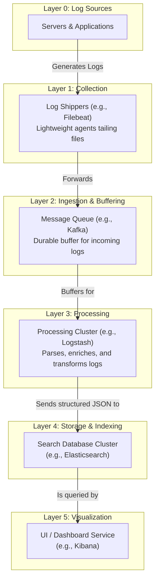

# High-Level Design: Distributed Log Collection System

## 1. Document Information

- **Document Title**: Distributed Log Collection System - High-Level Design
- **Version**: 1.0
- **Date**: 2025-08-30
- **Author**: Jules (AI Agent)
- **Status**: Draft

---

## 2. Executive Summary

### 2.1 Purpose
This document outlines the high-level design for a distributed log collection and analysis system, architecturally similar to the ELK Stack (Elasticsearch, Logstash, Kibana) or other modern logging pipelines (e.g., Fluentd, Loki). The system is designed to collect logs from thousands of servers and applications, parse and structure them, store them in a centralized, searchable database, and provide a user interface for analysis and visualization.

### 2.2 Scope

**In Scope:**
-   Lightweight log shipping agents to be deployed on servers.
-   A central ingestion and processing pipeline for parsing and enriching logs.
-   A scalable, distributed, searchable database optimized for text data.
-   A user interface for searching, filtering, and visualizing log data.
-   A mechanism for archiving old logs to cheaper storage.

**Out of Scope:**
-   The applications that generate the logs.
-   Metrics collection and alerting (this is handled by a separate monitoring system).
-   The underlying infrastructure for the cluster.
-   The specific parsing logic for every log format (the system provides the framework).

### 2.3 High-Level Architecture Overview
The architecture is a multi-stage data pipeline. **Log Shippers** (e.g., Filebeat, Fluentd) are lightweight agents deployed on every host. They tail log files and forward the log entries to a central **Ingestion & Processing Layer** (e.g., Logstash or a Kafka queue). This layer is responsible for parsing the unstructured log lines, enriching them with metadata (e.g., geo-IP lookup), and transforming them into a structured format like JSON. The structured logs are then sent to the **Storage & Indexing Layer** (e.g., Elasticsearch), a distributed database optimized for full-text search. Finally, a **Visualization Layer** (e.g., Kibana) provides a web UI for users to explore, search, and create dashboards on top of the data in Elasticsearch.

---

## 3. System Overview

### 3.1 Business Context
In a distributed system, understanding application behavior and debugging failures requires access to logs from hundreds or thousands of services. Centralizing these logs in a single, searchable platform is essential for effective troubleshooting, security analysis, and operational intelligence. It allows engineers to quickly search across all services to trace a request or identify the root cause of an error.

### 3.2 System Purpose
To provide a scalable and centralized platform for collecting, storing, searching, and analyzing log data from an entire IT infrastructure, enabling rapid troubleshooting and deep operational visibility.

### 3.3 Success Criteria
-   **Search Performance**: Typical search queries over recent data (e.g., last hour) should return in a few seconds.
-   **Ingestion Scalability**: The system must be able to ingest terabytes of log data per day.
-   **Data Freshness**: Logs should be searchable within a short time of being generated (e.g., < 1 minute).
-   **Reliability**: The logging pipeline should be resilient to data spikes and component failures, with minimal log loss.
-   **Ease of Use**: The UI should make it easy for developers to search and filter logs without needing to be experts in a complex query language.

### 3.4 Assumptions
-   Logs are mostly unstructured or semi-structured text.
-   The primary use case is interactive searching and troubleshooting, not long-term compliance archiving (though the system can support it).
-   A significant amount of compute and storage resources will be dedicated to this system.

### 3.5 Constraints
-   **High Storage Costs**: Storing and indexing massive volumes of text data can be very expensive.
-   **High Resource Consumption**: The indexing process is CPU and I/O intensive.
-   **"Garbage In, Garbage Out"**: If logs are not properly parsed and structured at ingestion time, they become very difficult to search and analyze effectively.
-   **Query Complexity**: While powerful, the search query language can be complex for casual users.

---

## 4. Requirements Analysis

### 4.1 Functional Requirements
-   **FR-001 (Log Collection)**: The system must provide lightweight agents to collect logs from files, systemd journals, and other sources.
-   **FR-002 (Buffering)**: The ingestion pipeline must include a durable buffer (e.g., a message queue) to absorb load spikes and prevent log loss if the storage layer is slow or unavailable.
-   **FR-003 (Parsing & Enrichment)**: The system must be able to parse various log formats (e.g., Apache access logs, JSON logs) and enrich logs with additional data (e.g., adding GeoIP data from an IP address).
-   **FR-004 (Storage & Indexing)**: The system must store logs in a way that allows for fast full-text search and filtering on structured fields.
-   **FR-005 (Search UI)**: The system must provide a web interface for users to perform searches, filter by fields, and view log entries over time.
-   **FR-006 (Visualization)**: The UI must allow users to create dashboards and visualizations (e.g., pie charts of status codes, line charts of error rates) from the log data.
-   **FR-007 (Data Retention)**: The system must support time-based retention policies to automatically delete old log data.

### 4.2 Non-Functional Requirements
-   **Scalability**: All layers of the pipeline (ingestion, storage, visualization) must be horizontally scalable.
-   **High Availability**: The system must be highly available, especially the ingestion endpoint and the storage cluster.
-   **Performance**: Low ingestion latency and fast search query performance.
-   **Durability**: Minimize log loss during transport and processing.
-   **Security**: Access to the search UI must be authenticated and authorized. Sensitive data in logs should be masked during the parsing stage.
-   **Multi-tenancy**: The system should be able to logically separate logs from different teams or environments.

---

### 5. Core Architecture

The architecture is a classic, multi-stage data pipeline designed to process and index large volumes of text data.

- **Layer 1: Collection (The "Beats")**
  - **Log Shippers (e.g., Filebeat):** Lightweight agents deployed on every source machine. They are designed to be efficient and have a small resource footprint.
  - Their sole responsibility is to tail log files, track file positions, and forward log lines securely to the next layer. They do minimal parsing.

- **Layer 2: Ingestion & Buffering (The "Queue")**
  - **Message Queue (e.g., Kafka or Redis):** This is a critical component for reliability and scalability.
  - Log shippers send data here, not directly to the processors.
  - This provides a durable buffer that absorbs load spikes and allows the processing and storage layers to be taken down for maintenance without losing incoming logs.

- **Layer 3: Processing (The "Logstash")**
  - **Processors (e.g., Logstash, or a custom Flink/Spark Streaming job):** A cluster of worker nodes that consume from the message queue.
  - They perform the heavy lifting:
    - **Parsing:** Applying parsers (e.g., Grok for regex-based parsing, JSON parser) to transform unstructured text into structured fields.
    - **Enrichment:** Adding metadata, such as performing a GeoIP lookup on an IP address or adding server information.
    - **Transformation:** Normalizing field names, masking sensitive data.
  - The processed, structured log (now typically a JSON object) is then sent to the storage layer.

- **Layer 4: Storage & Indexing (The "Elasticsearch")**
  - **Search Database (e.g., Elasticsearch):** A distributed, document-oriented database built on Apache Lucene.
  - It stores the JSON log documents and builds an inverted index on all fields, which allows for extremely fast full-text searching and filtering.
  - Data is stored in time-based indices (e.g., one index per day). This makes it easy to manage data retention by simply deleting old indices.
  - The database runs as a cluster of nodes for scalability and high availability.

- **Layer 5: Visualization (The "Kibana")**
  - **UI/Dashboard Service (e.g., Kibana):** A web application that acts as the user interface for the system.
  - It connects to the Elasticsearch cluster's query API.
  - It provides a UI for building complex search queries, exploring log data, and creating visualizations and dashboards.



### 6. Data Schema and Models

- **Raw Log:** A single line of text, e.g., `127.0.0.1 - - [10/Oct/2000:13:55:36 -0700] "GET /apache_pb.gif HTTP/1.0" 200 2326`.
- **Structured Log (JSON document in Elasticsearch):**
  ```json
  {
    "@timestamp": "2000-10-10T20:55:36.000Z",
    "client_ip": "127.0.0.1",
    "http_verb": "GET",
    "request_path": "/apache_pb.gif",
    "response_code": 200,
    "bytes_sent": 2326,
    "geoip": {
      "country_code": "US",
      "city_name": "New York"
    }
  }
  ```
- **Index Template:** A configuration in Elasticsearch that defines the default mappings (data types, analyzers) for fields in a new time-based index.

### 7. API Design

The system's APIs are primarily the internal protocols between components and the query API of the storage layer.

- **Elasticsearch Query API (`POST /{index}/_search`):**
  - **Usage:** Used by the visualization layer (Kibana) to search for logs.
  - **Body:** A rich JSON-based Query DSL for expressing complex search criteria.

### 8. Scalability and Performance

- **Horizontal Scalability:** Every layer in the stack is designed to be horizontally scalable. More log shippers can be deployed, the message queue can be expanded, and more processor or Elasticsearch nodes can be added to the clusters to handle increased load.
- **Indexing Performance:** Elasticsearch achieves high write throughput by using techniques like in-memory buffering and append-only segment files.
- **Search Performance:** The use of an inverted index allows for very fast lookups of search terms. Caching at various levels (e.g., OS page cache, Elasticsearch query cache) further improves performance.

### 9. Reliability and Fault Tolerance

- **Agent Buffering:** Log shippers can buffer logs on local disk if they cannot reach the message queue.
- **Durable Queue:** The message queue is the most important component for reliability, preventing log loss during downstream failures.
- **Clustering:** The processing and storage layers run as clusters, providing high availability. Elasticsearch, for example, shards and replicates its indices across multiple nodes. If a node fails, its shards can be recovered on another node.

### 10. Security Considerations

- **Secure Transport:** All communication between components (shipper to queue, processor to Elasticsearch) must be encrypted with TLS.
- **Access Control:** The visualization layer (Kibana) must have its own authentication and authorization system, providing role-based access to different log indices.
- **Data Masking:** The processing layer must have rules to find and mask or redact sensitive PII (e.g., credit card numbers, passwords) from logs before they are stored.

### 11. Monitoring and Observability

- **Pipeline Monitoring:** The health of the logging pipeline itself is critical.
  - **Queue Depth:** The number of messages in the central buffer queue is a key indicator of health. A rapidly growing queue means the processing or storage layer can't keep up.
  - **Ingestion Latency:** The end-to-end time from when a log is generated to when it is searchable.
- **Elasticsearch Cluster Health:** Monitor the cluster status (green, yellow, red), disk space, CPU usage, and indexing/search latency.

### 12. Deployment and Operations

- **Index Lifecycle Management (ILM):** This is a key operational task. ILM policies are defined in Elasticsearch to automatically manage indices:
  - **Rollover:** Create a new index each day.
  - **Hot/Warm/Cold Architecture:** Move older indices to nodes with cheaper, slower storage.
  - **Deletion:** Automatically delete indices older than the defined retention period.
- **Configuration as Code:** The configurations for Logstash pipelines, Filebeat agents, and Elasticsearch templates should be managed in version control.

### 13. Cost Estimation

- **Primary Drivers:**
  - **Storage:** The cost of the high-performance SSDs required by the Elasticsearch cluster. This is driven by the daily log volume and the retention period.
  - **Compute:** The cost of the Elasticsearch and Logstash cluster nodes, which are often CPU and memory intensive.
  - **Data Transfer:** Network costs for shipping logs between components, especially across availability zones.

### 14. Risks and Mitigations

- **Mapping Explosion:**
  - **Risk:** Logs with dynamic or unbounded field names (e.g., using a user ID as a JSON key) can cause an "explosion" in the number of unique fields in an Elasticsearch index, leading to performance degradation and memory issues.
  - **Mitigation:** Implement strict parsing at the ingestion layer. Use an index template to enforce a schema and reject unexpected fields.
- **"Garbage In, Garbage Out":**
  - **Risk:** Poorly structured or unparsed logs are ingested, making them useless for analysis and searching.
  - **Mitigation:** Establish a standardized logging format (e.g., JSON) across all applications. Implement a robust parsing layer and move any unparseable logs to a "dead letter queue" for review.

### 15. Final Considerations

A centralized logging system is an indispensable tool for observability in a distributed environment. The ELK-style architecture is popular because it is powerful, scalable, and flexible. Its success hinges on the processing layer's ability to transform messy, unstructured logs into clean, structured data and the storage layer's ability to index this data for fast searching. The biggest operational challenges are managing the cost of the storage and compute resources and enforcing good logging practices across the organization to prevent "garbage in, garbage out."
