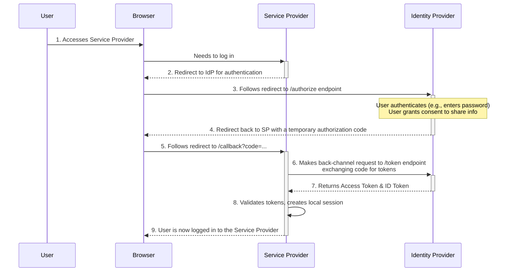

# High-Level Design: Identity Provider (IdP)

## 1. Document Information

- **Document Title**: Identity Provider (IdP) - High-Level Design
- **Version**: 1.0
- **Date**: 2025-08-30
- **Author**: Jules (AI Agent)
- **Status**: Draft

---

## 2. Executive Summary

### 2.1 Purpose
This document outlines the high-level design for an Identity Provider (IdP). An IdP is a centralized service that manages a user's identity and provides authentication services to other applications, known as Service Providers (SPs) or Relying Parties (RPs). This allows users to use a single set of credentials to log in to multiple, independent applications (Single Sign-On - SSO). This design focuses on supporting two major federation protocols: **OAuth 2.0** (for authorization flows) and **SAML 2.0** (for enterprise SSO).

### 2.2 Scope

**In Scope:**
-   A central user authentication service (login pages, etc.).
-   Implementation of the server-side logic for standard SSO protocols (OAuth 2.0 and SAML 2.0).
-   Management of client applications (Service Providers), including their credentials and redirect URIs.
-   Issuance of security tokens (e.g., SAML assertions, JWTs).
-   A user consent screen for third-party application access.

**Out of Scope:**
-   The Service Provider applications that integrate with the IdP.
-   The user interface for user self-registration or profile management.
-   The underlying user database (we assume one exists).
-   Advanced features like adaptive authentication or risk-based access control.

### 2.3 High-Level Architecture Overview
The system is a centralized, web-facing authentication authority. When a user tries to access a **Service Provider (SP)**, the SP redirects the user's browser to the **Identity Provider (IdP)**. The IdP authenticates the user (if they don't already have an active session). After successful authentication, the IdP presents a **consent screen** if required. Once consent is granted, the IdP generates a **security assertion** (a SAML assertion or an OAuth authorization code) and redirects the user's browser back to the SP, passing the assertion along. The SP then validates this assertion (either directly or by exchanging the code for a token) and establishes a logged-in session for the user.

---

## 3. System Overview

### 3.1 Business Context
In a world with countless online services, users are fatigued by managing dozens of different passwords. Businesses with multiple products want to provide a seamless user experience, allowing users to log in once and access everything. Identity Providers and SSO solve these problems. They improve user experience, centralize security and user management, and simplify integration for application developers, who can offload the complexities of authentication.

### 3.2 System Purpose
To act as a central, trusted authority for user identity, enabling Single Sign-On (SSO) across a wide range of first-party and third-party applications using standard, interoperable protocols.

### 3.3 Success Criteria
-   **Security**: The IdP is the ultimate source of trust for authentication and must be extremely secure.
-   **Interoperability**: The IdP must correctly implement the OAuth 2.0 and SAML 2.0 specifications to work with standard off-the-shelf client libraries and applications.
-   **High Availability**: The IdP is a critical dependency for logging into all integrated applications. It must be highly available.
-   **User Experience**: The SSO flow should be as seamless and low-friction as possible for the user.
-   **Scalability**: The system must scale to handle authentication requests for millions of users.

### 3.4 Assumptions
-   A primary user store (database or directory) exists.
-   Service Provider applications are developed by trusted parties who can securely store client secrets.
-   Users' browsers are capable of handling HTTP redirects and cookies.

### 3.5 Constraints
-   **Protocol Complexity**: OAuth 2.0 and especially SAML 2.0 are complex specifications with many possible flows and potential security pitfalls if implemented incorrectly.
-   **Critical Security Component**: A vulnerability in the IdP could compromise every integrated application.
-   **Browser-Based Flows**: The core SSO flows rely on browser redirects, which can be complex to manage and secure (e.g., protecting against CSRF, open redirect vulnerabilities).
-   **Session Management**: The IdP must manage its own central session for the user to enable a seamless SSO experience.

---

## 4. Requirements Analysis

### 4.1 Functional Requirements
-   **FR-001 (SP Registration)**: Administrators must be able to register new Service Provider applications, generating client IDs and secrets and configuring allowed redirect URIs.
-   **FR-002 (User Authentication)**: The IdP must provide a user interface for users to log in with their credentials.
-   **FR-003 (SSO Session Management)**: The IdP must maintain a session for authenticated users (e.g., via a secure cookie) to prevent them from having to log in for every request.
-   **FR-004 (SAML 2.0 SSO Flow)**: The system must support the SP-initiated SAML 2.0 Web Browser SSO Profile. This involves receiving an `AuthnRequest`, authenticating the user, and returning a signed SAML `Response` with an assertion.
-   **FR-005 (OAuth 2.0 Authorization Code Flow)**: The system must support the OAuth 2.0 Authorization Code Grant flow. This involves handling a request to the `/authorize` endpoint and providing an authorization code, and then handling a request to the `/token` endpoint to exchange that code for an access token.
-   **FR-006 (User Consent)**: For third-party applications, the IdP must display a consent screen to the user, asking for permission to share their information with the SP.
-   **FR-007 (Token/Assertion Issuance)**: The IdP must be able to generate and sign security tokens (SAML Assertions, JWTs) containing user identity information.

### 4.2 Non-Functional Requirements
-   **Security**: The system must be protected against CSRF, XSS, session hijacking, and other common web vulnerabilities. All sensitive communication must use TLS.
-   **High Availability**: The IdP service must be deployed in a highly available, fault-tolerant configuration.
-   **Scalability**: The service must be horizontally scalable to handle high authentication loads.
-   **Performance**: The login and redirect flows should be fast and efficient.
-   **Auditability**: Every authentication event, consent grant, and token issuance must be securely logged for auditing.
-   **Interoperability**: The system's SAML metadata and OAuth 2.0 discovery documents must be compliant with the respective standards.

---

### 5. Core Architecture

The IdP is a stateful web application with several key components, designed to handle complex redirect-based authentication flows securely.

- **Frontend/UI Layer:**
  - Provides the user-facing pages: Login, Password Reset, Consent Screen, and Profile Management.
  - This is a standard web application (e.g., built with React or similar).

- **SSO Core Service:**
  - The main backend service that orchestrates the SSO flows.
  - **Session Manager:** Manages the user's central SSO session via a secure, encrypted cookie.
  - **Protocol Endpoints:** Implements the required endpoints for the different protocols:
    - **SAML:** `/saml/sso` (for receiving `AuthnRequest` and sending `Response`).
    - **OAuth 2.0 / OIDC:** `/oauth/authorize` (for user consent and issuing auth codes) and `/oauth/token` (for exchanging codes for tokens).
  - **Token/Assertion Service:** Generates, signs, and encrypts the SAML assertions and JWTs.
  - **Client Registry:** A component that loads information about registered Service Providers (clients) from the database, including their redirect URIs, client secrets, and requested permissions (scopes).

- **Data Stores:**
  - **User Database:** The primary source of truth for user identities and credentials.
  - **IdP Configuration Database:** Stores information about registered client applications (SPs/RPs), user consent grants, issued refresh tokens, and active sessions.
  - **Session Cache (e.g., Redis):** A cache for storing active SSO session data to reduce database load.

- **Security Components:**
  - **Signing Key Manager:** Manages the private keys used to sign SAML assertions and JWTs. These keys must be stored in a secure location, preferably a Hardware Security Module (HSM) or a managed KMS.
  - **CSRF Protection:** Implements anti-CSRF tokens (e.g., the `state` parameter in OAuth 2.0) to protect redirect-based flows.

**Example Flow (OAuth 2.0 Authorization Code):**
1.  User clicks "Login with MyIdP" on a Service Provider's website.
2.  SP redirects the user's browser to the IdP's `/authorize` endpoint with parameters like `client_id`, `redirect_uri`, `scope`, and `state`.
3.  The IdP's SSO Core service checks if the user has an active SSO session (via cookie).
4.  If not, it presents the Login page. The user authenticates. The IdP sets a session cookie.
5.  The IdP checks if the user has already consented to the requested `scope` for this `client_id`.
6.  If not, it presents the Consent page. The user approves.
7.  The IdP generates a short-lived, single-use **authorization code**, stores it, and redirects the user's browser back to the SP's `redirect_uri` with the code and the original `state` parameter.
8.  The SP's backend receives the code. It makes a direct, back-channel API call to the IdP's `/token` endpoint, presenting the authorization code and its `client_id`/`client_secret`.
9.  The IdP validates the code and credentials, and if valid, returns an **Access Token** and **ID Token** (JWTs).
10. The SP validates the tokens and logs the user in.

### 6. Data Schema and Models

- **Clients Table (in IdP Config DB):**
  - `client_id` (Primary Key), `client_secret_hash`, `application_name`, `allowed_redirect_uris` (array), `allowed_scopes` (array).
- **Consents Table:** `user_id`, `client_id`, `granted_scopes` (array).
- **Authorization Codes Table:** `code` (Primary Key), `user_id`, `client_id`, `redirect_uri`, `expiry_time`.
- **SAML Assertion:** An XML-based security token containing a `Subject` with user attributes and `Conditions` specifying its validity. It is digitally signed.
- **JWT (Access/ID Token):** A JSON-based token containing claims about the user and the authentication event, signed by the IdP.

### 7. API Design

The API consists of the standard, specification-defined endpoints.

- **OAuth 2.0 / OIDC:**
  - `GET /authorize`: The browser-based endpoint for authentication and consent.
  - `POST /token`: The back-channel endpoint for exchanging codes/credentials for tokens.
  - `GET /.well-known/openid-configuration`: A discovery endpoint where clients can find metadata about the IdP's capabilities and other endpoints.
- **SAML 2.0:**
  - `POST /saml/sso`: The endpoint that receives the `AuthnRequest` and to which the browser is redirected back with the `SAMLResponse`.
  - `GET /saml/metadata`: An endpoint that serves the IdP's SAML metadata XML file.

### 8. Scalability and Performance

- **Stateless Core:** The SSO Core Service is stateless and can be scaled horizontally.
- **Database Scaling:** The workload is read-heavy. Standard database scaling with read replicas is effective.
- **Caching:** Caching client application configurations and user sessions in Redis can significantly reduce database load and improve latency.

### 9. Reliability and Fault Tolerance

- **High Availability:** All components (web frontend, SSO core, databases) are deployed redundantly across multiple availability zones.
- **Stateless Design:** The stateless nature of the core service makes it resilient to individual node failures. A load balancer will simply redirect traffic to a healthy node.

### 10. Security Considerations

- **Redirect URI Whitelisting:** The IdP must strictly enforce that it will only redirect users back to pre-registered `redirect_uri`s to prevent open redirect vulnerabilities.
- **CSRF and Replay Protection:** The `state` parameter in OAuth 2.0 and the `RelayState` and ID-based matching in SAML are critical for preventing Cross-Site Request Forgery and other attacks.
- **Client Authentication:** The `/token` endpoint must authenticate the client application (e.g., using its client secret) to ensure authorization codes are not stolen and used by malicious applications.
- **Key Management:** The security of the token/assertion signing keys is paramount. They must be stored in an HSM and rotated regularly.

### 11. Monitoring and Observability

- **Authentication Funnel:** Monitor the number of successful and failed logins, consent grants, and token issuances.
- **Security Event Auditing:** Every security-sensitive event must be logged to a tamper-evident audit trail.
- **Latency Metrics:** Monitor the latency of each step in the SSO flow.

### 12. Deployment and Operations

- **Key Rotation:** A well-defined, zero-downtime procedure for rotating the signing keys is essential. The IdP should publish its new public keys to its metadata endpoint before it starts using the new private key for signing.
- **Client Onboarding:** A secure process for registering new applications and providing them with credentials.

### 13. Cost Estimation

- **Primary Drivers:**
  - **Compute:** The cost of the web and service instances.
  - **Databases:** The cost of the managed databases for users and IdP configuration.
  - **HSM/KMS:** The cost of the secure key management service.

### 14. Risks and Mitigations

- **Open Redirect Vulnerability:**
  - **Risk:** An attacker tricks the IdP into redirecting a user to a malicious site after login.
  - **Mitigation:** Strict validation of the `redirect_uri` parameter against the pre-registered whitelist for that client.
- **Credential Leak:**
  - **Risk:** The IdP's user database is compromised.
  - **Mitigation:** Use strong, salted password hashing. Enforce multi-factor authentication (MFA) for all users.
- **Leaked Client Secret:**
  - **Risk:** A Service Provider's client secret is leaked, allowing an attacker to impersonate that application.
  - **Mitigation:** Use more secure client authentication methods like private key JWTs (mTLS). Provide a mechanism for application owners to immediately rotate their secrets.

### 15. Final Considerations

An Identity Provider is a highly sensitive and complex system that forms the foundation of trust for a digital ecosystem. A correct and secure implementation of standard protocols like OAuth 2.0 and SAML is non-trivial and requires deep expertise. The design must prioritize security at every layer, from protecting against common web vulnerabilities in the browser-based flows to the physical security of the signing keys. By centralizing authentication, an IdP provides significant benefits in user experience and security management, but it also becomes a very high-value target for attackers.
