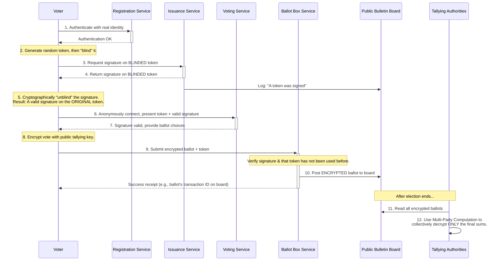

# High-Level Design: Online Voting System

## 1. Document Information

- **Document Title**: Online Voting System - High-Level Design
- **Version**: 1.0
- **Date**: 2025-08-30
- **Author**: Jules (AI Agent)
- **Status**: Draft

---

## 2. Executive Summary

### 2.1 Purpose
This document outlines the high-level design for a secure, private, and auditable Online Voting System. The system is designed to allow eligible, registered voters to cast their ballots electronically while ensuring the integrity of the election. The design must balance the often-conflicting goals of **voter anonymity** (no one can know how a specific person voted), **ballot integrity** (votes cannot be altered, duplicated, or forged), and **end-to-end verifiability** (voters and auditors can confirm that all votes were counted correctly).

### 2.2 Scope

**In Scope:**
-   A voter registration and authentication service.
-   A ballot issuance service that provides anonymous voting tokens.
-   A secure and anonymous ballot submission service.
-   A "digital ballot box" for storing encrypted, anonymized ballots.
-   A tallying service to count the votes after the election closes.
-   A public, append-only "bulletin board" for auditing purposes.

**Out of Scope:**
-   The process of registering citizens to be eligible voters.
-   The client-side application (web or mobile) used for voting.
-   The physical infrastructure.
-   The specific cryptographic primitives (we will describe their function, not their implementation).

### 2.3 High-Level Architecture Overview
The system is a sequence of decoupled, security-focused services that interact to separate identity from the vote itself.
1.  **Voter Registration Service:** An eligible voter authenticates themselves.
2.  **Ballot Issuance Service:** Upon successful authentication, this service issues a unique, single-use, anonymous **voting token**. The link between the voter's identity and this token is immediately destroyed.
3.  **Voting Service:** The voter uses the anonymous token to request a ballot. They cast their vote, which is encrypted on the client side.
4.  **Ballot Box Service:** The encrypted ballot is submitted to this service, which verifies the anonymous token has not been used and stores the encrypted ballot.
5.  **Public Bulletin Board:** Every significant, non-anonymous action (e.g., issuance of a token, submission of an encrypted ballot) is posted to a public, immutable log for auditing.
6.  **Tallying Service:** After the election, a set of independent, trusted authorities use a multi-party computation (MPC) or threshold cryptography scheme to collectively decrypt and tally the votes without any single party being able to see individual decrypted ballots.

---

## 3. System Overview

### 3.1 Business Context
Online voting is often proposed as a way to increase voter turnout and accessibility. However, it presents immense security and privacy challenges that are far greater than those in e-commerce or online banking. A successful online voting system must be exceptionally resilient to attack and transparently auditable to gain public trust.

### 3.2 System Purpose
To create a trustworthy electronic voting system that guarantees the secrecy and integrity of the ballot, while allowing for public verification of the election outcome.

### 3.3 Success Criteria
-   **Security**: The system must be resilient to attacks aimed at changing votes, stuffing the ballot box, or breaching voter anonymity. This is the paramount success criterion.
-   **Anonymity/Privacy**: It must be computationally infeasible to link a cast ballot back to the identity of the voter.
-   **Integrity**: Every valid vote must be counted, and no invalid votes can be added. Votes cannot be altered.
-   **Verifiability**:
    -   **Individual Verifiability**: A voter should be able to confirm their vote was included in the final tally.
    -   **Universal Verifiability**: Anyone should be able to verify that the final tally is a correct count of all the cast ballots.
-   **Availability**: The system must be available throughout the voting period and resilient to DDoS attacks.

### 3.4 Assumptions
-   A trusted process for initial voter registration exists.
-   A set of trusted, independent authorities is available to participate in the tallying process.
-   Voters have access to a reasonably secure device for casting their vote.

### 3.5 Constraints
-   **The Anonymity vs. Verifiability Dilemma**: These two goals are in direct conflict. A system that makes it easy to prove *how* you voted also makes it easy for someone to coerce you or buy your vote. The design must navigate this carefully.
-   **No Trust in a Single Component**: The system must be designed with a "zero trust" approach. No single server, administrator, or authority should be able to compromise the integrity or anonymity of the election.
-   **Extreme Threat Model**: The system must assume it will be targeted by sophisticated, well-funded state-level adversaries.
-   **Client-Side Security**: The security of the voter's own device is a major weak point that is largely outside the system's control.

---

## 4. Requirements Analysis

### 4.1 Functional Requirements
-   **FR-001 (Voter Authentication)**: The system must securely authenticate a registered voter's identity.
-   **FR-002 (Anonymous Token Issuance)**: The system must provide a single, anonymous voting token to each authenticated voter, ensuring one voter gets one vote. The linkage between voter and token must be broken.
-   **FR-003 (Ballot Casting)**: The system must allow a voter to cast their choices on a ballot, which is then encrypted before submission.
-   **FR-004 (Anonymous Ballot Submission)**: The system must accept the encrypted ballot only if it is accompanied by a valid, unused anonymous token.
-   **FR-005 (Immutable Public Record)**: All key events must be logged to a public, append-only bulletin board for auditing.
-   **FR-006 (Secure Tallying)**: The system must provide a secure, multi-party process for decrypting and tallying the votes after the election has concluded.
-   **FR-007 (Receipt Generation)**: The system should provide a voter with a receipt that allows them to verify their encrypted ballot appeared on the public bulletin board, but which cannot be used as proof of how they voted to a third party.

### 4.2 Non-Functional Requirements
-   **Security**: End-to-end encryption, resistance to tampering, DDoS protection.
-   **Anonymity**: Strong cryptographic guarantees separating voter identity from their vote.
-   **Auditability/Transparency**: All non-anonymous parts of the process must be publicly verifiable.
-   **High Availability**: The voting service must remain online during the entire voting period.
-   **Scalability**: The system must handle high load, especially at the beginning and end of the voting period.
-   **Correctness**: The final tally must be provably correct.

---

### 5. Core Architecture

The architecture is a workflow of highly-specialized, decoupled services designed to enforce the separation of identity and vote. This design uses a **Blind Signature** scheme to achieve anonymity.

- **1. Registration Service:**
  - A standard service where voters authenticate using their pre-existing credentials. This is the only component that knows the voter's real identity.

- **2. Issuance Service (The "Blinding" Authority):**
  - After a voter authenticates, the client application generates a unique, random token (the "ballot").
  - The client "blinds" this token using a cryptographic blinding factor.
  - The voter sends the blinded token to the Issuance Service.
  - The Issuance Service, which acts as a signing authority, signs the blinded token *without seeing the original token*. It returns the blinded signature. This is a critical step.
  - The client then "unblinds" the signature, resulting in a valid signature on the original, unblinded token. The Issuance Service has now certified a token without ever knowing which token it certified.

- **3. Voting Service:**
  - Later, the voter connects to the Voting Service, completely anonymously.
  - They present their original token and the now-valid signature.
  - The Voting Service verifies the signature using the Issuance Service's public key. If valid, it knows this is an authorized voter, but has no idea *which* voter.
  - It provides the voter with the election choices. The voter makes their selection, and the client encrypts the ballot.

- **4. Ballot Box Service:**
  - The anonymous voter submits their encrypted ballot along with the now-used token to the Ballot Box.
  - The Ballot Box verifies the signature on the token again and checks a database of used tokens to ensure this token hasn't been used before.
  - If valid, it stores the encrypted ballot and marks the token as used.

- **5. Public Bulletin Board:**
  - An immutable, append-only log (e.g., a Trillian log or a permissioned blockchain).
  - The Issuance Service posts a record for every blinded token it signs.
  - The Ballot Box posts every encrypted ballot it receives.
  - This allows anyone to verify that the number of signed tokens equals the number of ballots cast, without revealing any links.

- **6. Tallying Authorities:**
  - A group of independent, trusted organizations (e.g., from different political parties, academic institutions).
  - The ballot encryption scheme is a **homomorphic** one (like ElGamal), which allows for mathematical operations on the encrypted data.
  - Each Tallying Authority holds a share of the private decryption key.
  - To tally, the authorities perform computations directly on the encrypted ballots to get an encrypted sum for each candidate.
  - They then use a **multi-party computation (MPC)** protocol to combine their key shares to decrypt only the final sums, without ever decrypting an individual ballot.



### 6. Data Schema and Models

- **Ballot Token:** A high-entropy, cryptographically random number.
- **Encrypted Ballot:** A ciphertext produced by a homomorphic encryption scheme.
- **Used Token Store:** A simple key-value store (`token` -> `timestamp`) to prevent double-voting.
- **Public Bulletin Board Entry:**
  ```json
  {
    "entry_id": "...",
    "entry_type": "BALLOT_CAST", // or "TOKEN_SIGNED"
    "timestamp": "...",
    "payload": "ENCRYPTED_BALLOT_CIPHERTEXT" // or "SIGNED_TOKEN_ID"
  }
  ```

### 7. API Design

- **`POST /issue/request-signature`:**
  - **From:** Authenticated Voter Client
  - **Body:** `{ "blinded_token": "..." }`
  - **Response:** `{ "blinded_signature": "..." }`
- **`POST /vote/cast`:**
  - **From:** Anonymous Voter Client
  - **Body:** `{ "token": "...", "signature": "...", "encrypted_ballot": "..." }`
  - **Response:** `200 OK` with `{ "receipt_id": "..." }` (ID of the ballot on the bulletin board).

### 8. Scalability and Performance

- **Stateless Services:** Most services in the flow are stateless and can be scaled horizontally.
- **Bottlenecks:**
  - **Issuance Service:** Signing is computationally intensive.
  - **Ballot Box:** The "used token" database requires a strongly consistent, high-throughput store to prevent race conditions that could lead to double-voting.
- **DDoS Mitigation:** The public-facing services (Voting, Ballot Box) must be protected by robust DDoS mitigation services.

### 9. Reliability and Fault Tolerance

- **High Availability:** All services must be deployed in a highly available configuration across multiple data centers.
- **Data Integrity:** The use of cryptographic signatures ensures the integrity of tokens and ballots. The public bulletin board provides a tamper-evident log.
- **Tallying:** The use of multiple, independent tallying authorities ensures that no single authority can corrupt the election outcome.

### 10. Security Considerations

This entire system is a security consideration.
- **Coercion/Vote Buying:** The system is designed to be receipt-free. A voter gets a receipt to prove their vote was *cast*, but not how they voted. This makes it hard to prove to a coercer that you voted as instructed.
- **Client-Side Malware:** The biggest threat. Malware on a voter's device could change their vote before it's encrypted, or steal their credentials. This is an external risk that is difficult to mitigate completely.
- **Cryptographic Security:** The security of the entire system relies on the correct implementation of strong, modern cryptographic primitives (blind signatures, homomorphic encryption, MPC).
- **Insider Threat:** The system is designed to minimize trust. No single administrator can compromise the election. The Tallying Authority key shares must be generated and stored with extreme care.

### 11. Monitoring and Observability

- **System Health:** Monitor the availability and performance of all services.
- **Public Audit:** The primary form of "monitoring" is the public bulletin board. Independent auditors can continuously crawl the board to verify counts and cryptographic proofs.
- **Anonymous Metrics:** The system can track anonymous metrics, like the rate of ballot casting, to monitor the election's progress.

### 12. Deployment and Operations

- **Trusted Setup:** The generation of the Issuance Service's signing key and the Tallying Authorities' key shares is a highly sensitive, ceremonial process that must be done transparently and verifiably.
- **Code Audits:** The source code for all components must be open and subject to rigorous, independent security audits.

### 13. Cost Estimation

- **Primary Drivers:**
  - **Security Infrastructure:** HSMs, secure facilities, and extensive, continuous security auditing.
  - **High-End Cryptography:** Computationally intensive operations may require powerful hardware.
  - **DDoS Protection:** Enterprise-grade DDoS mitigation services are expensive.

### 14. Risks and Mitigations

- **Cryptographic Breaks:**
  - **Risk:** A fundamental flaw is discovered in one of the underlying cryptographic algorithms.
  - **Mitigation:** Use well-vetted, standardized algorithms. Design the system to be crypto-agile, allowing for algorithms to be upgraded in the future.
- **Loss of Trust:**
  - **Risk:** A security incident, even a minor one, erodes public trust and delegitimizes the election.
  - **Mitigation:** Extreme transparency. Make all code and processes open to public scrutiny. Partner with independent security researchers and audit firms.
- **Denial of Service:**
  - **Risk:** An attacker prevents legitimate voters from casting their ballots by overwhelming the system.
  - **Mitigation:** A robust, multi-layered DDoS protection strategy. A long voting period can also give voters more opportunities to cast their vote if the system is temporarily unavailable.

### 15. Final Considerations

Designing an online voting system is arguably one of the most challenging system design problems because the security, privacy, and integrity requirements are absolute. This design uses a combination of advanced cryptographic techniques to separate a voter's identity from their vote, creating a system that is auditable without compromising anonymity. The complexity is immense, and the trust in the system is not just based on the technology, but on the transparency of the processes, the openness of the code, and the independence of the authorities who operate it.
