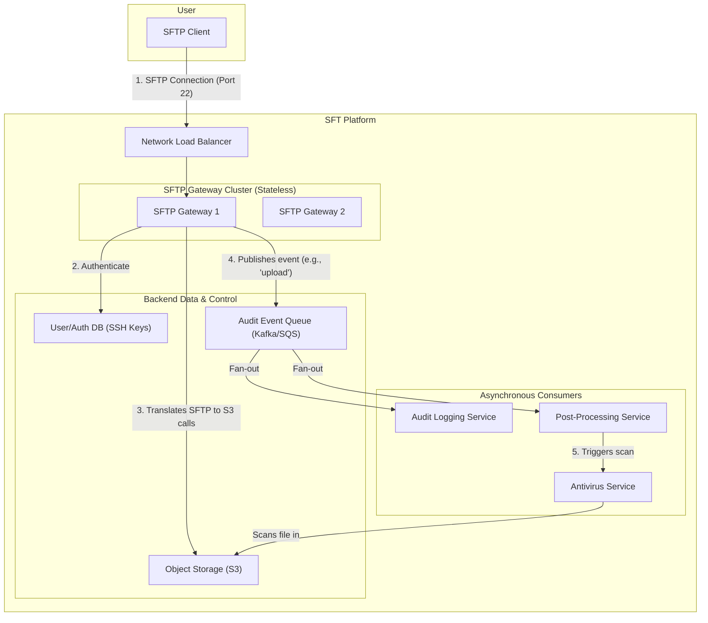

# High-Level Design: Secure File Transfer System

## 1. Document Information

- **Document Title**: Secure File Transfer System - High-Level Design
- **Version**: 1.0
- **Date**: 2025-08-30
- **Author**: Jules (AI Agent)
- **Status**: Draft

---

## 2. Executive Summary

### 2.1 Purpose
This document outlines the high-level design for a managed Secure File Transfer (SFT) system. The system is designed to provide a secure, reliable, and auditable platform for transferring files between users and systems, both internally and with external partners. It focuses on supporting standard secure protocols like SFTP (SSH File Transfer Protocol) while adding a layer of centralized management, automation, and observability.

### 2.2 Scope

**In Scope:**
-   A highly available SFTP server endpoint.
-   A user and authentication management system (e.g., supporting SSH keys).
-   A virtual file system that maps user directories to a durable storage backend like Amazon S3.
-   Detailed audit logging for every action (login, upload, download, delete).
-   Integration with an antivirus scanning service for uploaded files.
-   Automated actions or "triggers" based on file uploads (e.g., notifying a downstream service).

**Out of Scope:**
-   The client-side SFTP software used to connect to the system.
-   The underlying durable storage system (e.g., S3).
-   The antivirus scanning engine itself.
-   Other file transfer protocols like FTP/S or AS2.

### 2.3 High-Level Architecture Overview
The system consists of a cluster of stateless **SFTP Gateway** nodes behind a network load balancer. These gateways implement the SFTP protocol and handle user authentication. Instead of writing to a local disk, the gateways use a **Storage Abstraction Layer** to translate file system commands into operations on a durable, scalable **Object Storage** backend (like S3). User information and SSH keys are managed in a central **User/Auth Database**. Every file transfer and command is published as an event to a **Message Queue**, which feeds into an **Audit Logging Service**. Additionally, a **Post-Processing Service** can subscribe to "file upload" events to trigger downstream workflows, such as virus scanning.

---

## 3. System Overview

### 3.1 Business Context
Many business processes, especially in industries like finance and healthcare, still rely on batch file transfers. Exchanging these files securely and reliably is a critical requirement. A managed SFT platform provides a secure and centralized solution, replacing ad-hoc SFTP servers. It enhances security by providing central control over access, improves reliability with a scalable architecture, and ensures compliance through detailed audit trails.

### 3.2 System Purpose
To provide a secure, scalable, and centrally managed platform for transferring files over the SFTP protocol, abstracting away the complexity of server management and providing rich auditing and automation capabilities.

### 3.3 Success Criteria
-   **Security**: All data must be encrypted in transit and at rest. The system must be secure against unauthorized access.
-   **Reliability**: File transfers must be reliable. The system should not lose any successfully uploaded files.
-   **Availability**: The SFTP endpoint must be highly available (99.95%+).
-   **Auditability**: Every action performed on the system must be logged to a secure, tamper-evident audit trail.
-   **Performance**: The system should be able to handle a high number of concurrent connections and large file transfers, saturating the available network bandwidth.

### 3.4 Assumptions
-   Users will connect using standard SFTP clients.
-   A durable object storage system like S3 is available as the backend.
-   An external antivirus scanning service is available.

### 3.5 Constraints
-   **SFTP Protocol Limitations**: The SFTP protocol is stateful, which requires session affinity (stickiness) at the load balancer level.
-   **Performance of Object Storage**: Object storage has higher latency for metadata operations (like listing files) compared to a local file system. The storage abstraction layer must be designed to mitigate this.
-   **Large File Handling**: Transferring very large files (multi-gigabyte) requires careful handling of streaming and potential multipart uploads to the storage backend.

---

## 4. Requirements Analysis

### 4.1 Functional Requirements
-   **FR-001 (SFTP Connectivity)**: The system must provide an SFTP server that standard clients can connect to.
-   **FR-002 (User Authentication)**: The system must authenticate users via public key authentication (SSH keys).
-   **FR-003 (Virtual File System)**: Each user should have a "home directory" and be chrooted (jailed) to it, preventing them from navigating outside their designated directory.
-   **FR-004 (File Operations)**: The system must support standard file operations: upload (put), download (get), delete (rm), list (ls), and rename (mv).
-   **FR-005 (Durable Storage)**: All uploaded files must be stored durably in a backend object store.
-   **FR-006 (Audit Logging)**: The system must log every user login attempt and file operation, including user ID, source IP, timestamp, and action taken.
-   **FR-007 (Virus Scanning)**: Every successfully uploaded file must be automatically scanned for viruses. Infected files should be quarantined.
-   **FR-008 (Post-Upload Triggers)**: The system must be able to trigger a notification (e.g., by publishing an event) after a file has been successfully uploaded.

### 4.2 Non-Functional Requirements
-   **High Availability**: The SFTP service should be deployed across multiple availability zones.
-   **Scalability**: The system should be able to handle thousands of concurrent client connections.
-   **Security**: Data must be encrypted in transit (via SSH) and at rest (via server-side encryption on the object store).
-   **Performance**: The system should support high-throughput file transfers.
-   **Data Integrity**: The system must ensure that files are not corrupted during transfer or at rest.
-   **Ease of Management**: Administrators should have a simple way to manage users and their public keys.

---

### 5. Core Architecture

The architecture is designed for scalability and security by making the main SFTP servers stateless and offloading state and data to specialized backend services.

- **Network Load Balancer (NLB):** A TCP-level load balancer that distributes incoming SFTP connections (on port 22) across the gateway fleet. It must support session affinity (sticky sessions) based on source IP.
- **SFTP Gateway Cluster:** A fleet of stateless servers running a custom SFTP server application (e.g., built with a library like `apache-sshd` for Java or `paramiko` for Python).
  - **Authentication Handler:** When a user tries to log in, this component queries the **User/Auth Database** to retrieve the user's authorized public keys and validates the client's signature.
  - **Virtual File System (VFS):** This is the core component. It translates SFTP commands (`ls`, `get`, `put`) into API calls to the **Object Storage** backend. For example, an `ls` command becomes an S3 `ListObjects` call, and a `put` command streams the file data directly to an S3 `PutObject` call.
  - **Audit Event Emitter:** Every action (login, ls, get, put, rm) is published as a structured event to the **Audit Message Queue**.
- **Object Storage (e.g., Amazon S3):** The durable backend for all file data. Files are organized using prefixes that correspond to user home directories, e.g., `s3://bucket/home/user123/`.
- **User/Auth Database (e.g., PostgreSQL, DynamoDB):** A central database that stores user information, their home directory path, and their authorized SSH public keys.
- **Audit Message Queue (e.g., Kafka, SQS):** A reliable queue that receives audit events from all gateway nodes. This decouples the gateways from the logging system, ensuring that logging failures don't impact file transfers.
- **Audit Logging Service:** A consumer of the audit queue that writes the events to a secure, long-term storage location (e.g., a dedicated logging system like ELK Stack or a write-once S3 bucket).
- **Post-Processing Service:** Another consumer of the audit queue that listens specifically for `file-upload-success` events. When it receives one, it triggers a workflow:
  1.  Calls the **Antivirus Service** to scan the newly uploaded file in S3.
  2.  If the file is infected, it moves it to a quarantine location (`s3://bucket/quarantine/`).
  3.  If clean, it can publish a final "file ready" notification to other downstream systems.



### 6. Data Schema and Models

- **User DB Schema:**
  - `users` table: `user_id`, `username`, `home_directory_path`.
  - `ssh_keys` table: `key_id`, `user_id`, `public_key_pem`, `description`.
- **Audit Event Schema (in Message Queue):**
  ```json
  {
    "event_id": "uuid",
    "timestamp": "iso8601",
    "event_type": "sftp.login.success", // "sftp.put", "sftp.get"
    "user_id": "...",
    "source_ip": "...",
    "details": {
      "path": "/home/user123/file.txt",
      "bytes_transferred": 1024
    }
  }
  ```

### 7. API Design

The primary "API" is the SFTP protocol itself, implemented by the gateway servers. Internal services communicate via RPC or message queues.

- **Post-Processing Trigger:** The message published to a topic (e.g., SNS) after a clean file upload.
  - **Body:** `{ "bucket": "...", "key": "home/user123/file.txt", "size": 1024, "user_id": "..." }`

### 8. Scalability and Performance

- **Gateway Scaling:** The SFTP gateway nodes are stateless, so they can be scaled horizontally by adding more instances to the cluster.
- **Storage Scaling:** The object storage backend provides virtually limitless scalability for file data.
- **Database Scaling:** The User/Auth database is read-heavy (on login) and can be scaled using standard database techniques like read replicas.
- **Large File Transfers:** The VFS layer should use multipart uploads for large files to improve throughput and reliability.

### 9. Reliability and Fault Tolerance

- **High Availability:** The gateways are deployed across multiple availability zones, with the NLB routing traffic to healthy instances. The backend services (database, object store, queues) are all managed, highly available cloud services.
- **Stateful Protocol on Stateless Servers:** While the SFTP protocol is stateful, the server *application* is stateless. All persistent state (user data, files) is offloaded. If a gateway node fails mid-transfer, the user's connection will drop, but they can reconnect (to a new node) and resume the transfer without data loss. The partially uploaded file on S3 can be cleaned up or resumed depending on the implementation.

### 10. Security Considerations

- **Principle of Least Privilege:** The SFTP gateways have IAM roles that grant them access only to the S3 bucket and the user database. They do not have broader permissions.
- **Chroot Jail:** The VFS must strictly enforce the user's home directory as the root, preventing path traversal attacks.
- **Key Management:** SSH host keys for the gateways must be managed securely. User public keys are stored securely in the database.
- **Data Encryption:** Data is encrypted in transit by the SSH protocol and at rest by server-side encryption in S3.

### 11. Monitoring and Observability

- **Gateway Metrics:** Number of active connections, login success/failure rates, file transfer throughput, and error rates.
- **Audit Trail:** The centralized audit log provides a complete record of all activity for security and compliance reviews.
- **Post-Processing Monitoring:** Monitor the depth of the post-processing queue and the success/failure rate of the virus scans.

### 12. Deployment and Operations

- **User Management:** An admin interface or API is needed to manage users and their public keys in the database.
- **Gateway Deployment:** The gateway application is containerized and deployed using a standard CI/CD pipeline.

### 13. Cost Estimation

- **Primary Drivers:**
  - **Compute:** The cost of the SFTP gateway cluster instances.
  - **Storage:** The cost of storing data in the object store.
  - **Data Transfer:** The cost of network egress for downloads.
  - **Supporting Services:** The cost of the database, message queues, and NLB.

### 14. Risks and Mitigations

- **Object Storage Latency:**
  - **Risk:** Metadata-heavy SFTP operations (like `ls` on a directory with thousands of files) can be slow due to the high latency of object store `LIST` calls.
  - **Mitigation:** Implement a metadata caching layer (e.g., using Redis) in the VFS to cache directory listings for a short period.
- **Authentication Database as SPOF:**
  - **Risk:** If the User/Auth database is down, no new users can log in.
  - **Mitigation:** Use a managed, multi-AZ database service to ensure high availability. The gateways can also cache authentication data for a short TTL to allow currently connected users to continue working.
- **Security Vulnerability in SFTP Server:**
  - **Risk:** A vulnerability in the SFTP server implementation could lead to a security breach.
  - **Mitigation:** Use well-maintained, popular libraries for the SFTP implementation. Keep them patched and up-to-date. Run regular vulnerability scans.

### 15. Final Considerations

A managed Secure File Transfer system provides significant advantages over traditional, single-server SFTP setups. By abstracting the file system onto a scalable object store and making the front-end gateways stateless, the system achieves high availability and scalability. The real value, however, comes from the centralized management and observability. The rich audit trail and the ability to trigger automated post-upload workflows (like virus scanning) provide a level of security, compliance, and automation that is difficult to achieve with standard SFTP servers.
