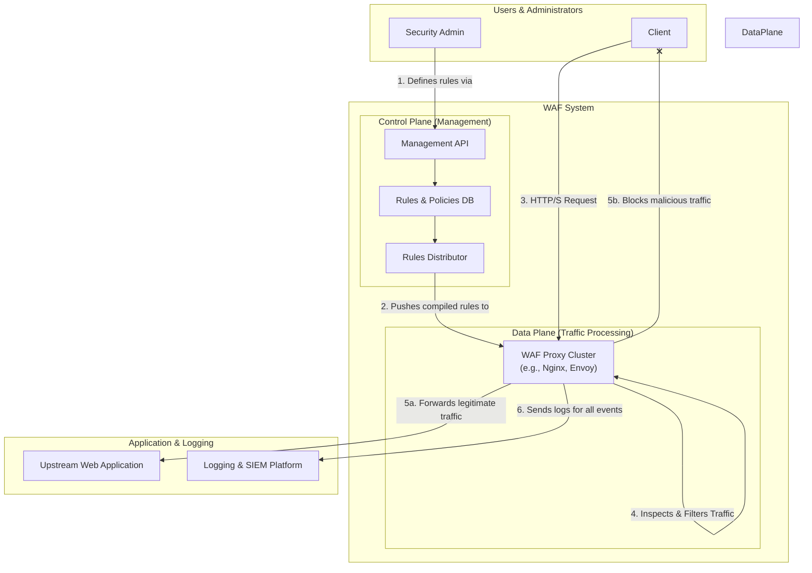

# High-Level Design: Web Application Firewall (WAF)

## 1. Document Information

- **Document Title**: Web Application Firewall (WAF) - High-Level Design
- **Version**: 1.0
- **Date**: 2025-08-30
- **Author**: Jules (AI Agent)
- **Status**: Draft

---

## 2. Executive Summary

### 2.1 Purpose
This document outlines the high-level design for a Web Application Firewall (WAF). A WAF is a network security system that sits in front of web applications and inspects HTTP/S traffic in real-time. It is designed to protect applications from common web-based attacks such as Cross-Site Scripting (XSS), SQL Injection (SQLi), and other vulnerabilities listed in the OWASP Top 10. The WAF operates at Layer 7 of the OSI model and can make intelligent decisions based on the content of the traffic itself.

### 2.2 Scope

**In Scope:**
-   A reverse proxy capable of intercepting all HTTP/S traffic destined for a web application.
-   A rule-based inspection engine that can analyze parts of the HTTP request (headers, body, query parameters).
-   A set of managed rulesets to detect common attack patterns (e.g., SQLi, XSS).
-   Support for custom user-defined rules.
-   Actions to be taken when a threat is detected (Block, Log, or Challenge).
-   Rate limiting based on IP address or other request characteristics.
-   A control plane for managing and deploying rule configurations.

**Out of Scope:**
-   The web applications being protected.
-   Protection against network-layer DDoS attacks (this is handled by a separate DDoS protection system).
-   Malware or virus scanning.
-   The specific implementation of the rule-matching engine (e.g., regex engine).

### 2.3 High-Level Architecture Overview
The WAF is deployed as a **Reverse Proxy** at the edge of the network, in front of the applications it protects. All incoming traffic is routed to the WAF first. The WAF consists of a **Data Plane** and a **Control Plane**. The Data Plane is a cluster of high-performance proxy nodes that inspect every request. Each request is passed through an **Inspection Engine**, which evaluates it against a set of **Rules**. If the request matches a malicious pattern, the WAF takes a configured **Action** (e.g., blocks the request and returns a `403 Forbidden` error). If the request is clean, it is forwarded to the upstream web application. The **Control Plane** provides an API and UI for security administrators to manage the rulesets and policies, which are then pushed out to the entire data plane fleet.

---

## 3. System Overview

### 3.1 Business Context
Web applications are a primary target for cyberattacks. A single vulnerability can lead to a data breach, causing significant financial and reputational damage. While secure coding practices are essential, a WAF provides a critical, additional layer of defense-in-depth. It can block attacks in real-time, protect legacy applications that cannot be easily patched, and provide valuable insights into the threats an organization is facing.

### 3.2 System Purpose
To protect web applications from common and emerging attacks by filtering and monitoring HTTP/S traffic between clients and servers.

### 3.3 Success Criteria
-   **Security Effectiveness**: The WAF must accurately detect and block a high percentage of common web attacks.
-   **Low False Positives**: The WAF must not block legitimate traffic. A high false positive rate can cause outages and disrupt business.
-   **Low Latency**: The WAF should add minimal latency to the request path (e.g., <5ms).
-   **High Availability**: As an inline component, the WAF must be extremely reliable and highly available.
-   **Scalability**: The WAF must be able to handle the full traffic load of the applications it protects.

### 3.4 Assumptions
-   The WAF can be deployed at the network edge with the ability to intercept all relevant traffic.
-   The WAF can decrypt TLS traffic to inspect its content (acting as a TLS termination point).
-   A team of security analysts is available to manage rules and investigate alerts.

### 3.5 Constraints
-   **Performance vs. Security Trade-off**: More complex rules provide better security but consume more CPU and add more latency.
-   **TLS Inspection**: Inspecting encrypted traffic requires the WAF to hold the private keys for the application's TLS certificates, which makes the WAF a highly sensitive security component.
-   **Evolving Threats**: Attackers constantly devise new techniques, requiring the WAF's rulesets to be updated continuously.
-   **Application-Specific Logic**: A generic WAF may not understand the specific business logic of an application, which can lead to false positives or missed attacks.

---

## 4. Requirements Analysis

### 4.1 Functional Requirements
-   **FR-001 (HTTP/S Proxying)**: The system must be able to act as a full reverse proxy for HTTP/S traffic.
-   **FR-002 (TLS Termination)**: The system must be able to terminate TLS traffic to inspect the decrypted request.
-   **FR-003 (Rule-Based Inspection)**: The system must inspect various parts of an HTTP request (URL, query string, headers, body) against a set of rules.
-   **FR-004 (Managed Rulesets)**: The system must support managed rulesets for common vulnerabilities like SQL Injection, Cross-Site Scripting (XSS), and Remote Code Execution (RCE).
-   **FR-005 (Custom Rules)**: Administrators must be able to create their own custom rules.
-   **FR-006 (Action Configuration)**: For each rule, an administrator must be able to configure the action to take (e.g., `BLOCK`, `LOG`, `CHALLENGE`).
-   **FR-007 (IP-based Rate Limiting)**: The system must be able to rate limit requests from a single IP address.
-   **FR-008 (IP Reputation)**: The system should be able to block traffic from known malicious IP addresses based on a reputation feed.
-   **FR-009 (Logging and Reporting)**: The system must generate detailed logs for all blocked and logged requests.

### 4.2 Non-Functional Requirements
-   **High Performance**: Low-latency inspection of traffic.
-   **High Availability**: The WAF data plane must be deployed in a fault-tolerant configuration.
-   **Scalability**: The system must be horizontally scalable to handle traffic growth.
-   **Security**: The WAF itself must be secure.
-   **Operational Simplicity**: It should be easy to update rules and manage the system without causing downtime.
-   **Low False Positive Rate**: Rules must be tuned to avoid blocking legitimate users.

---

### 5. Core Architecture

The architecture separates the high-performance Data Plane that processes traffic from the management Control Plane, similar to an API Gateway design.

- **Data Plane:**
  - A cluster of high-performance reverse proxies (e.g., built on Nginx with ModSecurity, or Envoy with a WAF filter). These are the "WAF nodes."
  - The nodes are deployed at the edge, behind a load balancer.
  - Each node is stateless and loads its configuration (rulesets) from the Control Plane.
  - **Request Flow within a WAF node:**
    1.  Request is received, and TLS is terminated.
    2.  The request (headers, path, query params, body) is passed to the **Inspection Engine**.
    3.  The Inspection Engine evaluates the request against the active rules in a specific order.
    4.  The engine uses a fast pattern-matching algorithm (like Aho-Corasick for string matching or a compiled regex engine) to check against thousands of rules simultaneously.
    5.  If a rule matches, its score is added to a transaction risk score.
    6.  After all rules are evaluated, if the total risk score exceeds a configured threshold, the configured `Action` (e.g., `BLOCK`) is taken.
    7.  If the request is not blocked, it is forwarded to the upstream application.
    8.  The response from the application is also inspected for potential issues like information leakage.

- **Control Plane:**
  - **Management API:** A REST API for security administrators to manage the WAF's configuration.
  - **Configuration Database:** Stores all WAF configurations: managed rulesets, custom rules, action policies, rate limiting settings, etc.
  - **Rules Compiler/Distributor:** This service takes the high-level rules from the database and compiles them into an optimized format for the Data Plane's inspection engine. It then pushes the updated, compiled ruleset to all WAF nodes. The nodes can hot-reload the new rules without dropping connections.

- **Supporting Components:**
  - **Logging & Analytics Pipeline:** WAF nodes stream detailed event logs (for both blocked and passed traffic) to a central logging system.
  - **Log Analysis & Alerting:** A system (e.g., SIEM - Security Information and Event Management) consumes these logs, aggregates them, and generates alerts for security analysts when significant attack patterns are detected.
  - **IP Reputation Feed:** A service that periodically pulls a list of known malicious IP addresses from third-party threat intelligence feeds and loads them into the WAF's blocklist.



### 6. Data Schema and Models

- **Rule Definition (e.g., ModSecurity SecRule format):**
  - `SecRule ARGS "@rx evil_pattern" "id:12345,phase:2,block,msg:'Evil Pattern Detected'"`
  - This defines a rule that inspects request arguments (`ARGS`), matches them against a regular expression (`@rx`), and if it matches, blocks the request.
- **WAF Event Log (JSON format):**
  ```json
  {
    "timestamp": "...",
    "client_ip": "...",
    "request_host": "...",
    "request_path": "...",
    "action_taken": "BLOCK",
    "matched_rule_id": 12345,
    "matched_rule_message": "Evil Pattern Detected",
    "request_id": "..."
  }
  ```

### 7. API Design

The primary API is the Control Plane's Management API.

- **`GET /api/v1/rulesets`**: List all available rulesets.
- **`PUT /api/v1/policies/{policy_id}/rules`**: Attach a ruleset to a policy.
- **`POST /api/v1/rules/custom`**: Create a new custom rule.
  - **Body:** `{ "name": "...", "expression": "...", "action": "LOG" }`
- **`GET /api/v1/events`**: Query the log of WAF events.

### 8. Scalability and Performance

- **Data Plane Scaling:** The stateless WAF nodes can be scaled horizontally using a load balancer and an autoscaling group to match traffic demands.
- **Low Latency:** The inspection engine must be highly optimized. Using efficient algorithms and writing rules in a compiled, high-performance language are key. The entire ruleset is held in memory for fast evaluation.
- **Control Plane Scalability:** The control plane is not in the request path and has lower performance requirements, but it can be made highly available by running multiple instances.

### 9. Reliability and Fault Tolerance

- **Data Plane HA:** WAF nodes are deployed across multiple availability zones. The load balancer will route around any failed node.
- **Fail-Open vs. Fail-Closed:** The WAF must have a configurable behavior in case of a critical failure.
  - **Fail-Open:** If a WAF node crashes, traffic is allowed to pass through to the application unfiltered. This prioritizes availability over security.
  - **Fail-Closed:** If a WAF node crashes, no traffic is passed. This prioritizes security over availability.
- **Configuration Rollbacks:** The control plane must support versioning of configurations, allowing for quick rollbacks if a new rule causes false positives.

### 10. Security Considerations

- **Evasion Techniques:** Attackers will try to evade WAF rules using techniques like character encoding, obfuscation, and protocol variations. The inspection engine must normalize the request data before evaluating rules to counter this.
- **WAF Bypass:** A misconfiguration in the network could allow an attacker to bypass the WAF and connect directly to the application servers. Strict firewall rules must ensure the WAF is the only entry point.
- **Protecting the WAF Itself:** The WAF's management API and control plane are high-value targets and must be secured with strong authentication and network isolation.

### 11. Monitoring and Observability

- **WAF Metrics:**
  - Requests per second (total vs. blocked).
  - Request processing latency (p99).
  - Rule hit counts (to identify noisy or ineffective rules).
- **Alerting:** Alerts should be generated for significant spikes in blocked requests, which could indicate a large-scale attack. Alerts should also be generated for WAF node health issues.
- **Logging:** Detailed logs are crucial for forensic analysis after a security incident.

### 12. Deployment and Operations

- **Rule Tuning (The Hardest Part):** The biggest operational challenge is tuning the rules to minimize false positives. This often involves:
  1.  Deploying new rules in `LOG`-only mode first.
  2.  Analyzing the logs to see what legitimate traffic the rule would have blocked.
  3.  Adding exceptions or refining the rule.
  4.  Gradually promoting the rule to `BLOCK` mode.
- **CI/CD for Rules:** WAF custom rule configurations should be stored in Git and deployed via a CI/CD pipeline that can run validation tests on the rules.

### 13. Cost Estimation

- **Primary Drivers:**
  - **Compute:** The cost of the cluster of WAF nodes.
  - **Logging/SIEM:** The cost of ingesting, storing, and analyzing the high volume of WAF event logs.
  - **Threat Intelligence Feeds:** The subscription cost for managed rulesets and IP reputation lists.

### 14. Risks and Mitigations

- **High False Positive Rate:**
  - **Risk:** The WAF blocks legitimate users, causing business impact.
  - **Mitigation:** A rigorous rule tuning process. Start in `LOG` mode. Have a clear and fast process for adding exceptions when a false positive is identified.
- **Zero-Day Vulnerabilities:**
  - **Risk:** A new, unknown type of attack bypasses the WAF's existing rules.
  - **Mitigation:** The WAF is not a silver bullet. It must be part of a defense-in-depth strategy. Use managed rulesets from a reputable vendor who can push out "virtual patches" for new vulnerabilities faster than applications can be patched.
- **Performance Degradation:**
  - **Risk:** A poorly written regex in a custom rule causes high CPU usage and adds significant latency.
  - **Mitigation:** Performance-test all new rules before deployment. Implement a "circuit breaker" to automatically disable a rule if it is consuming too much CPU.

### 15. Final Considerations

A Web Application Firewall is an essential layer of security for any modern web application. The separation of the data plane and control plane allows for a scalable and manageable design. While managed rulesets provide a strong baseline of protection, the effectiveness of a WAF is highly dependent on the continuous, iterative process of tuning rules, analyzing logs, and adapting to the specific traffic patterns of the applications it protects. It is a dynamic system that requires constant care and feeding from a skilled security team.
