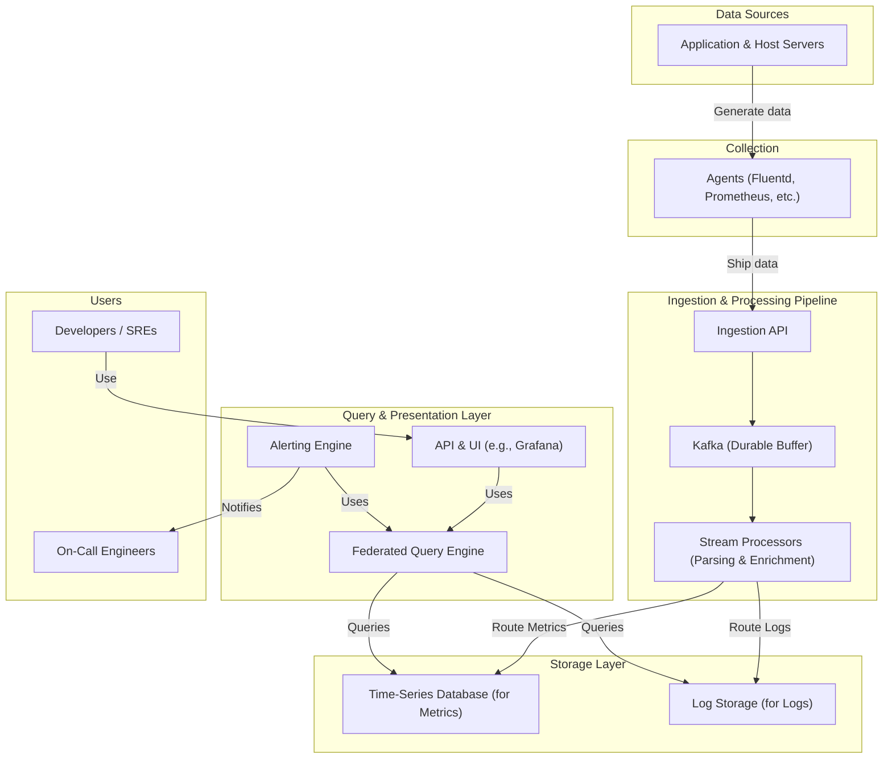

# High-Level Design: Distributed Metrics & Logging System

## 1. Document Information

- **Document Title**: Distributed Metrics & Logging System - High-Level Design
- **Version**: 1.0
- **Date**: 2025-08-30
- **Author**: Jules (AI Agent)
- **Status**: Draft

---

## 2. Executive Summary

### 2.1 Purpose
This document provides the high-level design for a unified, large-scale system for collecting, storing, querying, and alerting on both time-series metrics and application logs. This observability platform, modeled after systems like Prometheus and the ELK Stack, is designed to provide a single pane of glass for monitoring the health and performance of a complex, distributed application environment.

### 2.2 Scope

**In Scope:**
-   Lightweight agents for collecting metrics and logs from host machines and applications.
-   A scalable data ingestion pipeline capable of handling high-volume, high-cardinality data.
-   A specialized time-series database (TSDB) for storing metrics efficiently.
-   A document-oriented database optimized for full-text search to store logs.
-   A powerful query language and engine that can query both metrics and logs.
-   A user interface for creating dashboards and visualizations.
-   An alerting component to run rules against the data and notify on-call engineers.

**Out of Scope:**
-   Distributed tracing (this is a separate, though related, observability pillar).
-   The applications that are being monitored.
-   Automated remediation of issues (the system provides alerts, but does not take action).

### 2.3 High-Level Architecture Overview
The architecture is a high-throughput data pipeline. **Agents** deployed on client servers collect data and ship it to a central **Ingestion & Processing Layer**. This layer parses and enriches the data, then routes it to the appropriate storage backend: a **Time-Series Database (TSDB)** for metrics or a **Log Storage System** for logs. A unified **Query Engine** provides a single API for users and a **Dashboard UI** to query both data stores. An **Alerting Service** continuously evaluates defined rules against the query engine.

---

## 3. System Overview

### 3.1 Business Context
As software systems grow in complexity and scale, understanding their internal state becomes increasingly difficult. An observability platform that centralizes metrics (what is happening) and logs (why it is happening) is no longer a luxury but a fundamental requirement for maintaining uptime, debugging issues, and ensuring performance.

### 3.2 System Purpose
The primary purpose is to provide engineers with the tools they need to monitor and understand their systems. It aims to make operational data accessible, queryable, and actionable in near real-time.

### 3.3 Success Criteria
-   **Scalability**: The system must scale to ingest terabytes of logs and billions of metric data points per day.
-   **Query Performance**: P99 latency for typical dashboard queries should be under 2 seconds.
-   **Data Freshness (Ingestion Latency)**: Data should be available for querying within 10 seconds of being generated on the source machine.
-   **Availability**: The data ingestion and alerting pipelines must be highly available (99.99%).
-   **Cost-Effectiveness**: The system must store data efficiently to be economically viable at scale.

### 3.4 Assumptions
-   The system will be used by internal engineering teams.
-   Agents can be deployed on all relevant hosts in the infrastructure.
-   A degree of data loss during a major outage of the logging system is tolerable, but metric data loss is less so.

### 3.5 Constraints
-   **High Write Load**: The system is extremely write-heavy, with ingestion rates far exceeding query rates. The storage layer must be optimized for writes.
-   **High Cardinality**: For metrics, the number of unique time-series (combinations of name and labels) can be in the tens of millions, which presents a challenge for indexing and storage.
-   **Data Retention Costs**: Storing massive amounts of data is expensive. The system must have a clear data retention and downsampling strategy.

---

## 4. Requirements Analysis

### 4.1 Functional Requirements
-   **FR-001 (Data Collection)**: The system shall provide lightweight agents that can be configured to scrape metrics endpoints (like Prometheus exporters) and tail log files.
-   **FR-002 (Metrics Ingestion)**: The system must support the ingestion of time-series data, consisting of a timestamp, a metric name, a value, and a set of key-value labels.
-   **FR-003 (Log Ingestion)**: The system must support the ingestion of log lines, which should be parsed to extract a timestamp, severity level, and structured metadata.
-   **FR-004 (Querying)**: The system must provide a rich query language that supports filtering, aggregation, and mathematical operations on metrics, and full-text search on logs.
-   **FR-005 (Visualization)**: The system must have a web UI where users can build dashboards with various visualizations (graphs, heatmaps, single-stats) based on queries.
-   **FR-006 (Alerting)**: Users must be able to define alert rules based on queries. The system will evaluate these rules continuously and trigger notifications (e.g., via PagerDuty, Slack, email) when a rule's condition is met.
-   **FR-007 (Data Retention)**: The system must support configurable retention policies, e.g., automatically downsampling high-resolution metrics to lower resolutions after a period of time, and deleting data after it exceeds its retention period.

### 4.2 Non-Functional Requirements
-   **High Write Throughput**: The ingestion pipeline must be able to handle millions of writes per second.
-   **Scalability**: All components (ingestion, storage, querying) must be horizontally scalable.
-   **Cost-Effectiveness**: The storage layer must use effective compression and data lifecycle policies to manage costs.
-   **Availability**: The ingestion and alerting pathways must be highly available. The query/UI pathway can have a slightly lower availability target.
-   **Multi-tenancy**: The system should be able to logically isolate data from different teams or services.
-   **Security**: Access to the system should be authenticated and authorized. Sensitive data within logs should be masked or redacted if possible.

---

### 5. Core Architecture

The system follows a distributed, agent-based architecture designed for high throughput and scalability.

- **Data Collection Agents (e.g., Fluentd, Logstash, Prometheus Exporters):** Lightweight agents deployed on every application server or host. They collect metrics and logs, buffer them, and forward them to the ingestion pipeline. They handle different data formats and add metadata (e.g., host, service name).
- **Ingestion & Processing Pipeline (Kafka + Stream Processors):**
  - **Kafka:** A distributed message queue that acts as a central buffer for all incoming data. It decouples the collection agents from the storage backend, providing durability and backpressure handling.
  - **Stream Processors (e.g., Apache Flink, Kafka Streams):** Consumers of the Kafka topics. They perform real-time parsing, filtering, enrichment (e.g., geo-IP lookup), and transformation of the data before it's stored.
- **Data Storage (Time-Series Database & Object Storage):**
  - **Time-Series Database (TSDB) (e.g., Prometheus, InfluxDB, TimescaleDB):** Optimized for storing and querying high-cardinality, timestamped metrics data. It offers fast aggregations and retention policies.
  - **Object Storage (e.g., Amazon S3, MinIO):** Cost-effective storage for long-term retention of processed, structured logs. Data is partitioned by time (day/hour) for efficient querying.
- **Query Engine:** A federated query service that can access both the TSDB for recent/hot metrics and the object store for historical logs. It exposes a unified query language (e.g., PromQL, SQL-like).
- **API & Visualization Layer:** A set of APIs that expose the query engine's capabilities to front-end dashboards (e.g., Grafana), alerting systems, and other clients.

### 6. Data Schema and Models

- **Metrics Data Model:**
  - Follows the Prometheus model.
  - `metric_name{label1="value1", label2="value2"}`
  - **Components:**
    - `Timestamp`: 64-bit integer (Unix milliseconds).
    - `Value`: 64-bit float.
    - `Labels`: Key-value pairs (strings) that define the metric's dimensions (e.g., `service`, `host`, `http_status`).
  - **Index:** Indexed heavily on metric name and label key-value pairs for fast lookups.

- **Log Data Model (Stored in Object Storage):**
  - Stored in a structured format like JSON or Parquet.
  - **Fields:**
    - `timestamp`: ISO 8601 string.
    - `service_name`: String.
    - `hostname`: String.
    - `level`: String (e.g., `INFO`, `ERROR`, `WARN`).
    - `message`: String (the original log line).
    - `metadata`: JSON object containing parsed key-value pairs from the log.
  - **Partitioning:** Data in object storage is partitioned by `service_name/year/month/day/hour/`.

### 7. API Design

All APIs are RESTful, use JSON for request/response bodies, and are secured via standard authentication mechanisms (e.g., OAuth 2.0).

- **`POST /api/v1/write` (Metrics):**
  - **Usage:** Used by agents to push metrics data to the ingestion pipeline.
  - **Body:** A batch of metrics in a compressed format (e.g., Protobuf with Snappy compression).
  - **Response:** `202 Accepted` if the batch is successfully queued in Kafka.

- **`POST /api/v1/logs` (Logs):**
  - **Usage:** Used by agents to push log data.
  - **Body:** A batch of structured log entries.
  - **Response:** `202 Accepted`.

- **`GET /api/v1/query` (Metrics):**
  - **Usage:** Execute a time-series query.
  - **Query Params:**
    - `query`: The query string (e.g., PromQL).
    - `start`: Start timestamp.
    - `end`: End timestamp.
    - `step`: Query resolution step (e.g., `15s`).
  - **Response:** `200 OK` with a JSON body containing the query result.

- **`GET /api/v1/logs/search` (Logs):**
  - **Usage:** Search for logs over a time range.
  - **Query Params:**
    - `filter`: A filter expression (e.g., `service_name='api-gateway' AND level='ERROR'`).
    - `start`: Start timestamp.
    - `end`: End timestamp.
    - `limit`: Max number of results.
  - **Response:** `200 OK` with a JSON array of log entries.

### 8. Scalability and Performance

- **Horizontal Scaling:** All components—agents, Kafka brokers, stream processors, TSDB nodes, and query engines—are designed to be stateless or have a sharding mechanism, allowing for horizontal scaling by adding more nodes.
- **Load Balancing:** Load balancers are placed in front of the ingestion API and the query API layer to distribute traffic across available nodes.
- **Partitioning:** Kafka topics are partitioned to allow for parallel processing. The TSDB shards data by time and metric labels. Log data is partitioned in the object store.
- **Caching:** A caching layer (e.g., Redis) is used in front of the query engine to cache results of frequent, expensive queries, especially for dashboards.
- **Batching & Compression:** Agents batch and compress data before sending it to reduce network I/O and improve ingestion throughput.

### 9. Reliability and Fault Tolerance

- **Redundancy:** All stateful components (Kafka, TSDB) are run in clustered mode with data replication (e.g., Kafka replication factor of 3). Stateless components are run with multiple instances.
- **Backpressure Handling:** Kafka acts as a natural buffer. If the downstream processing or storage layers slow down, data accumulates in Kafka instead of being dropped. Agents have on-disk buffers to survive network outages.
- **Dead-Letter Queues (DLQ):** Messages that fail processing (e.g., due to malformed data) are routed to a DLQ for later inspection, preventing them from halting the pipeline.
- **High Availability:** The system is deployed across multiple availability zones (AZs). In case of an AZ failure, traffic is automatically routed to healthy instances in other zones.

### 10. Security Considerations

- **Authentication & Authorization:** All API endpoints are protected. Service-to-service communication is secured using mTLS. User access to data is controlled via Role-Based Access Control (RBAC), enforced at the API gateway.
- **Data Encryption:** Data is encrypted in transit using TLS 1.3 and at rest in both the TSDB and the object store using standard encryption algorithms (e.g., AES-256).
- **Data Isolation:** In a multi-tenant environment, data is logically isolated by a `tenant_id` label/field, and all API queries are automatically scoped to the user's tenant.
- **Rate Limiting:** The ingestion and query APIs are rate-limited to prevent abuse and ensure fair usage, protecting the system from DoS attacks or runaway scripts.

### 11. Monitoring and Observability

The system will monitor itself using a separate, smaller instance of the same architecture (a "meta-monitoring" setup).
- **Key Metrics:**
  - `ingestion_rate`: Number of metrics/logs ingested per second.
  - `ingestion_latency`: End-to-end time from agent to storage.
  - `query_latency`: p95/p99 latency for API queries.
  - `kafka_lag`: Consumer lag for processing topics.
  - `storage_capacity`: Disk usage and growth rate.
- **Dashboards:** Pre-configured Grafana dashboards to visualize the health of all system components.
- **Alerting:** Prometheus Alertmanager is configured to fire alerts on critical conditions like high latency, high consumer lag, or low disk space.

### 12. Deployment and Operations

- **Infrastructure as Code (IaC):** The entire infrastructure is defined using Terraform and provisioned automatically.
- **CI/CD:** A Jenkins or GitLab CI pipeline automates testing, building Docker images, and deploying changes to a Kubernetes cluster.
- **Containerization:** All components are containerized using Docker and managed by Kubernetes, which handles auto-scaling, self-healing, and rolling updates.
- **Configuration Management:** All configurations are stored in a central repository (e.g., Git) and managed via a tool like Consul or etcd.

### 13. Cost Estimation

- **Primary Drivers:**
  - **Compute:** Number and size of instances for Kafka, stream processors, TSDB, and query nodes.
  - **Storage:** Volume of data stored in the TSDB (hot data) and object storage (cold data).
  - **Network:** Data transfer costs, especially for inter-AZ replication and data ingestion.
- **Cost Optimization Strategies:**
  - **Data Tiering:** Aggressively downsample and move data from expensive TSDB storage to cheap object storage.
  - **Retention Policies:** Enforce strict retention policies to automatically delete old data.
  - **Reserved Instances:** Use reserved cloud instances for baseline capacity to reduce compute costs.
  - **Cardinality Management:** Monitor and control high-cardinality metrics, which are a primary driver of TSDB costs.

### 14. Risks and Mitigations

- **Data Loss:**
  - **Risk:** Agents or ingestion pipeline nodes fail, leading to data loss.
  - **Mitigation:** Agent-level disk buffering, Kafka replication, and at-least-once processing semantics.
- **Query Performance Degradation:**
  - **Risk:** Inefficient queries or high-cardinality data slow down the system.
  - **Mitigation:** Implement query timeouts, cardinality limits, and educate users on best practices. Use caching and pre-aggregation.
- **"Thundering Herd" Problem:**
  - **Risk:** All agents try to reconnect and send buffered data simultaneously after a network partition is resolved, overwhelming the ingestion pipeline.
  - **Mitigation:** Implement jitter and exponential backoff in agent reconnect logic.
- **Scalability Bottleneck:**
  - **Risk:** A single component (e.g., a specific Kafka partition) becomes a hot spot.
  - **Mitigation:** Continuous performance testing to identify bottlenecks. Ensure proper data partitioning and sharding strategies are in place.

### 15. Final Considerations

This distributed metrics and logging system is foundational for ensuring the reliability of a large-scale microservices ecosystem. The key design principles are **decoupling, scalability, and resilience**. The separation of ingestion, storage, and querying allows each part of the system to be scaled and maintained independently. While the design borrows from established systems like Prometheus and ELK, the federated query layer and unified data model provide a seamless experience for developers and SREs. Future work could focus on integrating anomaly detection and automated root cause analysis directly into the stream processing layer.
