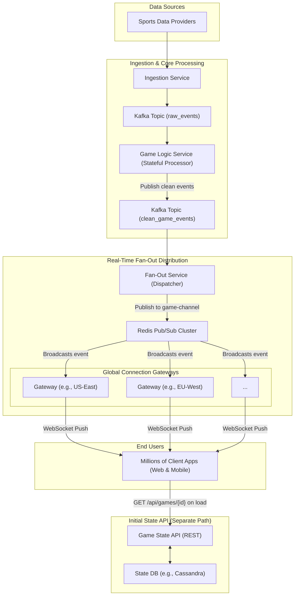

# High-Level Design: Live Sports Score Updates

## 1. Document Information

- **Document Title**: Live Sports Score Updates - High-Level Design
- **Version**: 1.0
- **Date**: 2025-08-30
- **Author**: Jules (AI Agent)
- **Status**: Draft

---

## 2. Executive Summary

### 2.1 Purpose
This document outlines the high-level design for a massive-scale, low-latency system to deliver real-time sports score updates to millions of concurrent users. The system is designed to ingest data from multiple official sports data providers, process it, and push it to client applications (web and mobile) with minimal delay, ensuring fans receive updates as events happen on the field.

### 2.2 Scope

**In Scope:**
-   An ingestion layer to consume data feeds from various sports data providers (e.g., via APIs, XML feeds, or streaming protocols).
-   A real-time processing engine to normalize data, calculate game state, and identify key events.
-   A distribution layer capable of pushing updates to millions of concurrently connected clients.
-   A client-facing API for fetching initial game state and subscribing to real-time updates.
-   Support for multiple sports with different rules and data formats.

**Out of Scope:**
-   The client-side applications (e.g., the ESPN or Bleacher Report app).
-   The sports data provider feeds themselves.
-   User account management and authentication (assumed to be handled by a separate service).
-   Fantasy sports leagues and scoring logic.
-   Video streaming of the games.

### 2.3 High-Level Architecture Overview
The architecture is a fan-out, real-time pipeline. An **Ingestion Service** pulls data from multiple **Sports Data Providers**. This raw data is published to a **Message Queue** (e.g., Kafka) for reliability. A **Processing Service** consumes the data, normalizes it into a canonical model, and determines the specific updates (e.g., "Goal Scored," "Score is now 2-1"). These granular updates are published to a **Fan-Out Cache/PubSub System** (e.g., Redis PubSub). A globally distributed **Push Notification Service** (using WebSockets or MQTT) subscribes to these updates and pushes them to the correct group of clients (e.g., all clients watching the "Manchester United vs. Liverpool" game).

---

## 3. System Overview

### 3.1 Business Context
Live sports are a cornerstone of the media and entertainment industry. Providing fast, reliable score updates is a fundamental feature for any sports media application. The ability to handle massive, simultaneous traffic spikes (e.g., during the Super Bowl or World Cup final) is a key competitive advantage and crucial for user retention.

### 3.2 System Purpose
To deliver accurate, real-time sports data to a massive global audience with very low latency. The system must be extremely resilient and scalable to handle the immense load generated by major sporting events.

### 3.3 Success Criteria
-   **Glass-to-Glass Latency**: The time from an event happening on the field to it appearing on a user's screen should be under 2 seconds.
-   **Scalability**: The system must support at least 10 million concurrent client connections during a peak event.
-   **Reliability**: The system must be highly available (99.99%) during live games. No data loss is acceptable.
-   **Fan-out Efficiency**: A single event from a data provider should be efficiently delivered to millions of clients without overwhelming the backend.
-   **Data Accuracy**: The scores and game state displayed must be correct.

### 3.4 Assumptions
-   We will have contracts with reliable, low-latency sports data providers who supply the raw game data.
-   Clients (web/mobile apps) will have the ability to maintain persistent connections (e.g., WebSockets).
-   The number of concurrent games is manageable (hundreds, not thousands). The number of fans per game is the primary scaling challenge.

### 3.5 Constraints
-   **The "Thundering Herd" Problem**: When a major event occurs (e.g., a goal in the World Cup final), the system must instantly push an update to millions of clients. This creates a massive fan-out challenge.
-   **Connection Management at Scale**: Maintaining millions of persistent TCP connections is resource-intensive and requires a specialized infrastructure.
-   **Provider Data Formats**: Data providers use different formats (XML, JSON, proprietary protocols), requiring a flexible ingestion layer.
-   **State Management**: The system must maintain the correct state for thousands of concurrent games.

---

## 4. Requirements Analysis

### 4.1 Functional Requirements
-   **FR-001 (Data Ingestion)**: The system must ingest real-time data feeds for multiple sports (e.g., Soccer, Football, Basketball) from different providers.
-   **FR-002 (Data Normalization)**: The system must transform provider-specific data models into a single, canonical model for each sport.
-   **FR-003 (Game State Management)**: The system must maintain the current state of every live game (e.g., score, time remaining, possession).
-   **FR-004 (Event Detection)**: The system must identify and generate specific, granular event updates (e.g., `GoalScored`, `PlayerSubstitution`, `QuarterEnd`).
-   **FR-005 (Real-Time Push)**: The system must push these granular events to subscribed clients in real-time.
-   **FR-006 (Client Subscription)**: Clients must be able to subscribe to updates for one or more specific games.
-   **FR-007 (Initial State API)**: The system must provide a REST API for clients to fetch the full current state of a game when they first open the app or subscribe to a new game.

### 4.2 Non-Functional Requirements
-   **Latency**: P99 latency from data provider ingestion to client notification < 2 seconds.
-   **Scalability**: Support 10+ million concurrent connections.
-   **Availability**: 99.99% uptime for the entire push pipeline during live games.
-   **Efficiency**: The cost per connected client should be minimized through efficient connection management and fan-out.
-   **Resilience**: The system must be resilient to failures of individual components or data providers.
-   **Global Reach**: The system must provide low-latency updates to users worldwide.

---

### 5. Core Architecture

The architecture is a multi-layered, fan-out pipeline designed to deliver a small number of source events to a massive number of clients with minimal latency.

- **Ingestion Layer:** A set of services, one for each data provider, responsible for polling or listening to the provider's feed. They parse the provider-specific format and convert it into a canonical raw event format before publishing it to Kafka.
- **Reliable Queue (Apache Kafka):** Acts as the backbone of the system. The `raw_data` topic ingests all data from the providers, ensuring durability and decoupling the ingestion layer from the processing layer.
- **Game Logic Service (Stateful Stream Processor):** A Flink or Kafka Streams application that consumes from the `raw_data` topic. It maintains the state for each live game (e.g., in RocksDB or an external cache). It compares the incoming data with the current state to detect discrete events (e.g., a goal, a penalty).
- **Event Queue (Apache Kafka):** The Game Logic Service publishes these clean, granular game events (e.g., `GoalScoredEvent`) to a new Kafka topic, `game_events`.
- **Fan-Out Service (Dispatcher):** A stateless service that consumes from `game_events`. Its only job is to read an event and publish it to the correct channel in a high-speed, in-memory Pub/Sub system. For an event for game ID `123`, it publishes to the `game:123` channel.
- **In-Memory Pub/Sub (Redis Cluster):** Redis Pub/Sub is used for the massive, low-latency fan-out. It's highly optimized for this task. There will be one channel per active game.
- **Connection Gateway Layer (Global):** A globally distributed fleet of servers running a custom WebSocket/MQTT service. When a client connects and subscribes to `game:123`, the gateway it's connected to issues a `SUBSCRIBE game:123` command to the Redis cluster. When the Fan-out Service publishes an event to that channel, Redis broadcasts it to all subscribed gateways, which then forward it to their connected clients.
- **State API Service:** A simple REST API backed by a database (e.g., Cassandra or a cached RDBMS) that holds the current state of all games. This is used by clients to get the full score when they first load the app.



### 6. Data Schema and Models

- **Game Event Schema (in `game_events` topic):** A structured, canonical format for all game events.
  ```json
  {
    "event_id": "uuid",
    "game_id": "string",
    "sport": "soccer",
    "timestamp": "iso8601",
    "event_type": "SCORE_UPDATE", // "YELLOW_CARD", "GAME_START"
    "payload": {
      "home_score": 2,
      "away_score": 1,
      "scoring_player": "L. Messi",
      "assist_player": "S. Busquets"
    }
  }
  ```
- **WebSocket Message:** The same Game Event schema is pushed to the client.
- **Game State API Response (`GET /api/v1/games/{game_id}`):**
  ```json
  {
    "game_id": "...",
    "sport": "soccer",
    "status": "LIVE",
    "game_clock": "78:15",
    "home_team": { "name": "...", "score": 2 },
    "away_team": { "name": "...", "score": 1 },
    "last_events": [ ... ] // List of recent event objects
  }
  ```

### 7. API Design

- **`GET /api/v1/games/{game_id}`:**
  - **Usage:** Called by clients on initial load to get the full game state.
  - **Response:** `200 OK` with the Game State object.

- **WebSocket Connection `/ws/v1/`:**
  - **Usage:** Clients establish a persistent WebSocket connection to the nearest Connection Gateway.
  - **Subscription Message (Client -> Server):**
    ```json
    { "action": "subscribe", "channel": "game:123" }
    ```
  - **Unsubscription Message (Client -> Server):**
    ```json
    { "action": "unsubscribe", "channel": "game:123" }
    ```
  - **Data Message (Server -> Client):** The server pushes Game Event objects to the client.

### 8. Scalability and Performance

- **Massive Fan-Out:** The key is the multi-level fan-out. A single event is written once to Kafka, then published once to Redis. Redis then does the heavy lifting of broadcasting it to hundreds or thousands of gateways, which in turn broadcast it to thousands of their own clients.
- **Connection Management:** The Connection Gateway layer is the most critical for scaling. These are lightweight services written in an efficient language (Go, Rust, C++) designed to do nothing but manage TCP connections and forward messages. They are deployed globally using GeoDNS to ensure users connect to the closest, lowest-latency gateway.
- **Stateless Components:** The Ingestion, Fan-out, and Gateway services are stateless and can be scaled horizontally. The Game Logic service is stateful but is scaled using Flink/Kafka Streams' built-in partitioning and state management capabilities.

### 9. Reliability and Fault Tolerance

- **Provider Redundancy:** The Ingestion layer can connect to multiple data providers for the same sport. The Game Logic service can deduplicate and merge data from these providers to protect against a single provider failure or data error.
- **Durable Queue:** Kafka ensures that no raw data is lost if a downstream processor fails.
- **Gateway Failure:** If a Connection Gateway fails, its connected clients will be disconnected. The clients' SDKs must have automatic reconnection logic. They will be routed to a healthy gateway by the load balancer.
- **Redis Failure:** The Redis cluster is run in a high-availability configuration with replicas. A failure of a master node will trigger an automatic failover.

### 10. Security Considerations

- **DDoS Protection:** The WebSocket gateways and REST APIs are protected by a service like Cloudflare or AWS Shield to mitigate DDoS attacks.
- **Authentication:** While the core score data is public, the connection endpoints can require an API key or a temporary token to prevent unauthorized clients from connecting and draining resources.
- **Message Integrity:** Messages can be signed to ensure they are not tampered with, though this adds overhead.

### 11. Monitoring and Observability

- **End-to-End Latency:** A tracer ID is injected at the ingestion point and propagated through the system to measure the total latency.
- **Connection Metrics:** The number of concurrent connections per gateway, per region, and globally is the most important metric to track.
- **Message Delivery Rate:** Track the number of messages published to Redis vs. the number of messages sent to clients to ensure the pipeline is not dropping data.
- **Kafka Lag:** Monitor consumer lag for the Game Logic and Fan-out services.

### 12. Deployment and Operations

- **Global Deployment:** The Connection Gateway layer is deployed across dozens of cloud regions. Infrastructure and deployments are managed via Terraform and a global CI/CD system.
- **Zero-Downtime Updates:** Gateways are updated using rolling deployments. Clients are configured to gracefully reconnect if their connection is terminated during an update.

### 13. Cost Estimation

- **Primary Drivers:**
  - **Connection Gateways:** The sheer number of compute instances needed to maintain millions of TCP connections. This is the dominant cost.
  - **Data Egress:** The cost of pushing terabytes of event data from the gateways to users around the world.
  - **Redis Cluster:** High-memory instances for the Pub/Sub cluster.
- **Cost Optimization:**
  - **Efficient Gateway Code:** Writing the gateway in a language like Go or Rust to maximize connections-per-instance is critical.
  - **Message Batching:** Sending small batches of updates instead of individual messages can reduce overhead, but at a slight cost to latency.
  - **Binary Protocol:** Using a binary format like Protobuf instead of JSON for WebSocket messages reduces bandwidth.

### 14. Risks and Mitigations

- **"Thundering Herd" / Fan-out Failure:**
  - **Risk:** A component in the fan-out chain (e.g., Redis) fails or slows down under the load of a massive global event.
  - **Mitigation:** Over-provisioning of the Redis cluster and Fan-out services before major events. Extensive load testing to find bottlenecks. Regionalizing the Redis clusters so a failure in one region doesn't affect others.
- **Inaccurate Game State:**
  - **Risk:** Two instances of the Game Logic service process events out of order, leading to a "split-brain" scenario where they have different views of the score.
  - **Mitigation:** Ensure all events for a single game are processed by the same task manager by using the `game_id` as the Kafka partition key. Use a distributed lock or consensus mechanism if state needs to be shared across processors.
- **Provider Latency:**
  - **Risk:** The data provider's feed is delayed.
  - **Mitigation:** Contract with multiple providers and use the fastest one. Monitor the latency from all providers in real time.

### 15. Final Considerations

This system is a masterclass in managing large-scale fan-out. The core principle is to do work once at the "top" of the pipeline (ingestion, processing) and then leverage specialized, highly optimized systems (Redis, custom gateways) for the "bottom" part of the pipeline where the scale is orders of magnitude larger. The separation of the stateful game logic from the stateless connection management is the key architectural decision that enables the system to scale to millions of users.
