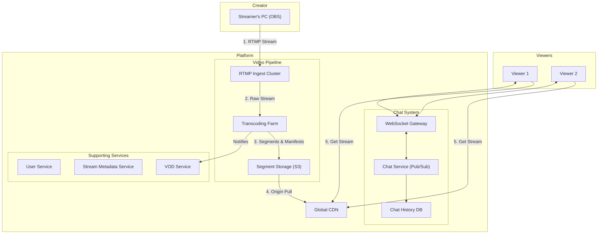

# High-Level Design: Live Streaming System

## 1. Document Information

- **Document Title**: Live Streaming Platform - High-Level Design
- **Version**: 1.0
- **Date**: 2025-08-30
- **Author**: Jules (AI Agent)
- **Status**: Draft

---

## 2. Executive Summary

### 2.1 Purpose
This document provides the high-level design for a large-scale, low-latency Live Streaming System (similar to Twitch or YouTube Live). The platform is designed to allow creators to broadcast live video and audio content to a massive, concurrent audience, while enabling real-time interaction via an integrated chat system.

### 2.2 Scope

**In Scope:**
-   **Video Ingestion**: Accepting live video feeds from creators using standard protocols (e.g., RTMP).
-   **Real-time Transcoding**: Processing the source video into multiple quality levels (e.g., 1080p, 720p, 480p) to support Adaptive Bitrate Streaming.
-   **Content Delivery**: Low-latency distribution of video segments to a global audience.
-   **Real-time Chat**: A scalable, per-channel chat system for viewers and creators.
-   **Stream Discovery**: Basic features for users to find live streams.
-   **VOD (Video on Demand)**: Archiving completed live streams for later viewing.

**Out of Scope:**
-   The streamer's client-side broadcasting software (e.g., OBS, XSplit).
-   Advanced monetization features (e.g., subscriptions, virtual currencies).
-   A complex recommendation engine for stream discovery.
-   Content moderation workflows and tooling.

### 2.3 High-Level Architecture Overview
The architecture is composed of two main, parallel systems: a **Video Pipeline** and a **Chat System**. The Video Pipeline is a multi-stage system that includes **Ingestion Servers**, a **Transcoding Farm**, and a **Content Delivery Network (CDN)** for global distribution. The Chat System is a separate, highly scalable service built on **WebSockets** for real-time, bi-directional communication. These systems are supported by standard backend services for managing users, streams, and metadata.

---

## 3. System Overview

### 3.1 Business Context
Live streaming has become a dominant medium for entertainment, education, and social interaction, particularly in gaming, live events, and creative arts. A successful platform must provide a reliable, high-quality viewing experience to millions of concurrent users while fostering a sense of community.

### 3.2 System Purpose
The primary purpose is to provide a scalable and resilient platform for creators to broadcast live content and for viewers to consume it with minimal latency and high quality. A key secondary purpose is to facilitate real-time interaction between creators and their audience.

### 3.3 Success Criteria
-   **Glass-to-Glass Latency**: The end-to-end delay from camera capture to viewer display. Target is < 5 seconds for a scalable HLS/DASH-based solution.
-   **Scalability**: The platform must support millions of concurrent viewers and tens of thousands of concurrent broadcasters.
-   **Availability**: 99.99% uptime for both video delivery and the chat service.
-   **Viewer Experience**: Smooth playback with minimal buffering, achieved through Adaptive Bitrate Streaming and a robust CDN.
-   **Chat Performance**: Chat messages should appear to all users in a channel in under 500ms.

### 3.4 Assumptions
-   The system will partner with a major global CDN provider for video distribution.
-   Streamers will use standard third-party software (like OBS) to send their stream to the platform.
-   A significant portion of traffic will be highly concentrated on a small number of very popular streams.

### 3.5 Constraints
-   **High Bandwidth Costs**: Video distribution is extremely bandwidth-intensive, making cost optimization a major constraint.
-   **High Computational Costs**: Real-time transcoding of thousands of video streams requires a massive amount of computational power.
-   **Network Variability**: Viewers will be on a wide range of devices and network conditions, necessitating Adaptive Bitrate Streaming.

---

## 4. Requirements Analysis

### 4.1 Functional Requirements
-   **FR-001 (Start Stream)**: A registered creator must be able to obtain a unique stream key and configure their software to start broadcasting to the platform's ingest servers.
-   **FR-002 (Video Ingestion)**: The system must accept incoming video streams via the Real-Time Messaging Protocol (RTMP).
-   **FR-003 (Video Processing)**: The system must transcode the incoming stream into multiple bitrates and segment it into small chunks for modern streaming protocols like HLS or DASH.
-   **FR-004 (Video Playback)**: A viewer must be able to load a stream in a video player and receive a manifest file that allows for adaptive bitrate playback.
-   **FR-005 (Real-time Chat)**: Viewers can connect to a stream's chat room, send messages, and see messages from other users in real-time.
-   **FR-006 (User & Stream Management)**: Users can create accounts. Creators can set their stream title and category.
-   **FR-007 (Archiving/VOD)**: The system shall automatically record a live stream and make it available for on-demand viewing after the stream ends.

### 4.2 Non-Functional Requirements
-   **Low Latency**: As measured by glass-to-glass time. This is a critical metric for user experience, especially in interactive streams.
-   **Scalability**: The system must handle the "thundering herd" problem, where millions of users join a stream simultaneously (e.g., for a major tournament). The chat system must also scale to handle tens of thousands of messages per second in popular channels.
-   **Availability**: The entire pipeline must be highly available. Redundancy is required for ingest servers, transcoders, and all backend services.
-   **Reliability**: The video pipeline must be resilient to failures of individual components. The chat system should guarantee that messages are not lost.
-   **Security**: Stream keys must be kept private to prevent stream hijacking. The chat system must be protected from spam and abuse.
-   **Interoperability**: The video stream output (HLS/DASH) must be compatible with standard web and mobile video players.

---

## 5. Architecture Design

### 5.1 Architecture Principles
- **Decouple Video and Chat**: The video pipeline and the chat system are treated as separate, independent systems. A failure in one should not impact the other.
- **Massive Scalability**: The system must be designed to handle millions of concurrent viewers, with most of them concentrated on a few popular streams.
- **Cost Optimization**: Bandwidth and transcoding are the biggest costs. The system must be designed to be efficient.
- **Low Latency where it Matters**: Prioritize low latency for chat interactions and reasonably low latency for video to maintain an interactive experience.

### 5.2 Architecture Patterns
- **Video Processing Pipeline**: A staged pipeline for handling video: Ingest -> Transcode -> Package -> Distribute.
- **Adaptive Bitrate Streaming (ABR)**: The core pattern for delivering a smooth viewing experience. The video is transcoded into multiple quality levels, and the viewer's client can intelligently switch between them based on network conditions.
- **Pub/Sub for Chat**: A publish-subscribe pattern is used for the chat system. When a user sends a message, it's published to a channel topic, and all other users subscribed to that topic receive the message.

### 5.3 High-Level Architecture Diagram

### 5.4 Component Overview
- **RTMP Ingest Cluster**: A set of servers that act as the entry point for streamers. They receive the RTMP stream and make it available to the transcoding farm.
- **Transcoding Farm**: A large cluster of servers (or a serverless function) responsible for the computationally expensive task of transcoding the source stream into multiple ABR renditions (e.g., 1080p, 720p, etc.).
- **Segment Storage (S3)**: An object store that holds the output of the transcoder: small video chunks (e.g., 2-second segments) and manifest files (e.g., `.m3u8` for HLS).
- **CDN**: A global Content Delivery Network that caches the video segments at its edge locations, close to viewers, to ensure low-latency, high-throughput delivery.
- **WebSocket Gateway**: Manages persistent WebSocket connections for all chat users.
- **Chat Service**: The core chat logic. It uses a pub/sub system (like Redis) to broadcast messages to all users in a specific channel.

### 5.5 Technology Stack
- **Ingest/Transcoding**: **C/C++** applications using **FFmpeg**, or a dedicated media server like **Ant Media Server**.
- **Chat System**: **Go**, **Elixir**, or **Node.js** for handling high concurrency and WebSocket connections efficiently.
- **Backend Services**: A standard stack like **Go** or **Java** with **PostgreSQL**.
- **CDN**: A major third-party provider like **Cloudflare**, **Akamai**, or **AWS CloudFront**.

### 5.6 Architecture Decision Records (ADRs)

#### 5.6.1 ADR-001: HLS/DASH over WebRTC for Mass Distribution
- **Decision**: To use HLS (HTTP Live Streaming) or DASH as the primary protocol for distributing video to viewers.
- **Justification**: HLS/DASH are HTTP-based, which allows them to leverage standard, highly scalable CDNs for delivery to millions of users. While WebRTC offers sub-second latency, it is a peer-to-peer or stateful-server technology that is significantly more complex and expensive to scale to a massive audience.
- **Consequences**: Accepts a higher glass-to-glass latency (typically 3-10 seconds) in exchange for massive scalability and lower cost.

---

## 6. Detailed Component Design

### 6.1 Component 1: Video Ingestion & Transcoding
- **Purpose**: To receive and process the incoming live stream.
- **Responsibilities**:
    -   The Ingest service authenticates the streamer via a unique stream key in the RTMP path.
    -   It receives the single, high-bitrate stream.
    -   The Transcoding service immediately begins pulling the stream and uses a tool like FFmpeg to create multiple output renditions.
    -   For each rendition, it creates short video segments (e.g., `stream123_720p_0001.ts`) and updates the corresponding manifest file (`stream123_720p.m3u8`).
    -   All generated files are continuously written to object storage (S3).

### 6.2 Component 2: Content Delivery
- **Purpose**: To deliver the stream to viewers globally.
- **Responsibilities**:
    -   A viewer's client first calls a backend API to get the master manifest URL (e.g., `.../stream123.m3u8`). This master manifest points to the individual rendition manifests (1080p, 720p, etc.).
    -   The video player on the client fetches this manifest from the CDN.
    -   The player then selects a quality level and starts fetching the corresponding video segments from the CDN.
    -   The CDN handles caching the segments at its edge locations to serve viewers with low latency.

### 6.3 Component 3: Chat System
- **Purpose**: To provide scalable, real-time messaging.
- **Responsibilities**:
    -   The WebSocket Gateway manages persistent connections from hundreds of thousands of users per channel.
    -   When a user sends a message, the Gateway forwards it to the Chat Service.
    -   The Chat Service publishes the message to a channel-specific topic in a pub/sub system (e.g., Redis Pub/Sub).
    -   All Gateways subscribed to that topic receive the message and broadcast it down to their connected clients in that channel.
    -   The Chat Service also asynchronously writes the message to a database for long-term storage.

---

## 7. Data Design

### 7.1 Data Models
- **`users` table**: `user_id`, `username`, `email`, `hashed_password`.
- **`streams` table**: `stream_id`, `user_id` (FK), `stream_key` (UNIQUE, private), `title`, `category`, `status` ('live', 'offline').
- **`chat_messages` table (Cassandra/ScyllaDB)**: A wide-column store is used for the massive write throughput of chat.
  - `channel_id` (Partition Key), `timestamp` (Clustering Key), `user_id`, `username`, `message_text`.
- **`vods` (Video on Demand) table**: `vod_id`, `stream_id` (FK), `user_id` (FK), `title`, `s3_path_to_manifest`, `duration`, `created_at`.

### 7.2 Data Storage Strategy
- **Relational Database (PostgreSQL)**: Used for user and stream metadata which requires strong consistency.
- **Object Storage (S3)**: Used to store all generated video segments, manifests, and VOD archives.
- **Wide-Column Store (Cassandra)**: Used to store chat messages, as it's optimized for extremely high write loads and time-series data.

---

## 8. API Design

### 8.1 API Architecture
The system exposes three main types of interfaces: an ingest protocol for streamers, a WebSocket API for chat, and a REST API for viewers to discover streams.

### 8.2 API Specifications
- **Video Ingest API**:
    - **Protocol**: RTMP (Real-Time Messaging Protocol).
    - **Endpoint**: `rtmp://ingest.platform.com/live/{stream_key}`. The `{stream_key}` is a secret that authenticates the streamer.
- **REST API (for viewers)**:
    - `GET /v1/streams`: Get a list of currently live streams.
    - `GET /v1/streams/{user_id}`: Get details for a specific stream, including the URL to the master video manifest on the CDN.
- **Chat API**:
    - **Protocol**: WebSocket.
    - **Endpoint**: `wss://chat.platform.com/v1/ws?channel={user_id}`. After connecting, clients send and receive JSON payloads for chat messages.

---

## 9. Security Design

### 9.1 Stream Security
- **Stream Keys**: Each streamer is assigned a long, random, and unique stream key. This key acts as a password to protect their ingest endpoint. Streamers can reset their key if it's compromised.
- **Content Protection**: For premium content, video segments can be encrypted, and access to the decryption keys can be controlled via a DRM (Digital Rights Management) system.

### 9.2 Chat Security
- **Authentication**: Users must be logged in to chat. Their session token (JWT) is used to authenticate the WebSocket connection.
- **Moderation**: The chat system must have features for moderation, including rate limiting, word filtering, and allowing channel owners (streamers) to ban abusive users.

---

## 10. Scalability & Performance

### 10.1 Video Pipeline Scalability
- The **Ingest Cluster** and **Transcoding Farm** are horizontally scalable. A load balancer can distribute incoming streams across available ingest servers.
- The **CDN** is the primary mechanism for scaling to millions of viewers.

### 10.2 Chat System Scalability
- The **WebSocket Gateway** layer is stateless and can be scaled horizontally.
- The **Chat Service** scales by partitioning channels. A given channel's pub/sub topic is handled by a specific node, but different channels can be handled by different nodes in the cluster.

---

## 11. Deployment & Operations

### 11.1 Deployment
- The backend services and chat system are deployed as microservices on Kubernetes.
- The transcoding farm may use specialized EC2 instances with GPU or media acceleration hardware.
- A robust CI/CD pipeline is used for automated testing and deployment.

### 11.2 Monitoring
- **Video Pipeline Monitoring**: Critical metrics include the health of ingest servers, transcoding queue length, and output stream quality (e.g., bitrate, framerate).
- **Viewer-side Monitoring**: The video player should report back key Quality of Experience (QoE) metrics, such as buffering ratio, startup time, and rendition changes.
- **Chat Monitoring**: Key metrics are connection counts, message rates, and message delivery latency.

---

## 12. Testing Strategy

### 12.1 Load Testing
- **Streamer Load Testing**: Simulate thousands of concurrent streamers sending RTMP feeds to the ingest cluster.
- **Viewer Load Testing**: Use a tool to simulate millions of clients requesting video segments from the CDN to test its performance and caching strategy.
- **Chat Load Testing**: Use a tool to simulate hundreds of thousands of concurrent users in a single chat channel to test the WebSocket gateways and pub/sub system.

### 12.2 End-to-End Testing
An automated test that starts a stream using a headless client, transcodes it, and then has a viewer client play the stream and verify its quality and latency.

---

## 13. Risk Analysis

| Risk | Impact | Probability | Mitigation |
|------|--------|-------------|------------|
| CDN Outage | Critical | Low | A major CDN outage can take the entire platform down. Mitigation: Multi-CDN strategy, allowing for dynamic switching of traffic to a secondary CDN provider. |
| "Thundering Herd" | High | High | A popular streamer going live causes a massive traffic spike. Mitigation: Auto-scaling on all components. Pre-warming CDN caches for scheduled, high-profile events. |
| Transcoding Farm Failure | High | Medium | Build redundancy and auto-scaling into the transcoding farm. Have a buffer of standby capacity. |
| Chat Service Failure | Medium | Medium | Decoupling chat from video ensures that a chat outage does not stop video playback. The chat system itself should be highly available with redundant nodes. |

---

## 14. Implementation Plan (High-Level)

- **Phase 1 (Core Video)**: Build the minimal video pipeline: one ingest server, one transcoder, S3 storage, and CDN integration.
- **Phase 2 (Core Backend)**: Build the user and stream metadata services.
- **Phase 3 (Chat)**: Build the scalable chat system with WebSocket gateways.
- **Phase 4 (VOD & Scale)**: Build the VOD archiving system and scale out the video pipeline components for production load.
- **Phase 5 (Launch)**: Launch a public beta.

---

## 15. Appendices

### Appendix A: Glossary
- **RTMP**: Real-Time Messaging Protocol. A common protocol for sending video from a broadcaster to an ingest server.
- **HLS/DASH**: HTTP Live Streaming / Dynamic Adaptive Streaming over HTTP. Modern, HTTP-based protocols for delivering video to viewers.
- **Transcoding**: The process of converting a video from one format/quality to another.
- **CDN**: Content Delivery Network. A global network of servers that cache content close to users for fast delivery.
- **Glass-to-Glass Latency**: The total time from when a camera captures an image to when it is displayed on a viewer's screen.
