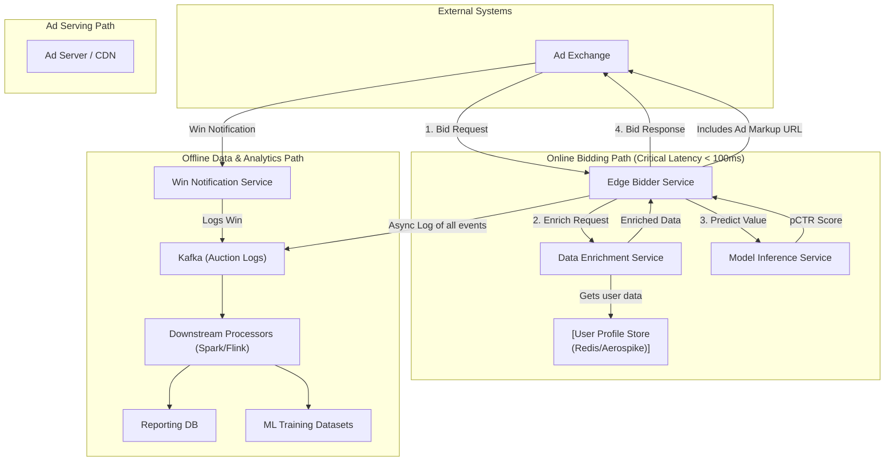

# High-Level Design: Real-Time Bidding (RTB) System

## 1. Document Information

- **Document Title**: Real-Time Bidding (RTB) System - High-Level Design
- **Version**: 1.0
- **Date**: 2025-08-30
- **Author**: Jules (AI Agent)
- **Status**: Draft

---

## 2. Executive Summary

### 2.1 Purpose
This document details the high-level design for a Real-Time Bidding (RTB) platform. This system, acting as a Demand-Side Platform (DSP), will participate in real-time auctions for digital advertising inventory. Its primary function is to receive bid requests from ad exchanges, evaluate the impression opportunity using a machine learning model, and return a bid price—all within an extremely tight latency budget (typically under 100 milliseconds).

### 2.2 Scope

**In Scope:**
-   A "bidder" endpoint that integrates with ad exchanges via the OpenRTB protocol.
-   An enrichment service to augment bid requests with valuable data (e.g., user data, geo-location).
-   A machine learning model inference service to predict the value of an impression (e.g., click-through rate, conversion probability).
-   A bidding logic component that uses the model's prediction to calculate a bid price.
-   A data pipeline to collect auction results for reporting, model retraining, and budget management.
-   An ad creative (or "ad markup") serving mechanism.

**Out of Scope:**
-   The ad exchange itself (we are a participant, not the auctioneer).
-   The Supply-Side Platform (SSP) that represents the publishers.
-   The machine learning model training pipeline (though we will design the data collection for it).
-   The campaign management UI for advertisers (this is a separate system that would use the RTB platform's APIs).

### 2.3 High-Level Architecture Overview
The core of the system is the **Bidder**, an ultra-low-latency web service. When a **Bid Request** arrives from an ad exchange, it is first enhanced by a **Data Enrichment Service**, which queries a **User Profile Store** (e.g., a key-value store like Aerospike or Redis). The enriched request is then sent to a **Model Inference Service**, which scores the impression. The **Bidding Logic** uses this score and campaign budget data to formulate a bid. If the bid is won, the system serves the **Ad Creative**. All auction data (requests, bids, wins, losses) is asynchronously logged to a **Message Queue** (e.g., Kafka) for downstream processing and analytics.

---

## 3. System Overview

### 3.1 Business Context
Real-time bidding is the dominant method for buying and selling programmatic advertising. By evaluating individual ad impressions in real time, advertisers can target specific user segments with precision, improving ad effectiveness and maximizing return on investment (ROI). This RTB system allows the business to act as a DSP, competing for these impressions on behalf of its advertisers.

### 3.2 System Purpose
To build a highly available, ultra-low-latency platform that can intelligently bid on billions of ad impressions per day, optimizing for advertiser campaign goals (e.g., maximizing clicks for a given budget).

### 3.3 Success Criteria
-   **Ultra-Low Latency**: P95 response time for the bidder endpoint must be under 100ms (including network overhead). Many exchanges impose even stricter limits (e.g., 50ms).
-   **High Availability**: The bidder endpoint must have 99.99% uptime, as downtime translates directly to lost bidding opportunities.
-   **High Throughput**: The system must handle hundreds of thousands of queries per second (QPS) from multiple ad exchanges.
-   **Bidding Intelligence**: The ML model and bidding strategy must effectively optimize campaign performance.
-   **Scalability**: The system must be able to scale horizontally to handle traffic fluctuations and growth.

### 3.4 Assumptions
-   The ad exchanges we integrate with will use a standard protocol, primarily OpenRTB.
-   User data for profiling is available and compliant with privacy regulations (e.g., GDPR, CCPA).
-   A separate system exists for managing advertiser campaigns and creatives.

### 3.5 Constraints
-   **Extreme Latency Budget**: The entire process, from receiving the request to sending the bid response, must complete in milliseconds. This dictates technology choices and architectural patterns.
-   **High QPS**: The sheer volume of bid requests requires a highly optimized and efficient infrastructure.
-   **Geographical Distribution**: To minimize network latency, bidders must be deployed in data centers geographically close to the ad exchange servers (e.g., US-East, EU-West, APAC).
-   **Statelessness**: The core bidding path should be as stateless as possible to improve speed and scalability. Any required state (like user profiles) must be accessed from a very fast, external data store.

---

## 4. Requirements Analysis

### 4.1 Functional Requirements
-   **FR-001 (Bid Request Handling)**: The system must be able to receive and parse OpenRTB bid requests from multiple ad exchanges.
-   **FR-002 (Data Enrichment)**: The system shall enrich bid requests with internal data, such as user history, frequency caps, and segment information.
-   **FR-003 (Impression Valuation)**: The system must use a machine learning model to predict the probability of a desired outcome (e.g., a click or conversion) for each impression.
-   **FR-004 (Bidding Strategy)**: The system must apply a bidding strategy to the model's output to calculate a final bid price in cents CPM (Cost Per Mille). This includes considering campaign budgets and pacing.
-   **FR-005 (Bid Response Generation)**: The system must generate a valid OpenRTB bid response containing the bid price and a reference to the ad creative to be shown.
-   **FR-006 (No-Bid Response)**: If the system decides not to bid on an impression, it must return a "no-bid" response quickly.
-   **FR-007 (Win Notification Handling)**: The system must have an endpoint to receive win notifications from the exchange when our bid is successful.
-   **FR-008 (Data Logging)**: The system must log all bid requests, responses, wins, clicks, and conversions for billing, reporting, and model retraining.

### 4.2 Non-Functional Requirements
-   **Latency**: P95 response time < 100ms.
-   **Throughput**: Support at least 100,000 QPS per bidder instance, with the ability to scale horizontally.
-   **Availability**: 99.99% uptime for the bidder and win notification endpoints.
-   **Scalability**: All components must be horizontally scalable. The system should be designed to handle traffic spikes (e.g., during major live events).
-   **Geographic Distribution**: Ability to deploy bidder clusters in multiple regions worldwide.
-   **Cost-Effectiveness**: The system should be efficient in its use of compute resources to keep the cost-per-query low.
-   **Security**: Protect against common threats and ensure the integrity of the bidding process.

---

### 5. Core Architecture

The architecture is optimized aggressively for low-latency, high-throughput processing.

- **Edge Bidder Service:** A highly optimized, lightweight service deployed in multiple geographic regions, close to ad exchange data centers. Written in a high-performance language like C++, Go, or Rust. Its sole job is to handle the OpenRTB request/response cycle.
  1.  Receives POST request from exchange.
  2.  Parses the request.
  3.  Makes a call to the Data Enrichment Service.
  4.  Makes a call to the Model Inference Service.
  5.  Applies bidding logic.
  6.  Sends response.
  7.  Asynchronously writes a log of the transaction to a local agent, which then forwards to Kafka.
- **Data Enrichment Service:** A low-latency service that provides additional data about the user or impression. It queries a high-speed key-value store.
- **User Profile Store (Aerospike/Redis):** An in-memory or hybrid key-value database that stores user profiles, segment information, and frequency capping data. It must provide single-digit millisecond read latency.
- **Model Inference Service:** A service that wraps a machine learning model (e.g., a gradient-boosted tree or a neural network). It exposes a simple API to get a prediction (e.g., pCTR) for an enriched request. The model itself is loaded in memory for fastest access.
- **Asynchronous Logging Pipeline (Kafka):** A central data bus for all auction events (requests, bids, wins, impressions, clicks). This decouples the low-latency bidding path from the high-volume data analytics path.
- **Downstream Processors (Flink/Spark):** Consumers of the Kafka stream that handle data processing for:
  - **Reporting & Analytics:** Aggregating data for dashboards.
  - **Billing:** Counting billable events (wins).
  - **Model Retraining:** Creating datasets for the next version of the ML model.
- **Ad Creative Service (CDN):** A service that returns the ad markup (HTML/JS) or image URL for a given creative ID. This is often fronted by a global Content Delivery Network (CDN) for low-latency delivery to the end-user's browser.

### 6. Data Schema and Models

- **OpenRTB Request/Response:** Follows the standard IAB OpenRTB 2.5 specification. The request object is a complex JSON containing details about the impression (`imp`), site (`site`), device (`device`), and user (`user`). The response contains a bid price, an ad markup (`adm`), and a win notice URL (`nurl`).
- **User Profile Schema (Key-Value Store):**
  - **Key:** User ID (e.g., from a cookie).
  - **Value:** A compact data structure (e.g., Protobuf) containing:
    - List of user segments (e.g., `["auto_intender", "sports_fan"]`).
    - Ad interaction history (timestamps of recent impressions/clicks).
    - Frequency caps (e.g., `{"campaign_123": 5}`).
- **Auction Log Schema (in Kafka):** A flattened JSON or Avro record containing all relevant information from the auction.
  - `timestamp`, `exchange_id`, `user_id`, `impression_id`, `predicted_ctr`, `bid_price`, `was_win`, `win_price`, `creative_id`.

### 7. API Design

- **`POST /bid` (Edge Bidder Service):**
  - **Usage:** The main endpoint called by ad exchanges.
  - **Body:** Standard OpenRTB JSON request.
  - **Response:** `200 OK` with an OpenRTB JSON response, or `204 No Content` for a no-bid. Must respond within the exchange's time limit.

- **`GET /win` (Win Notification Service):**
  - **Usage:** The `nurl` (win notice URL) provided in the bid response points here. The exchange calls this URL when we win.
  - **Query Params:** Contains information about the win, including the actual price paid (e.g., `price=${AUCTION_PRICE}`).
  - **Response:** `200 OK`. The primary action is to log the win event to Kafka.

- **Internal APIs (gRPC for performance):**
  - **`POST /enrich` (Data Enrichment Service):** Takes a user ID, returns a user profile.
  - **`POST /predict` (Model Inference Service):** Takes feature vector, returns a score.

### 8. Scalability and Performance

- **Language Choice:** The bidder is written in a high-performance, compiled language (C++, Go, Rust) to minimize garbage collection pauses and maximize CPU efficiency.
- **Stateless Services:** The bidder, enrichment, and inference services are stateless, allowing for simple horizontal scaling.
- **Connection Pooling:** Maintain persistent connections to downstream services (enrichment, inference) to avoid TCP handshake latency.
- **Geographic Locality:** Deploy bidder clusters in the same data centers as the ad exchanges. Use Geo-DNS to route exchange traffic to the nearest bidder.
- **Kernel/Network Tuning:** The bidder hosts are tuned for low-latency networking (e.g., kernel bypass, busy-polling).

### 9. Reliability and Fault Tolerance

- **Redundancy:** All services are run with N+1 redundancy across multiple availability zones.
- **Circuit Breakers:** If a downstream dependency (e.g., User Profile Store) becomes slow or unavailable, a circuit breaker trips, causing the bidder to immediately return a no-bid instead of timing out. This protects the bidder from cascading failures.
- **Fast Restarts:** Services are designed to start quickly and load necessary data (like ML models) into memory rapidly.
- **Asynchronous Logging:** The critical bidding path does not wait for logging. Data is written to a local buffer or agent and sent to Kafka in the background, preventing logging backpressure from affecting bid responses.

### 10. Security Considerations

- **DDoS Protection:** Use cloud-native DDoS protection services at the edge.
- **Request Validation:** Strictly validate incoming OpenRTB requests against the spec to prevent malformed requests from causing errors.
- **Secure Win Notifications:** Use cryptographic signatures on win notification URLs (`nurl`) to ensure they are legitimate and not forged by fraudulent publishers trying to claim payment for fake impressions.
- **Data Privacy:** All user data must be handled in accordance with privacy regulations (GDPR, CCPA). This includes honoring opt-out requests and managing data residency.

### 11. Monitoring and Observability

- **Low-Level Metrics:** Monitor everything at a sub-second granularity.
  - Bidder response time (histograms, not just averages).
  - QPS per exchange.
  - Cache hit/miss rates for user profiles.
  - ML model inference latency.
- **Business Metrics:**
  - Bid rate, win rate.
  - Spend per campaign.
  - Click-through rate (CTR).
- **Alerting:** Alerts are configured for any deviation in latency, error rates, or bid/win rates. Automated alerts for when campaign budgets are exhausted.

### 12. Deployment and Operations

- **Blue-Green/Canary Deployments:** New versions of the bidder or ML models are rolled out cautiously to a small percentage of traffic first. Performance is closely monitored before a full rollout.
- **Global Configuration Management:** A system like etcd or Consul is used to manage configuration (e.g., campaign budgets, bidding parameters) globally and push updates to the bidders in near real-time.
- **Performance Testing:** A dedicated performance environment is used to load-test any changes before they are deployed to production.

### 13. Cost Estimation

- **Primary Drivers:**
  - **Compute:** The massive number of bidder instances required to handle the QPS from all exchanges. This is the largest cost.
  - **Network Egress:** Data transfer from the bidders back to the exchanges.
  - **In-Memory Cache:** The cost of the large, high-memory instances needed for the User Profile Store.
- **Cost Optimization:**
  - **Efficient Code:** Optimizing the bidder code to handle more QPS per CPU core has a direct and significant impact on cost.
  - **Request Sampling:** Exchanges often send traffic that is very unlikely to be bid on. A pre-bid filter can immediately drop a percentage of low-value requests to save processing costs.
  - **Instance Selection:** Use compute-optimized or network-optimized cloud instances.

### 14. Risks and Mitigations

- **Latency Spikes:**
  - **Risk:** A component in the chain (e.g., network, model inference) causes the bidder to exceed the exchange's timeout.
  - **Mitigation:** Aggressive timeouts on all internal calls, circuit breakers, and constant performance monitoring. Pre-warm caches and use connection pools.
- **Budget Overspending:**
  - **Risk:** A bug or configuration error causes a campaign to spend its budget too quickly or exceed its cap.
  - **Mitigation:** Implement multiple layers of budget checks (in-memory at the bidder, and in a central store). Have automated alerts and kill-switches for runaway campaigns.
- **ML Model Performance Degradation:**
  - **Risk:** The model's predictive accuracy declines over time (concept drift), leading to inefficient bidding.
  - **Mitigation:** Continuously monitor model performance (e.g., predicted CTR vs. actual CTR) and have a robust pipeline for frequent and automated retraining.

### 15. Final Considerations

Building an RTB system is an extreme engineering challenge where performance is the most critical feature. The design prioritizes speed and availability above all else in the synchronous bidding path, while offloading all non-essential work to asynchronous background processes. The success of the platform depends not only on the raw performance of the infrastructure but also on the quality of the data and the sophistication of the machine learning models that drive the bidding decisions.
