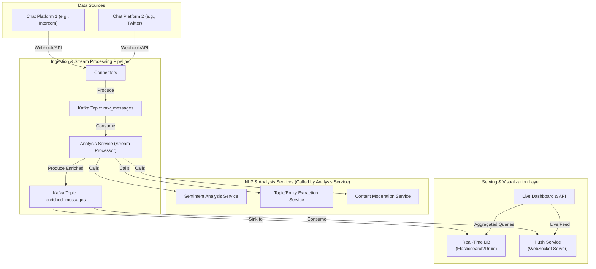

# High-Level Design: Real-Time Chat Analytics

## 1. Document Information

- **Document Title**: Real-Time Chat Analytics - High-Level Design
- **Version**: 1.0
- **Date**: 2025-08-30
- **Author**: Jules (AI Agent)
- **Status**: Draft

---

## 2. Executive Summary

### 2.1 Purpose
This document outlines the high-level design for a Real-Time Chat Analytics platform. The system is designed to ingest messages from various chat services (e.g., in-app support chat, community forums, social media), process them in real-time using Natural Language Processing (NLP), and extract key insights. These insights include sentiment analysis, topic extraction, and content moderation, which are then exposed via a live dashboard and an API.

### 2.2 Scope

**In Scope:**
-   Connectors for ingesting chat messages from different sources (e.g., via webhooks or polling APIs).
-   A scalable, real-time stream processing pipeline.
-   Integration with NLP services/models for sentiment analysis, entity recognition, and topic modeling.
-   A content moderation component to flag messages containing profanity, PII, or policy violations.
-   A real-time dashboard to visualize analytics (e.g., sentiment trends, trending topics).
-   An API to allow other services to access the analytics data.

**Out of Scope:**
-   The chat platforms themselves.
-   The training of the core NLP models (we will use pre-trained models or third-party NLP APIs).
-   Long-term storage and complex batch analytics on historical chat data (the focus is real-time).
-   Building a human-in-the-loop moderation tool (we provide the flags; another system would handle the review workflow).

### 2.3 High-Level Architecture Overview
The system is an event-streaming pipeline. **Connectors** pull or receive messages from various chat sources and push them into a central **Message Queue** (e.g., Kafka). A **Stream Processing** application (e.g., Flink, Kafka Streams) consumes these messages. For each message, it makes parallel calls to various **NLP/Analysis Services** (Sentiment, Topic, Moderation). The enriched message, now containing analytics metadata, is published to another Kafka topic. From there, the data is sunk into a **Real-Time Database** (e.g., Elasticsearch, Druid) that powers a **Live Dashboard**, and also made available via a **Push Notification Service** (e.g., WebSockets) for live updates.

---

## 3. System Overview

### 3.1 Business Context
In a world of constant communication, businesses need to understand the vast streams of text data they generate and receive. Customer support, community management, and brand monitoring teams can gain significant value from understanding user sentiment, identifying emerging issues, and automatically moderating conversations to ensure a safe environment.

### 3.2 System Purpose
To provide immediate, actionable insights from live chat data, enabling businesses to react quickly to customer sentiment, identify trends as they happen, and automate content moderation at scale.

### 3.3 Success Criteria
-   **End-to-End Latency**: Insights for a new message should be available on the dashboard within 5 seconds.
-   **Scalability**: The system must handle tens of thousands of messages per minute during peak times.
-   **Accuracy**: The NLP analysis must be accurate enough to be reliable for business decision-making.
-   **Availability**: The data ingestion and processing pipeline must be highly available (99.95%).
-   **Extensibility**: The system should make it easy to add new chat source connectors or new types of analysis.

### 3.4 Assumptions
-   Access to chat platform APIs or webhooks is available.
-   Third-party NLP services (like Google NLP API, AWS Comprehend) or fine-tuned, pre-trained models (like BERT) will be used for the core analysis.
-   The primary use case is real-time dashboards and alerting, not historical reporting.

### 3.5 Constraints
-   **NLP Costs**: Calls to third-party NLP APIs can be expensive at scale. The system must be designed to be cost-efficient.
-   **NLP Latency**: The latency of the external NLP services is a major contributor to the overall end-to-end latency and must be carefully managed.
-   **Language Support**: The choice of NLP models/services will constrain the languages the system can support.
-   **Data Privacy**: The system will process potentially sensitive user conversations and must handle the data securely.

---

## 4. Requirements Analysis

### 4.1 Functional Requirements
-   **FR-001 (Multi-Source Ingestion)**: The system must be able to ingest messages from at least three different chat source types (e.g., Intercom, Slack, Twitter).
-   **FR-002 (Sentiment Analysis)**: For each message, the system shall determine the sentiment (Positive, Negative, Neutral) and a confidence score.
-   **FR-003 (Topic/Entity Extraction)**: The system shall identify key topics, entities (like people, products, organizations), and keywords in each message.
-   **FR-004 (Content Moderation)**: The system must flag messages that contain profanity, hate speech, or personally identifiable information (PII).
-   **FR-005 (Real-Time Dashboard)**: A web-based dashboard must display aggregated analytics in near real-time, including:
    -   A live feed of incoming messages with their analytics.
    -   Time-series graphs of sentiment over time.
    -   A word cloud or list of trending topics/keywords.
    -   Counts of moderated messages by category.
-   **FR-006 (API Access)**: The system must provide a streaming API (e.g., WebSocket) that external clients can connect to for receiving the enriched message data.

### 4.2 Non-Functional Requirements
-   **Latency**: P99 end-to-end latency from message ingestion to dashboard visibility < 5 seconds.
-   **Throughput**: Support up to 50,000 messages per minute.
-   **Scalability**: All components must be horizontally scalable.
-   **Availability**: 99.95% uptime for the data pipeline.
-   **Cost-Effectiveness**: Minimize expensive API calls, for example by caching results for common phrases or using less expensive models for simpler tasks.
-   **Security**: All data encrypted in transit and at rest. PII that is detected should be masked or redacted where possible.

---

### 5. Core Architecture

The architecture is a decoupled, multi-stage stream processing pipeline.

- **Connectors:** A set of independent microservices responsible for connecting to external chat platforms. They handle authentication, polling or subscribing to webhooks, and transforming the source-specific message format into a canonical internal format. They then produce these messages to the central Kafka topic.
- **Ingestion Queue (Apache Kafka):** A Kafka topic (`raw_messages`) serves as the entry point for all messages, providing a durable buffer.
- **Analysis Service (Stream Processor):** A Flink or Kafka Streams application that consumes from `raw_messages`. For each message, it orchestrates the analysis by making asynchronous, parallel calls to specialized NLP services.
    - **It performs a lightweight pre-analysis:** e.g., using regex for simple PII detection or a local dictionary for profanity, to avoid expensive API calls for obvious cases.
- **NLP Services:** A set of microservices, each wrapping a specific model or API call.
    - **Sentiment Service:** Calls a third-party API (e.g., AWS Comprehend) or a self-hosted model.
    - **Topic/Entity Service:** Similar to the sentiment service.
    - **Moderation Service:** Handles more complex moderation rules.
- **Enriched Queue (Apache Kafka):** The Analysis Service produces the original message, now enriched with analytics metadata, to a new Kafka topic (`enriched_messages`).
- **Real-Time Sink & Database (Elasticsearch/Apache Druid):** A Kafka connector sinks the data from `enriched_messages` into a database optimized for real-time aggregation and querying. Elasticsearch is a good choice as it also supports text search on the message content.
- **Push Notification Service (WebSocket Server):** A service that consumes from `enriched_messages` and pushes the data in real-time to connected dashboard clients via WebSockets.
- **Query API & Dashboard:** A standard web application. The backend queries the real-time database (Elasticsearch) to populate initial dashboard views, and the frontend connects to the Push Notification Service for live updates.



### 6. Data Schema and Models

- **Canonical Message Schema (in Kafka `raw_messages`):**
  ```json
  {
    "message_id": "string",
    "source": "slack", // "twitter", "intercom"
    "channel_id": "string",
    "user_id": "string",
    "timestamp": "iso8601",
    "text": "The new feature is amazing!"
  }
  ```
- **Enriched Message Schema (in Kafka `enriched_messages`):**
  ```json
  {
    "message_id": "...",
    "source": "...",
    "text": "...",
    "analytics": {
      "sentiment": { "label": "POSITIVE", "score": 0.98 },
      "topics": ["new_feature"],
      "entities": [],
      "moderation": {
        "is_flagged": false,
        "reasons": []
      },
      "pii_detected": false
    }
  }
  ```
- **Real-Time DB Schema:** The enriched message schema is stored directly as a document in Elasticsearch, which automatically indexes the fields for querying.

### 7. API Design

- **`POST /ingest/v1/webhook/{source}`:**
  - **Usage:** Public endpoint for chat platforms that support webhooks.
  - **Body:** The native payload from the source platform.
  - **Response:** `202 Accepted`.

- **WebSocket API `/ws/v1/feed`:**
  - **Usage:** The dashboard frontend connects to this endpoint.
  - **Protocol:** After connection, the server streams enriched message objects to the client as they are processed.
  - **Filtering:** Connection can be initiated with query params to filter the feed, e.g., `/ws/v1/feed?source=twitter&sentiment=NEGATIVE`.

- **REST API `GET /api/v1/analytics/summary`:**
  - **Usage:** Used to populate the dashboard on initial load.
  - **Query Params:** `timeRange`, `source`, etc.
  - **Response:** `200 OK` with aggregated data (e.g., total messages, sentiment breakdown) from Elasticsearch.

### 8. Scalability and Performance

- **Horizontal Scaling:** All components in the pipeline (Connectors, Kafka, Flink processors, NLP services, WebSocket servers) are stateless or part of a distributed cluster and can be scaled horizontally.
- **Parallel Processing:** Flink/Kafka Streams naturally parallelizes the processing of messages across multiple partitions and task managers. The use of `AsyncDataStream` in Flink is key for making non-blocking calls to the NLP services.
- **Caching:** A Redis cache is placed in front of the NLP services. Before calling an expensive API for a message text, the system checks if the exact same text has been processed recently and reuses the result. This is highly effective for common phrases or spam messages.

### 9. Reliability and Fault Tolerance

- **Durable Queue:** Kafka provides durability. If a processing node fails, messages are not lost and can be processed by another node.
- **At-Least-Once Semantics:** The stream processor uses checkpoints to ensure every message is processed at least once.
- **NLP Service Failure:** The Analysis Service uses circuit breakers for the NLP calls. If a specific NLP service (e.g., sentiment) is down, it can be configured to either drop the enrichment for that field or halt processing, depending on business requirements.
- **Backpressure Handling:** The entire pipeline is asynchronous. If the dashboard or database slows down, Kafka will buffer the incoming messages, preventing the ingestion layer from being overwhelmed.

### 10. Security Considerations

- **Authentication:** Connectors use API keys/OAuth to securely connect to source chat platforms. Access to the dashboard and APIs is protected by user authentication.
- **PII Redaction:** The system includes a specific NLP task to find and mask PII (e.g., emails, phone numbers, credit cards). The raw message might be discarded after processing to avoid storing sensitive data.
- **Data Encryption:** All data is encrypted in transit (TLS) and at rest in Kafka and Elasticsearch.
- **Rate Limiting:** Ingestion endpoints are rate-limited to prevent abuse.

### 11. Monitoring and Observability

- **Pipeline Lag:** Monitor Kafka consumer lag at each stage of the pipeline to measure processing delay.
- **End-to-End Latency:** Track the time from message creation to visibility on the dashboard.
- **NLP Service Metrics:** Monitor the latency, error rate, and cost (number of calls) for each external NLP service.
- **Resource Usage:** Monitor CPU/memory of the Flink cluster and the load on the Elasticsearch cluster.

### 12. Deployment and Operations

- **Infrastructure as Code:** The entire system is defined in Terraform.
- **CI/CD:** Automated pipelines for each microservice.
- **Containerization:** All services are containerized with Docker and deployed on Kubernetes, which simplifies scaling and management.

### 13. Cost Estimation

- **Primary Drivers:**
  - **NLP API Calls:** This is often the largest and most variable operational cost.
  - **Stream Processing Cluster:** The number and size of Flink/Kafka Streams instances.
  - **Real-Time Database:** The size and query load on the Elasticsearch cluster.
- **Cost Optimization:**
  - **Intelligent Caching:** Implement aggressive caching for NLP results.
  - **Model Tiering:** Use cheaper, less accurate models for low-value conversations and reserve expensive, powerful models for high-value ones (e.g., customer support chat).
  - **Local Models:** For simple tasks like profanity filtering, use a local dictionary/regex instead of an API call.

### 14. Risks and Mitigations

- **NLP Inaccuracy/Bias:**
  - **Risk:** The pre-trained models misunderstand slang, sarcasm, or domain-specific language, leading to incorrect analytics. Models may also exhibit biases.
  - **Mitigation:** Allow users to provide feedback on incorrect classifications. Use this feedback to fine-tune a custom model over time. Regularly audit model performance and bias.
- **Latency from Third-Party APIs:**
  - **Risk:** High latency from an external NLP service slows down the entire pipeline.
  - **Mitigation:** Use aggressive timeouts and circuit breakers. Consider hosting a self-managed model for critical, low-latency tasks. A/B test different NLP providers for performance.
- **"Data Tsunami":**
  - **Risk:** A sudden viral event causes a massive, unexpected spike in message volume, overwhelming the system.
  - **Mitigation:** Ensure Kubernetes Horizontal Pod Autoscalers are configured for all components. Use Kafka's buffering capacity to absorb the spike while the system scales up.

### 15. Final Considerations

This Real-Time Chat Analytics system transforms unstructured conversation data into structured, actionable insights. The key is a well-orchestrated, low-latency streaming pipeline that leverages specialized NLP services. While using third-party NLP APIs accelerates development, the long-term strategy may involve bringing models in-house for better control over cost, latency, and accuracy. The value of the system lies not just in the raw analytics but in how quickly it can deliver them to the teams that need them to make decisions.
