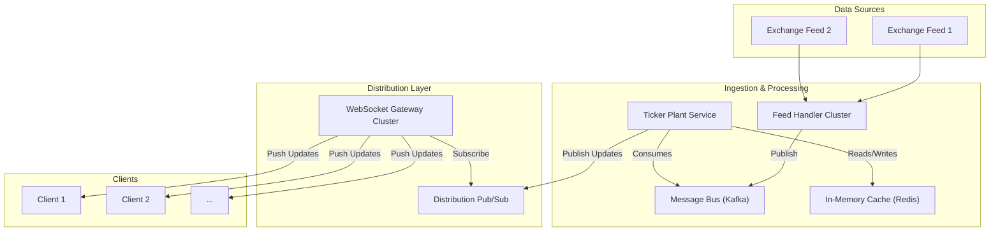

# High-Level Design: Real-time Stock Ticker System

## 1. Document Information

- **Document Title**: Real-time Stock Ticker System - High-Level Design
- **Version**: 1.0
- **Date**: 2025-08-30
- **Author**: Jules (AI Agent)
- **Status**: Draft

---

## 2. Executive Summary

### 2.1 Purpose
This document provides the high-level design for a Real-time Stock Ticker System. The system is designed to ingest high-frequency market data from multiple financial exchanges, consolidate it, and broadcast it with very low latency to a massive number of concurrent client applications, such as web-based trading platforms and financial news portals.

### 2.2 Scope

**In Scope:**
-   Ingestion of real-time quote and trade data from multiple sources (e.g., stock exchange data feeds).
-   Consolidation of data to maintain the latest price for thousands of symbols.
-   A highly scalable distribution layer capable of pushing real-time updates to millions of concurrent clients.
-   A client-facing API (primarily WebSocket-based) for subscribing and unsubscribing to data for specific symbols.

**Out of Scope:**
-   The client-side applications (web/mobile apps) that consume the data.
-   Historical market data storage and analysis.
-   Order entry or any form of trading (this is a read-only data dissemination system).
-   The data feeds themselves (the system is a consumer of these feeds).

### 2.3 High-Level Architecture Overview
The architecture is a high-throughput, low-latency data pipeline. **Feed Handlers** connect to external data sources and normalize the data into a common format. These normalized messages are published to a central, high-speed **Message Bus**. A **Ticker Plant** service consumes these messages, maintaining an in-memory cache of the latest price for every symbol. This state is then pushed to a massively scalable **Distribution Layer**, which manages client connections (via WebSockets) and broadcasts the updates to all subscribed clients.

---

## 3. System Overview

### 3.1 Business Context
Timely and accurate market data is the lifeblood of the financial industry. Retail brokerage apps, institutional trading platforms, and financial news websites all depend on real-time stock ticker data to provide value to their users. Providing this data as a service requires a highly specialized, performant, and reliable infrastructure.

### 3.2 System Purpose
The primary purpose is to provide a single, consolidated, and easy-to-use stream of real-time market data, abstracting away the complexity of connecting to and processing dozens of different, complex exchange data feeds.

### 3.3 Success Criteria
-   **End-to-End Latency**: P99 latency from receiving a message from an exchange to it being delivered to a client's browser should be under 200ms.
-   **Scalability**: The system must support over 2 million concurrent client connections.
-   **Accuracy**: The system must not drop messages. The data displayed to users must be accurate and reflect the true market state.
-   **Availability**: 99.99% uptime during market trading hours.

### 3.4 Assumptions
-   The system will have access to direct, low-latency data feeds from various exchanges and data providers.
-   The number of symbols to track is in the tens of thousands.
-   The update rate can reach millions of messages per second during peak volatility.

### 3.5 Constraints
-   **High Cost of Data**: Direct market data feeds are extremely expensive, and contracts often have strict licensing and redistribution rules.
-   **High Fan-out Requirement**: A single price update for a popular stock like AAPL or TSLA may need to be broadcast to millions of clients simultaneously.
-   **Bursty Traffic**: The data volume is not smooth; it spikes massively at market open, market close, and during major news events.

---

## 4. Requirements Analysis

### 4.1 Functional Requirements
-   **FR-001 (Data Ingestion)**: The system must connect to multiple, disparate real-time data feeds, each with its own protocol (e.g., FIX/FAST, or proprietary binary protocols).
-   **FR-002 (Data Normalization & Consolidation)**: The system must parse the various feed formats and normalize them into a single, unified internal data model for quotes and trades.
-   **FR-003 (Subscription API)**: The system must provide an API for clients to subscribe to real-time updates for a specific list of symbols (e.g., `SUBSCRIBE ["AAPL", "TSLA", "GOOG"]`).
-   **FR-004 (Unsubscribe)**: The system must allow clients to unsubscribe from symbols they are no longer interested in to conserve client-side resources.
-   **FR-005 (Real-time Broadcast)**: When a new quote or trade for a symbol is processed, the system must immediately push this update to all clients currently subscribed to that symbol.

### 4.2 Non-Functional Requirements
-   **Low Latency**: The primary performance metric. The entire pipeline from ingest to distribution must be optimized for speed.
-   **High Concurrency & Fan-out**: The distribution layer must be architected to handle millions of persistent client connections (WebSockets) and to efficiently broadcast messages to large subscriber groups.
-   **Resilience**: The system must be resilient to the failure of individual feed handlers or distribution nodes.
-   **Elasticity**: The system should be able to scale its resources up and down to handle the daily peaks and troughs of market activity.
-   **Accuracy**: The system must guarantee that messages are delivered in the correct order and without loss for a given symbol.

---

## 5. Architecture Design

### 5.1 Architecture Principles
- **Low Latency**: Every component in the pipeline is optimized for speed.
- **High Fan-out**: The architecture is explicitly designed to distribute a single piece of information to a massive number of clients efficiently.
- **Resilience**: The system is designed to be resilient to the failure of individual components or data feeds.
- **Elasticity**: The system can scale resources dynamically to match market activity.

### 5.2 Architecture Patterns
- **Data Pipeline**: The system is a multi-stage pipeline: Ingest -> Normalize -> Process -> Distribute.
- **Pub/Sub**: A publish-subscribe pattern is used at multiple stages. Feed handlers publish to a message bus. The Ticker Plant publishes updates to distribution nodes. Distribution nodes publish to clients.
- **In-Memory Cache**: A distributed in-memory cache is used to store the latest state of all tickers, enabling fast updates and decoupling the state from the connection management layer.

### 5.3 High-Level Architecture Diagram



### 5.4 Component Overview
- **Feed Handlers**: A cluster of services responsible for connecting to external exchange data feeds. Each handler is specialized for a specific feed's protocol, and its only job is to parse the data, normalize it into a common format, and publish it to the Message Bus.
- **Message Bus (Kafka)**: A durable, high-throughput message bus that decouples the ingestion layer from the processing layer. It allows the system to buffer massive bursts of data from the feeds.
- **Ticker Plant**: A service that consumes from the message bus, processes the updates, and maintains the latest state (e.g., last trade price, best bid/offer) for every symbol in the In-Memory Cache.
- **In-Memory Cache (Redis)**: A distributed cache that holds the real-time state of all tickers. This acts as the single source of truth for the distribution layer.
- **Distribution Pub/Sub**: A lightweight, low-latency pub/sub system (could be Redis Pub/Sub) used to notify the distribution gateways of updates.
- **WebSocket Gateways**: A large cluster of servers optimized for handling a massive number of persistent WebSocket connections. They manage client subscriptions and push relevant updates to them.

### 5.5 Technology Stack
- **Feed Handlers**: **C++** or **Java** for high-performance network I/O and binary parsing.
- **Message Bus**: **Apache Kafka**.
- **Ticker Plant**: **Go** or **Java**.
- **In-Memory Cache**: **Redis Cluster**.
- **Distribution Gateways**: **Go** or **Node.js** for their efficiency in handling many concurrent network connections.

### 5.6 Architecture Decision Records (ADRs)

#### 5.6.1 ADR-001: WebSocket for Client Communication
- **Decision**: To use WebSockets as the primary protocol for pushing data to clients.
- **Justification**: WebSockets provide a persistent, bi-directional connection, which is far more efficient for real-time push notifications than alternatives like HTTP long-polling or Server-Sent Events (SSE), especially at massive scale.
- **Consequences**: Requires a server layer capable of managing millions of stateful, persistent connections.

---

## 6. Detailed Component Design

### 6.1 Component 1: Feed Handler
- **Purpose**: To connect to a single data source and normalize its data.
- **Responsibilities**:
    -   Establish and maintain a network connection to an external data feed.
    -   Parse the feed's proprietary binary or FIX/FAST protocol.
    -   Transform the parsed messages into a canonical internal format (e.g., a standardized JSON or Protobuf message).
    -   Publish the normalized messages onto a specific topic in Kafka.
    -   These handlers are horizontally scalable and run in a primary/backup pair for each feed to ensure high availability.

### 6.2 Component 2: Ticker Plant
- **Purpose**: To process the normalized data stream and maintain the latest state for every symbol.
- **Responsibilities**:
    -   Consume messages from all relevant topics in Kafka.
    -   For each message, update the corresponding symbol's data in the Redis cache (e.g., using a `HSET` command).
    -   After successfully updating the cache, publish a lightweight notification message (e.g., just the symbol "AAPL") to the distribution pub/sub system to signal that an update is available.

### 6.3 Component 3: WebSocket Gateway
- **Purpose**: To manage client connections and subscriptions.
- **Responsibilities**:
    -   Accept and terminate WebSocket connections from clients.
    -   Handle subscription requests (e.g., a client sends `{"action": "subscribe", "symbols": ["AAPL", "GOOG"]}`).
    -   Maintain an in-memory map of which clients are subscribed to which symbols.
    -   Subscribe to the distribution pub/sub system for updates.
    -   When a notification for a symbol (e.g., "AAPL") is received, look up which connected clients are subscribed to it, fetch the full data from Redis, and push it to them over their WebSocket connection.

---

## 7. Data Design

### 7.1 Data Models
- **Normalized Message Model**: The internal model published by Feed Handlers to Kafka.
  - `{"symbol": "AAPL", "type": "QUOTE", "bid_price": 150.25, "ask_price": 150.26, "timestamp": ...}`
  - `{"symbol": "AAPL", "type": "TRADE", "price": 150.25, "size": 100, "timestamp": ...}`
- **In-Memory Cache Model (Redis Hash)**:
  - `Key`: `ticker:aapl`
  - `Fields`: `last_trade_price`, `bid_price`, `ask_price`, `day_volume`, etc.

### 7.2 Data Storage Strategy
- **In-Memory First**: This is primarily an in-memory system. The Redis cluster is the system of record for the *current* state of the market.
- **No Long-term Persistence (in this system)**: The real-time ticker system itself is not responsible for long-term storage of historical data. That is considered the responsibility of a separate, offline data warehousing system that would also consume from the Kafka bus.

---

## 8. API Design

### 8.1 API Architecture
The primary and only client-facing API is WebSocket-based to allow for real-time, server-initiated push notifications.

### 8.2 API Specifications
- **Endpoint**: `wss://ticker.platform.com/v1/subscribe`
- **Authentication**: A client connects with a short-lived API key or JWT as a query parameter for authentication.
- **Subscription Model**: After connecting, the client sends JSON messages to manage subscriptions.
    - **Client to Server (Subscribe)**:
      ```json
      {
        "action": "subscribe",
        "symbols": ["AAPL", "TSLA", "MSFT"]
      }
      ```
    - **Client to Server (Unsubscribe)**:
      ```json
      {
        "action": "unsubscribe",
        "symbols": ["MSFT"]
      }
      ```
    - **Server to Client (Data Push)**: The server pushes updates to the client as they happen.
      ```json
      {
        "type": "quote",
        "symbol": "AAPL",
        "bid": 150.25,
        "ask": 150.26,
        "timestamp": 1664553600123456789
      }
      ```

---

## 9. Security Design

### 9.1 API Security
- **Authentication**: All client connections to the WebSocket gateways must be authenticated to prevent unauthorized use of the expensive data feed.
- **DDoS Protection**: The WebSocket gateway endpoints must be protected by a cloud-based DDoS mitigation service (like Cloudflare or AWS Shield).

### 9.2 Data Security
- **Data Entitlements**: The system can be extended to check a user's entitlements before allowing them to subscribe to certain data feeds (e.g., some feeds may not be licensed for non-professional users). This check would happen at the WebSocket gateway upon a subscription request.

---

## 10. Scalability & Performance

### 10.1 High Fan-out Architecture
The core scalability challenge is "fan-out." The architecture solves this by using multiple layers of pub/sub.
1.  The Ticker Plant publishes a single message, "AAPL updated."
2.  The Distribution Pub/Sub (Redis) delivers this tiny message to all WebSocket gateways.
3.  Each gateway, which might handle 50,000 clients, then looks up which of its clients want "AAPL" and pushes the full data to them. This parallelizes the final, and largest, part of the fan-out.

### 10.2 Performance
- **Latency**: The use of Kafka adds a small amount of latency but provides immense durability and buffering benefits. The Redis cache provides millisecond-level access to state. The final push via WebSockets is highly optimized.
- **Throughput**: The system is designed for high throughput. Kafka can handle millions of messages per second. The Redis cluster and the horizontally-scaled gateways can handle the processing and distribution load.

---

## 11. Deployment & Operations

### 11.1 Deployment
- The entire system is cloud-native and deployed on Kubernetes.
- The Feed Handlers, Ticker Plant, and WebSocket Gateways are all managed as separate deployments, allowing them to be scaled independently.

### 11.2 Monitoring
- **End-to-End Latency**: A critical metric to monitor. This can be measured by injecting tracer messages at the feed handler and measuring the time until they are received by a test client.
- **Kafka Consumer Lag**: The SRE team must monitor the consumer lag of the Ticker Plant to ensure it is keeping up with the data stream. High lag is an early indicator of a system bottleneck.
- **WebSocket Connections**: The number of active WebSocket connections per gateway instance is a key metric for capacity planning.

---

## 12. Testing Strategy

### 12.1 Load Testing
- A load testing framework is needed to simulate millions of concurrent WebSocket clients, each with its own subscription list.
- This framework will connect to the gateways and measure message delivery latency and accuracy while a data replay tool pumps a high volume of historical data through the Kafka pipeline.

### 12.2 Resilience Testing
Using chaos engineering principles, individual components (feed handlers, ticker plant nodes, Redis nodes, gateways) are randomly terminated in the staging environment to ensure the system remains available and recovers gracefully.

---

## 13. Risk Analysis

| Risk | Impact | Probability | Mitigation |
|------|--------|-------------|------------|
| Kafka Cluster Unavailability | Critical | Low | Deploy Kafka in a highly available, multi-zone cluster. Monitor consumer lag closely to detect issues early. |
| Redis Cluster Unavailability | Critical | Low | Use a managed, clustered Redis service with automated failover. The Ticker Plant can be designed to rebuild the cache from Kafka if necessary. |
| "Noisy" Symbol | High | Medium | A single symbol generating an extreme number of updates could overload the pub/sub channel. Mitigation: Rate limiting, or dynamically moving hyper-active symbols to their own dedicated pub/sub topic. |

---

## 14. Implementation Plan (High-Level)

- **Phase 1 (Core Pipeline)**: Build a single Feed Handler, the Kafka bus, the Ticker Plant, and the Redis cache.
- **Phase 2 (Distribution)**: Build the WebSocket Gateway and the distribution pub/sub layer.
- **Phase 3 (Scale & Harden)**: Set up the full HA deployments for all components and conduct large-scale load testing.
- **Phase 4 (Launch)**: Launch the service for internal consumers or a small set of beta customers.
- **Phase 5 (Expansion)**: Add more feed handlers for other data sources.

---

## 15. Appendices

### Appendix A: Glossary
- **Ticker Plant**: A system that processes a raw market data feed and maintains the latest state (the "quote") for all symbols.
- **Fan-out**: An architecture pattern where one message is delivered to many consumers.
- **WebSocket**: A communication protocol providing full-duplex communication channels over a single TCP connection.
- **Pub/Sub**: A messaging pattern where publishers send messages to topics, and subscribers receive all messages from the topics they are subscribed to.
